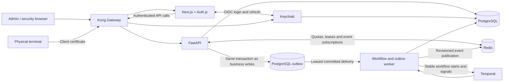

# IN / OUT Management System

A checkpoint management application for employee, visitor, and hardware entry/exit. Administrators manage records and permissions; security operators scan barcodes and act on access decisions. PostgreSQL stores movements and presence, while Keycloak handles login and roles.

[Features](#features) · [Architecture](#architecture) · [Quick start](#quick-start) · [Configuration](#configuration) · [Development](#development-and-testing) · [Test workflows](#test-workflows) · [Benchmarks](#benchmark-workflow) · [API](#api) · [Operations](#operations) · [Troubleshooting](#troubleshooting)

Detailed references: [product specification](docs/product-spec.md), [guide alignment and implementation plan](docs/guide-alignment-plan.md), [service architecture](docs/service-architecture.md), [test strategy](docs/test-strategy.md), and [release, incident and isolated restore procedure](docs/release-runbook.md). The restore procedure documents work to rehearse; it does not establish a completed drill or tested recovery objective.

Approved database/workflow/queue changes, regression evidence and deployment requirements are recorded in [reliability results](docs/reliability-results.md).

## Features

| Area | What it provides |
| --- | --- |
| Dashboard | Scan totals, entry/exit analytics, presence counts, and recent activity |
| Registry | Employees, temporary visitors, hardware assets, and completed permission/grant history |
| Permissions | Pending reviews, direct administrator grants, current access for every registered subject, and explicit critical-restriction release |
| Checkpoint management | Master-admin creation of checkpoints in either existing access zone; records become available for account assignment and scanning |
| Security terminal | Barcode scanning, up to four optional carried-hardware barcodes, a fixed account-assigned checkpoint, automatic entry/exit decisions, and persistent results |
| Movement logs | Search and filters, pagination, analytics, and movement notes |
| Alerts and audit | Scheduled attendance rules, accept/excuse review, warning-count reset with critical-hold release, per-employee assignments, and Registry alert history; evaluation every five minutes |
| Offline queue | Device-local scan storage and retry after reconnection; queued scans require a server decision before access is allowed |
| Account and appearance | Keycloak account security, SSO logout, administrator profile preferences, responsive layouts, and shared light/dark themes |

### Roles and pages

| Identity | Access |
| --- | --- |
| `admin` realm role | All admin pages and `/terminal`; scans/manual reviews additionally require a checkpoint assignment |
| `operator` realm role | `/terminal` and its scan/manual-review workflow; no admin pages |
| `master-admin` realm role | All `admin` access plus step-up-protected admin/operator management and checkpoint creation |
| Keycloak realm master administrator (built-in) | Keycloak configuration and identity management; distinct from the application's `master-admin` role |

The `admin` role grants access to every application page, including the security terminal. Scanning requires a checkpoint assignment, and user management requires a recent reauthentication. The `operator` role grants terminal access without admin pages. Keycloak login accounts and registry people are separate: creating a login does not register a person for checkpoint access.

**Manage users** offers unlock durations of **5, 10, 15, 20, or 30 minutes, or 1 hour**, defaulting to **5 minutes**. A new window starts at the fresh provider authentication time and keeps its expiry across reloads and token refreshes. While unlocked, choose from the same six choices under **Extend for** and press **Extend**. Completing a fresh app-form sign-in adds the selected duration to the captured active expiry; an expired or manually locked window starts fresh. Changing the selection alone keeps the old countdown. **Lock** takes effect immediately, including during longer windows. Starting an extension locks the current window until the fresh login completes; canceling that login leaves user management locked.

While Manage users is unlocked, a `master-admin` can use **Add checkpoint** to create a uniquely named checkpoint in the existing **Public** or **Secure** zone. The checkpoint is saved with an audit record and becomes available immediately for account assignment and terminal authorization. Checkpoints cannot be deleted, preserving movement and assignment history. Creating new zones is not supported.

The local app runs at `app.localhost:1008` and Keycloak at `auth.localhost:1005`. These distinct hostnames separate normal app, identity and unrelated localhost cookies. Cookies remain shared between ports on the same hostname; this local HTTP deployment assumes trusted workstation processes.

The Next.js runtime accepts up to **64 KiB of total request headers**, matching the gateway's allowance for a **32 KiB individual Cookie header** plus forwarded headers. Docker and the npm development/start commands use the same Node limit. Kong's **64 KiB response-header buffer** also accepts the complete block of chunked `Set-Cookie` headers. A session spread across Auth.js cookie chunks together with temporary OAuth state, PKCE, and nonce cookies must complete reauthentication without a `431` or an oversized-response `502`. After changing these settings, rebuild/recreate the app (`docker compose up -d --no-deps --build --wait app`) and recreate Kong (`docker compose up -d --no-deps --wait kong`); restarting old containers retains their previous limits.

The facility has two zones: **Main Entrance** (`public`, seeded checkpoint `cp-main`) and **Server Room** (`secure`, seeded checkpoint `server-room`). Master-admins can add checkpoints within either zone; every checkpoint in a zone inherits that zone's building identity. Access forms select either or both zones. Legacy `main-gate` scans resolve to `cp-main`; old display-name permissions and `All Zones` normalize to these two identifiers.

**Alert Command → Automated rules** includes two automatic building checks. A person recorded inside one building who scans at the other building generates a high-severity alert linked to that scan; the scan remains blocked. A visitor staying inside for **more than 12 continuous hours** generates one medium-severity alert per visit, at the next five-minute evaluation or an administrator's manual evaluation. Exits end the visit; denied scans, retries and redundant entries do not restart its clock. These rules apply automatically to their supported subjects and are independent of employee attendance selections.

Visitor and scheduled-access forms use facility time, **Asia/Kolkata (UTC+05:30)**. Choose a start near now or in the future and an end strictly after it, within the next **six calendar months**. The horizon keeps the same facility time and clamps to the last day when the target month is shorter. Creation allows five minutes of start-time grace for form completion and clock differences; the end must still be in the future. Native calendar limits and submission validation reject invalid or out-of-range typed values, and the backend enforces the same window. Approval can retain a request's past start, but cannot approve an expired window or extend beyond the horizon. Historical movement and report calendars accept past dates and cap their end at now.

In **Permission Manager → New permission**, administrators grant visitor access, zone access, or hardware custody directly. A new visitor's identity, approved decision, access, and audit evidence are saved together; no pending approval is needed for this administrator grant. Registering a visitor in Terminal or through the registry creation API still creates a pending approval. The pending queue shows only undecided requests and removes a request after its decision is saved. **Registry → Permissions** stores completed approvals, denials, and direct grants; **Permission Manager → Access directory** shows current access for every registered person and asset as cards, including entry zones, **Starts** / **Ends** in local time or **No end date**, custody, and available actions.

A critical alert bound to a registered subject blocks new entry independently of ordinary access permissions. Acknowledgement, accepting a review, another grant, or deletion of the source alert by retention does not lift that restriction. A reviewed manual admission allows that visit and its matching exit; later entry remains blocked. In **Alert Command**, **Reset warnings** requires a reason, clears the subject's confirmed warning count, lifts the current critical hold, and keeps every reviewed alert and reset note in **Registry → Alerts**. Excusing an alert is a review decision only and does not lift a hold. A new distinct critical trigger can restrict entry again; replaying an old alert ID cannot. Migration [`s7t8u9v0w1`](backend/alembic/versions/s7t8u9v0w1_critical_entry_restrictions.py) backfills existing critical alerts, including acknowledged alerts, using explicit subject IDs or unique barcodes rather than names.

### Scan and approval workflow

1. An administrator assigns each scanning account a checkpoint in **Manage users**. The terminal displays that fixed checkpoint. Scan a person or asset barcode and optionally add carried hardware, then press **Enter** or **Check access**. Unassigned accounts cannot scan.
2. The backend checks registration, access status, validity, zone, presence, and applicable hardware custody. Automatic checkpoints derive direction from presence; manual checkpoints expose **Entry** and **Exit** controls.
3. The decision and movement are recorded in PostgreSQL. Approved movements update presence; scheduled attendance rules generate alerts separately. Idempotency keys protect scan retries.
4. A denied scan can be sent for **manual approval**, with a required operator note. An administrator decides it in Permission Manager or Dashboard's **Pending Permissions**. Manual approvals offer **Valid for** choices of 15 minutes, 30 minutes, 1 hour, 2 hours, or 4 hours, defaulting to 1 hour; the backend validates these exact choices. Approval grants one rescan at the same checkpoint and direction before the window expires; the person must rescan to enter. The matching exit stays allowed after the window expires.
5. Manual entry approval atomically stores the identity, decision, movement, audit event, and presence. Its window starts at the administrator's decision time, and a retry does not extend it. Matching exit remains allowed after expiry or when normal entry access is restricted. Exit consumes that visit's permission; the original approval cannot authorize another entry. Additional hardware is not covered by the original approval.

**Recent scans** and **Manual reviews** are filtered to the assigned checkpoint. Completed manual-review decisions appear as notices with an optional **×** close control. Closing a notice leaves its decision and records in Terminal Activity and Registry's Permissions history; pending requests cannot be dismissed. The backend checks the assignment before scans, manual reviews, notice dismissal, and scan retries, including when the browser changes the checkpoint in its request. Account security and sign-out are in the terminal's account menu.

Admins can open **Terminal** from the admin sidebar. Its account menu links back to **Dashboard** and **Manage users**. To assign a new operator, open **Manage users**, unlock user management, choose **New user**, enable the **operator** role, and select **Terminal checkpoint** before creating the account. The same field updates an existing user's assignment. An admin can view the terminal without an assignment; scanning requires assigning that admin account a checkpoint too.

The offline queue uses IndexedDB in the same browser and device. Connect once to cache checkpoint and hardware configuration for the signed-in account. Scans queue on supported connection failures, retain their original checkpoint and idempotency keys, and retry after reconnection or through **Retry queued scans**. A reassigned account cannot replay a scan from its old checkpoint; do not rewrite that queued scan to a different checkpoint. This is queued verification, not offline authorization; it does not guarantee the page can first load without a connection.

Certificate-authenticated physical terminals also require a server-side assignment. After applying migrations, provision the exact certificate CN using `docker compose run --rm --no-deps backend-init python -m terminal_assignments --terminal <certificate-CN> --checkpoint cp-main` (or `server-room`). Unknown terminal identities fail closed. Browser assignments use verified Keycloak subject IDs and take effect immediately, without waiting for a new token.

The dashboard uses PostgreSQL summary queries and the operational query indexes directly. Redis delivers live events.

## Architecture



Kong Gateway owns the app, API, and Keycloak HTTP listeners. The browser uses the Next.js session/API layer, whose server-side requests reach FastAPI through Kong. The application's own sign-in form sends credentials to its same-origin Auth.js endpoint; the server exchanges them with the fixed Keycloak token endpoint using the confidential client. Passwords, access tokens and refresh tokens are not exposed in public session responses. Both the frontend session layer and FastAPI verify access-token signatures, issuer, audience, expiry and account identity; authorization uses verified roles. Signed ID tokens are also verified before session creation. Optional built-in account setup uses Authorization Code with S256 PKCE, state and nonce. Provider fetches have bounded responses, deadlines and fixed endpoints; refreshed expiry cannot outlive the verified bearer. FastAPI shares a bounded signing-key fetch across startup, cache expiry and key rotation; fresh known keys continue immediately during rotation. Verification uses the keys selected before entering the worker queue, avoiding a second expiry race. Expired snapshots cannot admit new requests when the identity provider is unavailable. Physical terminals can use Kong's optional certificate-authenticated TLS listener, configured in `compose.mtls.yaml` and `gateway/kong.yml`.

Kong additionally applies independent socket-IP limits to application sign-in POSTs (10/minute, 3/second) and Keycloak credential/MFA/recovery form POSTs (60/minute, 5/second), shared across replicas. Ordinary browser and public identity traffic keep their 1,800/600-per-minute allowances. Keycloak's realm brute-force protection adds account-level protection. Authentication POSTs retain CSRF/origin checks, an 8 KiB body limit and a five-second body deadline; ambiguous parameters and unsafe return URLs are rejected.

| Compose service | Technology / responsibility | Default local address |
| --- | --- | --- |
| `kong` | Kong OSS 3.9.3; DB-less routing, limits, streaming, and terminal identity | Owns ports `1008`, `1002`, and `1005` |
| `app` | Next.js 15, React 19, TypeScript, Auth.js; UI and session/API layer | [app.localhost:1008](http://app.localhost:1008), through Kong |
| `python-api` | Python 3.13, FastAPI, SQLAlchemy, asyncpg | [localhost:1002/docs](http://localhost:1002/docs), through Kong |
| `postgres-primary` | PostgreSQL 17; scoped service credentials and persistent storage | Private Docker networks |
| `redis` | Redis 7; authenticated quota and event ACLs | Private cache network |
| `keycloak` | OIDC identity provider; default image pin `26.8.0` | [auth.localhost:1005/realms/inout/account](http://auth.localhost:1005/realms/inout/account), through Kong |
| `keycloak-admin` | Optional maintenance gateway (`compose.keycloak-admin.yaml`); stop after use | [auth.localhost:1009/admin](http://auth.localhost:1009/admin), loopback only |
| `temporal` | Pinned Temporal 1.32.1 server; durable workflows observe committed decisions | Private workflow network |
| `temporal-schema-init` | Scoped, fresh-cluster schema initialization and existing-version guard | Internal job |
| `temporal-namespace-init` | SDK gRPC/namespace readiness and default namespace registration | Internal job |
| `temporal-ui` | Optional UI 2.55.0 (`observability` profile); vendor findings remain | Private workflow network; no host port |
| `backend-init` | Alembic migrations, reference seeding, and alert-schedule bootstrap; exits on completion | Internal job |
| `temporal-worker` | Executes approval/alert activities and delivers committed outbox records | Internal service |

Application tables hold subjects, people/assets, permissions, requests, presence, movements, scan retry records, alerts, and audit events. Keycloak uses the `keycloak` schema in the `inout` database; Temporal uses separate databases on the same PostgreSQL service. Administrator profiles are associated with the Keycloak identity and do not store login passwords. The PostgreSQL volume persists across normal restarts. Independent local installations do not share accounts or records.

### Repository layout

```text
app/                  Next.js pages, layouts, authentication, and API routes
frontend/components/  Admin and terminal UI
frontend/context/     Shared state, refresh handling, and data actions
frontend/lib/         Persistent offline terminal queue
services/             Browser API clients
lib/                  Shared types, normalization, analytics, and session logic
backend/routers/      FastAPI endpoints
backend/workflows/    Temporal workflows and activities
backend/alembic/      Database migrations
backend/tests/        Policy, authentication, contract, and PostgreSQL tests
keycloak/             Realm import template
gateway/              Kong routes, terminal-identity plugin, and isolated tests
scripts/              Authentication checks and local realm repair
tests/                Frontend contract and authentication tests
infrastructure/       Scoped database/cache provisioning and workflow startup guards
compose.yaml          Local services and isolated test services
```

Dependency versions are recorded in [package-lock.json](package-lock.json) and [backend/uv.lock](backend/uv.lock). The frontend includes a targeted PostCSS override for the Next.js 15 dependency tree.

## Quick start

**Requirements:** Docker Desktop running, Node.js 22.12+ with npm, and a local checkout. The commands below use PowerShell from the repository root; Python runs inside Docker. The test compiler loads the ESM JWT verifier through CommonJS, using the [ESM loading support enabled in Node 22.12](https://nodejs.org/en/blog/release/v22.12.0).

**1. Create configuration for a new installation.** Existing databases and realms require [existing-volume maintenance](#existing-volume-maintenance). Existing Temporal data also requires the [staged workflow upgrade](#temporal-upgrade); startup refuses an automatic multi-minor jump. Preserve their configuration and volumes.

```powershell
Copy-Item .env.example .env
node scripts/configure-new-install.mjs
```

The script fills only empty secret fields with independent random values and prints no credentials. The default application URL is `http://app.localhost:1008`. Never commit `.env`. It does not rotate passwords or client secrets saved in an existing database/provider.

For an **existing realm**, keep its current client secret from **Clients → inout-frontend → Credentials**. Changing `.env` does not rotate the saved secret, and startup import does not overwrite an existing realm. Back up the realm before applying identity changes; make and verify those changes in Keycloak before relying on the updated application configuration.

Sign-in stays on the application's `/login` page with its own username/password form. The server exchanges those credentials, and an optional authenticator code, through the confidential `inout-frontend` client's Direct Access Grant. The form does not automatically redirect to Keycloak. Its credentials callback retains Auth.js CSRF checks, strict same-origin validation, bounded inputs, gateway throttling and cryptographic verification of the resulting tokens. The client secret stays on the server. Provider tokens are confined to server-side exchanges and encrypted HttpOnly session cookies, excluded from public session JSON; passwords are not stored in the session. Use HTTPS outside local development.

For an existing realm, startup import does not overwrite clients: run `npm run keycloak:app-sign-in:apply` through the temporary admin gateway in step 3, then verify with `npm run keycloak:app-sign-in:check`. This enables Direct Access Grants for the confidential frontend client, removes the previous custom login setting when present, and preserves its secret, exact return URLs, scope mappings and unrelated attributes. Standard Flow with S256 stays available for optional built-in account setup and recovery. Postman's public client keeps password grants disabled; implicit flow and service accounts remain disabled for the application.

Direct grants cannot finish Keycloak required actions such as first-login password changes or authenticator enrollment. When valid credentials require those actions, the app displays **Complete account setup** to open Keycloak's built-in pages. Already enrolled authenticator codes can be submitted directly with the password. This application-hosted form is an explicit product choice: [Keycloak recommends Authorization Code over Direct Grant](https://www.keycloak.org/securing-apps/oidc-layers).

To send recovery emails, set `KEYCLOAK_SMTP_*` values in `.env` before running `npm run keycloak:recovery:apply`. Without an SMTP host and sender address, the recovery page is available but Keycloak cannot deliver reset emails. For an SMTP service outside Docker's internal networks, add `compose.keycloak-smtp.yaml` when starting the stack; it gives only Keycloak outbound connectivity. The recovery command updates only recovery and supplied SMTP settings while preserving users and clients.

**2. Build and start.**

```powershell
docker compose up --build -d --wait
docker compose ps -a
```

`-d` runs services in the background. `db-provision`, `temporal-schema-init`, `temporal-namespace-init` and `backend-init` should exit successfully; the API and worker remain running. A new cluster initializes workflow schemas using only its database owner, verifies real gRPC/namespace readiness, then seeds reference checkpoints and alert rules and registers the durable alert schedule. Startup does not create application login users.

For later starts without code changes, use `docker compose up -d --wait` to reuse the built images. Keycloak is compiled into its image, and the app initializes alongside its dependencies; Kong waits for all required services before opening the public listeners. Startup probes run every second during their grace periods. Frontend compilation and Python dependency downloads are cached between builds. Direct PostgreSQL connections reuse prepared statements; set `DATABASE_STATEMENT_CACHE_SIZE=0` when using a transaction pool that does not preserve them.

The Temporal inspection interface is intentionally off by default. Start it only when diagnosing workflows:

```powershell
docker compose --profile observability up -d temporal-ui
```

**3. Create application users.**

Enable the separate loopback administration gateway for initial setup:

```powershell
docker compose -f compose.yaml -f compose.keycloak-admin.yaml up -d --wait keycloak-admin
npm run keycloak:app-sign-in:apply
npm run keycloak:app-sign-in:check
```

To enable password-reset email, configure the SMTP values in `.env` and also run `npm run keycloak:recovery:apply` while this maintenance gateway is available.

1. Open [Keycloak administration](http://auth.localhost:1009/admin) using the master credentials from `.env`.
2. Select the `inout` realm, create a user under **Users**, and set a password under **Credentials**. Turn **Temporary** off for immediate app-form sign-in. If it is on, the user must finish the password change through **Complete account setup** before using the app form.
3. Assign the `admin` realm role under **Role mapping**, preserving default realm roles. Admins can also use the terminal. Create a separate user with `operator` when you want terminal-only access.
4. Sign in at [app.localhost:1008](http://app.localhost:1008). After role changes, sign out and back in to obtain updated claims.

Stop the administration gateway after setup. The regular identity listener continues to serve login, account security, and token refresh while rejecting provider administration:

```powershell
docker compose -f compose.yaml -f compose.keycloak-admin.yaml stop keycloak-admin
```

**4. Register subjects and operate the terminal.** Use the admin Registry and Permission Manager pages to create people/assets and configure access. Assign the scanning account a checkpoint through **Manage users** before scanning at `/terminal`.

## Configuration

[.env.example](.env.example) lists settings; [compose.yaml](compose.yaml) defines which values each container receives.

| Setting | Purpose |
| --- | --- |
| `POSTGRES_PASSWORD` | Provisioning administrator credential; application services receive separate scoped credentials |
| `APP_DB_PASSWORD`, `MIGRATION_DB_PASSWORD`, `KEYCLOAK_DB_PASSWORD`, `TEMPORAL_DB_PASSWORD` | Independent URL-safe credentials for application DML, migrations, identity persistence and workflow persistence |
| `REDIS_QUOTA_PASSWORD`, `REDIS_EVENTS_PASSWORD`, `REDIS_GATEWAY_PASSWORD` | Independent Redis ACL credentials for data/behavior/leases, presence events, and Kong request counters |
| `AUTH_SECRET` | Encrypts/authenticates Auth.js session cookies |
| `AUTH_TRUST_HOST` | Auth.js host handling; Compose supplies this for the local stack |
| `KEYCLOAK_ADMIN_USERNAME`, `KEYCLOAK_ADMIN_PASSWORD` | Bootstrap master credentials, used when Keycloak first initializes |
| `KEYCLOAK_CLIENT_ID`, `KEYCLOAK_CLIENT_SECRET` | Frontend client configuration; Compose uses `inout-frontend` and requires its matching secret |
| `AUTH_URL`, `APP_PORT` | Browser-facing application origin and Docker port; keep callback URLs consistent |
| `KEYCLOAK_VERSION`, `KEYCLOAK_PORT` | Server image pin and local identity-provider port |
| `KEYCLOAK_ADMIN_PORT` | Temporary loopback administration gateway; default `1009`, enabled only with `compose.keycloak-admin.yaml` |
| `KEYCLOAK_ISSUER`, `KEYCLOAK_ISSUER_PUBLIC`, `KEYCLOAK_JWKS_BASE`, `KEYCLOAK_AUDIENCE` | Token issuer, optional browser-facing issuer override, internal JWKS address, and required API audience |
| `KEYCLOAK_SMTP_*` | Optional SMTP connection and sender for Keycloak password-reset emails; apply them with `npm run keycloak:recovery:apply` |
| `KEYCLOAK_JWKS_CACHE_TTL` | Signing-key cache lifetime; default 300 seconds |
| `PYTHON_API_URL`, `DATABASE_URL`, `READ_DATABASE_URL` | API and database connections; an empty read URL uses the primary database |
| `QUOTA_REDIS_URL`, `EVENTS_REDIS_URL`, `TEMPORAL_HOST` | Separate authenticated cache pools and internal workflow connection |
| `PYTHON_API_PORT`, `APP_PORT`, `KEYCLOAK_PORT` | Loopback gateway listener port overrides; infrastructure ports are not published |
| `KONG_VERSION` | Pinned Kong OSS image version; default `3.9.3` |
| `KONG_TERMINAL_SECRET` | Optional Kong-to-API terminal identity secret, at least 32 random characters |
| `KONG_IDENTITY_SECRET` | Independent 32+ character secret for Kong's internal identity lookup; never reuse `AUTH_SECRET` |
| `KEYCLOAK_STEP_UP_SIGNING_SECRET` | Backend verification secret for browser user-management proofs; Compose supplies the same value as `AUTH_SECRET` |
| `KONG_TLS_DIR`, `TERMINAL_TLS_PORT` | Certificate directory and listener port for `compose.mtls.yaml` |
| `gateway/kong.yml` | Sole request-frequency configuration: ordinary API 300/minute per verified account or terminal; permission actions 60/minute and 10/second; user and alert actions each 20/minute and 5/second; API ingress 6,000/minute per socket peer before authentication |
| `MAX_REQUEST_BODY_BYTES`, `REQUEST_ADMISSION_CONCURRENCY` | API resource bounds; defaults 262,144 body bytes and 64 active requests per worker |
| `DATA_BYTES_PER_MINUTE`, `DATA_WINDOW_SECONDS` | Successful authenticated JSON reads and live-stream chunks share 67,108,864 bytes (64 MiB) per verified account in a fixed 60-second window; token refresh and API replicas share the account budget |
| `MAX_DATA_RESPONSE_BYTES` | Maximum complete JSON read response or individual live-stream chunk; default 16,777,216 bytes (16 MiB) |
| `DATA_SNAPSHOT_MAX_ROWS`, `DATA_ANALYTICS_MAX_ROWS` | Complete-read source caps; defaults 10,000 snapshot/directory/bucket/note rows and 50,000 activity-range events; excess returns 422 instead of sampled results |
| `MAX_SUBJECT_METADATA_BYTES` | Stored employee, visitor and hardware metadata cap; default 16 KiB, including server fields; creation and cumulative updates reject excess before committing |
| `BEHAVIOR_FAILURES_PER_MINUTE` | Authenticated 400/403/409/422 response threshold; default 20 per sliding minute |
| `BEHAVIOR_UNKNOWN_BARCODES_PER_MINUTE` | Fresh distinct unregistered barcode threshold per verified scanning identity; default 30 per sliding minute |
| `BEHAVIOR_COOLDOWN_SECONDS` | Temporary write pause after a behavior threshold; default 60 seconds; accounts are not suspended |
| `REQUEST_BODY_DEADLINE_SECONDS`, `INOUT_UPLOAD_DEADLINE_SECONDS` | Total API/gateway upload deadlines, both 30 seconds by default |
| `PRESENCE_STREAMS_PER_PRINCIPAL`, `PRESENCE_STREAMS_GLOBAL`, `PRESENCE_LEASE_SECONDS` | Distributed live-stream admission; defaults 3 per principal, 128 globally, 45-second crash recovery leases |
| `QUOTA_REDIS_MAX_CONNECTIONS`, `EVENTS_REDIS_MAX_CONNECTIONS` | Independent bounded Redis pools, default 64 and 160 connections |
| `ALERT_EVALUATION_MAX_SUBJECTS`, `ALERT_EVALUATION_MAX_MOVEMENTS`, `ALERT_EVALUATION_MAX_ALERTS`, `ALERT_EVALUATION_MAX_RULES` | Whole-evaluation capacity caps; exceeding any cap returns 503 without partial alerts |
| `*_RETENTION_DAYS` | Maintenance windows: retry records 30 days; audit events, alerts, and movements default to indefinite retention (`0`) |

Compose supplies scoped credentials and private service addresses. Host-side backend development uses disposable test services or explicitly authenticated maintenance access. Backend settings are defined in [backend/config.py](backend/config.py). Settings not forwarded in a service's `environment` must be passed explicitly, for example with `docker compose run -e NAME=value ...`; adding a value to the root `.env` alone does not automatically inject it into every container.

### Data and behavior protection

Kong owns HTTP request-frequency limits using its bundled `rate-limiting` plugin, the synchronous Redis policy (`sync_rate: -1`), and `fault_tolerant: false`. Configure these only in [gateway/kong.yml](gateway/kong.yml), then recreate Kong. Each operation group has one stable service ID, so alternating endpoints or routing through another gateway does not create a fresh allowance. Ordinary API reads, writes and stream connections share one ordinary allowance; sensitive writes use their group's stricter allowance. Limits use Kong's fixed calendar second/minute windows, rather than the removed application's sliding action windows. Kong returns `429` with `Retry-After`; a required gateway Redis failure returns `500` and does not reach a business handler.

Before accounting an account allowance, Kong's identity adapter calls the API's private `POST /internal/gateway/identity` endpoint with a separate secret and the bearer token. The existing Keycloak verifier checks signature, issuer, audience, type and expiry. Kong caches only successful verification for at most 30 seconds, checks expiry on every hit, and derives a hashed credential from issuer and subject. Token refresh cannot reset a quota. Verified physical terminals use their certificate DN. Public listeners block the internal endpoint and strip forged trusted headers; application role and checkpoint authorization still run in FastAPI. API paths use static ASCII/UUID segments; percent escapes, dot segments, repeated slashes, backslashes and semicolons in paths return `400` before routing so alternate spellings cannot select a weaker group limit. Encoded query parameters remain supported. Before body reads or identity lookup, a separate adapter invokes the same bundled Kong limiter for the generous socket-peer ingress budget; forwarded headers cannot change that identity. No Python request-frequency counters or token-work quotas remain.

Anonymous browser and identity traffic also pass ingress admission before upload buffering or upstream work. The browser listener allows 1,800 requests per socket-peer IP per minute, including static assets and browser API calls; the public Keycloak listener allows 600. These are separate from the API's 6,000/minute ingress allowance and its authenticated account/action quotas. Stable service IDs share each listener's counters across gateway replicas. Caller-supplied `Host`, listener and forwarded-address headers cannot select a different listener allowance. The optional maintenance listener is excluded; stop it after maintenance. Keycloak's failed-login protection remains enabled independently.

Redis ACL users have explicit connection-command allowlists. Application data, presence events and Kong counters retain separate key/channel scopes; service accounts cannot pause Redis, kill or unblock other clients, configure the server, or clear the database.

The API selects identities only after JWT verification or trusted terminal certificate validation. Redis atomically shares data and behavior budgets across API replicas. Two access tokens or browser sessions for one account share the same account budget; a different account has a separate budget. Physical terminals use their verified certificate identity. Caller-supplied identity and forwarded-address headers cannot select another account's allowance.

Successful authenticated `GET` JSON responses are charged by their actual UTF-8 body bytes. The API holds the complete body until its size and remaining allowance pass, so a rejection sends an error without a partial successful response. A response over 16 MiB returns `413`; an exhausted 64 MiB allowance returns `429` with `Retry-After`. Complete source reads fetch at most their configured cap plus one sentinel row and return `422` on overflow. Paginated routes remain available within their existing page limits, and SQL dashboard counts still aggregate the complete matching history. Narrow report ranges or page through records; a failed page or capacity check must not become a partial CSV export presented as complete.

Live presence streams charge each emitted chunk, including heartbeats. If a chunk exceeds the size cap, the account exhausts its data budget, or quota storage becomes unavailable, the stream emits a safe `throttled` event with a retry delay and closes. The rejected chunk is withheld and stream resources are cleaned up. Ordinary JSON responses retain an HTTP admission slot through buffering and delivery; live streams use their separate distributed stream leases.

Backend behavior checks count authenticated validation/access failures and distinct fresh unknown barcodes, rather than ordinary action frequency. A denied scan decision returning `200` does not count as a validation failure. Replaying the same scan key does not spend the distinct-barcode allowance or create another movement; it still passes Kong's request quota and any active behavior cooldown. A behavior cooldown temporarily rejects subsequent writes with `429` and a decreasing `Retry-After`, while reads remain available subject to their own data and Kong limits. Locking the user-management window remains possible during a behavior cooldown. Rejected attempts do not extend that cooldown, and no account suspension is performed.

The first data or behavior throttle transition records a security audit event, deduplicated by verified identity and limit kind for the retry window. Inspect `GET /v1/audit-events?category=security` for `request_throttled`, limit kind, actor, route template, retry delay and signal details. Bearer tokens, request bodies, query strings and raw unknown barcodes are omitted. Structured application logs retain evidence if audit persistence fails. Kong request-frequency rejections appear in gateway access logs; they do not create application audit rows. Required API data/behavior-store failures return `503`; required Kong counter-store failures return `500`. Both reject instead of permitting unmetered work. See [Workflow 16](#16-enforce-data-and-behavior-limits-and-recover-safely) for the acceptance procedure.

Report generation shares a 10,000-row and 16 MiB budget across every selected source, with a 60-second loading deadline. Capacity, inconsistent-page and timeout failures stop further pagination and block export. Up to three already-running requests can finish under their existing HTTP deadlines. Browser API routes preserve upstream `Retry-After` for reads, commands, identity management and initial stream failures.

## Development and testing

Install host-side dependencies with `npm ci`. Keep Docker backend services running, then start the frontend with its development callback origin:

```powershell
$env:AUTH_URL = "http://app.localhost:3001"
npm run dev
```

Open [app.localhost:3001](http://app.localhost:3001). Register this exact callback/origin through authenticated provider maintenance for development; the default realm permits only the Compose app origin. Use `npm run dev:webpack` for the Webpack development server. Remove the temporary override with `Remove-Item Env:AUTH_URL` before returning to the Docker application URL. Backend code changes require rebuilding its services through `docker compose up --build -d`.

| Command | Verification |
| --- | --- |
| `npm run typecheck` | TypeScript types |
| `npm audit --audit-level=moderate` | Known advisories in the locked npm dependency tree |
| `npm test` | Data contracts, session/token handling, and realm-repair behavior |
| `npm run build` | Production frontend build |
| `npm run test:auth:http` | HTTP authentication using isolated identity/API stubs; run after building |
| `npm run test:postgres` | Backend suite, migrations, and transaction behavior against isolated PostgreSQL |
| `uv audit --project backend --frozen --no-dev` | Known advisories in the locked Python runtime dependencies |
| `npm run test:gateway` | Disposable real Kong, certificate authentication, request limits, and streaming with fixture upstreams |
| `npm run test:auth:account` | Live local Keycloak account endpoints, signed frontend role claims, and parallel admin API authorization; creates and removes a temporary test identity |

PostgreSQL tests use the `test` Compose profile, a separate temporary database, and a schema per database test. They require Docker and the Compose configuration values. Stop the test service afterward with `docker compose --profile test stop db-test`. The live account check additionally requires the running local stack and matching credentials in `.env`.

[GitHub Actions](.github/workflows/verify.yml) runs dependency audits, frontend type checks, tests, the production build and HTTP security checks, plus isolated backend, Kong, Keycloak, database/Redis and workflow-restart suites. Pinned Trivy checks cover all configured runtime images and the scoped workflow maintenance image. Known vendor HIGH findings currently prevent clean release gates; findings are not suppressed. Run `npm run test:gateway` locally to verify routing, streaming, body/upload bounds, the public Keycloak administration boundary, terminal certificate authentication, and shared verified-identity rate limits across two gateways. Backend tests verify data budgets, behavior signals and resource admission; request-frequency counters live only in Kong.

`npm run keycloak:account:check`, `npm run keycloak:account:repair`, and `npm run test:auth:account` require the temporary administration gateway from quick start. The live account test creates and deletes a disposable identity. Stop the gateway after maintenance. These Node scripts connect to loopback with the configured `auth.localhost` Host header, so host DNS does not need to resolve that browser-only hostname.

The frontend and Postman clients disable **Full scope allowed** and explicitly map the `admin` and `operator` realm roles. Their composites retain account self-service and the administrator's delegated user-management permissions, while unrelated user roles stay out of application tokens. This follows [Keycloak's role scope guidance](https://www.keycloak.org/docs/26.8.0/server_admin/#_role_scope_mappings). Existing realms are preserved on startup, so changing the import file alone does not repair them. Run `npm run keycloak:account:repair` through the maintenance gateway: it adds and verifies the required mappings before disabling full scope, preserves client secrets and other settings, and checks effective token roles and the API audience. Repeating it makes no further changes. Obtain a fresh application session afterward.

To verify the configured Keycloak image and realm template independently, use the disposable provider suite. It runs PostgreSQL on tmpfs, publishes no host ports, uses fixture credentials, and checks signed OIDC login/refresh/logout, account security, role mappings, and the public Admin REST/SCIM boundary:

```powershell
docker compose -p inout-keycloak-test -f keycloak/compose.test.yaml run --build --rm tests
docker compose -p inout-keycloak-test -f keycloak/compose.test.yaml down --volumes
```

`KEYCLOAK_TEST_VERSION` overrides this suite's target image for compatibility checks; it does not change the main stack's `KEYCLOAK_VERSION`.

For a reproducible isolated check, run the frontend commands in the order below, then use named Compose projects for the backend and gateway. Run these commands from a fresh PowerShell terminal; the dummy environment values satisfy Compose interpolation and do not change `.env`.

```powershell
npm ci
npm run typecheck
npm test
npm run build
npm run test:auth:http

$env:POSTGRES_PASSWORD = "isolated-test-postgres"
$env:KEYCLOAK_ADMIN_USERNAME = "isolated-test-admin"
$env:KEYCLOAK_ADMIN_PASSWORD = "isolated-test-password"
$env:KEYCLOAK_CLIENT_SECRET = "isolated-test-client-secret"
$env:AUTH_SECRET = "isolated-test-auth-secret"

docker compose -p inout-backend-test --profile test run --build --rm backend-tests
docker compose -p inout-backend-test --profile test down --volumes
docker compose -p inout-kong-test -f gateway/compose.test.yaml run --build --rm tests
docker compose -p inout-kong-test -f gateway/compose.test.yaml down --volumes
```

Check each command's exit status before proceeding. These projects start only their test dependencies; their cleanup commands target those project names. Close the terminal afterward to discard its environment overrides. Run the live account check separately with the real local stack and its matching configuration.

### Coverage status

The API inventory checked on **2026-10-10** has **51 OpenAPI method/path operations**, including complete dashboard-period aggregates, employee-activity queries, and persistent user-management window lock endpoints. The original 2026-10-05 audit inventoried 44 operations; its run results below are historical evidence. Endpoint behavior, every business-rule branch, and performance are **not completely covered**. There is no configured line/branch coverage measurement, and passing tests do not establish a percentage of endpoint coverage.

| Area | Existing evidence | Still needed |
| --- | --- | --- |
| Scans, access policy, retries, manual decisions | Policy tests and PostgreSQL transactions through selected FastAPI routes; race, rollback, stale-timeout, checkpoint-spoofing and replay regressions | Concurrent scan retries, all validity/cooldown boundaries, full browser → Kong → Keycloak → API integration |
| Registry, typed requests, historical movements | Selected PostgreSQL routes plus handler/helper tests, including completed-notice dismissal and checkpoint ownership | Direct list/get/options/sync/conflict tests; complete routed visitor/zone/custody decision matrix |
| Direct grants and critical entry restrictions | Routed PostgreSQL grant/release/scan regressions, atomic rollback and concurrency tests, migration backfill, and date/schema validation | Complete grant/release browser lifecycle, every authorization/failure branch, real Redis/Temporal integration |
| Authentication and administration | Real signed JWT tests with mocked JWKS; isolated Next.js HTTP session tests; provider-failure recovery tests and PostgreSQL checkpoint rollback | Complete live user-management lifecycle; authorization matrix for every route |
| Alerts, audit, presence, health | Attendance-rule tests, review/reset/assignment PostgreSQL tests, live-update merge contracts, mocked publication, gateway streaming | Full rerun of the new migration-backed suite, real Redis delivery, real Temporal scheduling/replay, and browser workflows |
| Performance | Small serial dashboard handler comparison | Repeatable large-data HTTP, write/concurrency, SSE, workflow, and browser benchmarks |

Verified during this audit on **2026-10-05**: **106 backend tests, 36 frontend tests, and 6 gateway tests passed**, as did TypeScript checking, a production frontend build in Docker, and isolated HTTP authentication/terminal-role checks. The host Windows build encountered `spawn EPERM`; Docker provided the successful build. The live Keycloak account script, manual browser workflows, and new large-data benchmarks were not executed in this audit.

Current verification on **2026-10-07**: the isolated PostgreSQL backend suite passes **191 tests**, the frontend suite passes **54 tests**, `npm run typecheck` passes, and `npm run build` completes successfully. The manual workflows and large-data benchmark procedure below remain acceptance steps to run against a disposable environment; no benchmark result is implied by this verification.

Verification on **2026-10-09** after the UI/backend fixes: **219 backend tests passed** against isolated PostgreSQL, as did the complete `npm test` suite, TypeScript checking, the production build, and the isolated HTTP authentication harness. Regression coverage includes provisioning/save recovery, refreshed step-up cookies, bounded provider logout, profile-load safeguards, visitor registration, offline queue ownership/recovery, carried hardware, complete analytics, exact drilldowns, separate alert saves, and calendar bounds. These results do not establish live provider failure recovery, complete browser acceptance, or representative load performance.

Targeted authentication verification on **2026-10-10**: **21 signed-JWT authentication tests**, **12 realm-repair tests**, and **5 real Keycloak 26.8.0 compatibility tests** passed. Authentication batches of 24 requests cover startup, expired keys, rotation, and an unavailable provider; separate regressions cover cancellation and cache expiry while queued for verification. The existing realm was repaired without reimporting it, and a subsequent check confirmed both application clients have full scope disabled with required role mappings. Fresh signed admin/operator tokens passed the live account and terminal checks; all **18 parallel admin API requests** returned `200`, and all **3 operator requests** to those admin endpoints returned `403`. Quota tests passed with their one Redis integration test skipped; all 7 presence privacy tests passed. The API image was rebuilt and deployed healthy, and the temporary identity and isolated provider test stack were removed. This was targeted authentication verification, not a full-suite rerun or representative performance benchmark.

Kong migration verification on **2026-10-13**: **18 real gateway tests**, **72 targeted backend tests**, **6 private identity callback tests**, and **3 Redis ACL tests** passed. Gateway tests use two Kong instances and shared Redis to check account isolation, token refresh, grouped quotas, concurrent requests, cache expiry, invalid credentials, path aliases and dependency failures. The frontend suite, production build and HTTP authentication harness passed, including Kong error messages and `Retry-After` propagation. The live Keycloak account check passed for signed admin/operator tokens with Kong limit headers, preserved role authorization and a publicly inaccessible identity callback. App, API, Redis and Kong were deployed healthy; the temporary account was deleted and the maintenance listener stopped. This was targeted migration verification, not a full backend-suite rerun or a representative load benchmark.

Security remediation verification on **2026-10-14**: **19 real gateway tests**, **14 infrastructure tests**, and **5 real Keycloak tests** passed with the narrowed Redis ACL and browser/public-identity ingress limits. All **10 new manual-access snapshot tests** passed, including metadata-only records, change-then-revert, identical regrants, cosmetic edits, legacy grants, admitted exits and concurrent revocation. The full isolated backend run exercised **412 tests in 897.488 seconds**: 410 passed, an older manually constructed approval fixture lacked the newly required snapshot, and an existing key-rotation test timed out at its one-second scheduling wait. The fixture now uses the real approval function; all **43 authentication/cross-building/manual-snapshot tests passed on rerun** in 66.951 seconds, including the unchanged key-rotation test. No failures remained in those rerun suites; the complete suite was not repeated after the fixture-only correction. API/worker images built successfully, and disposable fixture stacks were cleaned up. Main application services were already stopped; the source/configuration and rebuilt images are ready for the next Compose startup. Daybreak was not accessed or modified. No representative load benchmark or new runtime-image advisory scan was performed.

Application sign-in verification is separated into configuration tests (`tests/keycloak-sign-in.test.mjs`), the built-app HTTP harness (`npm run test:auth:http`), and the isolated real-provider fixture (`keycloak/compose.test.yaml`). Configuration tests verify the confidential form grant, built-in setup fallback, preserved secrets/scopes/settings, read-only checks, idempotent repair and Postman's disabled password grant. The provider fixture verifies real signed direct-grant tokens, invalid-password rejection, OTP enforcement, required-action denial, optional code/S256 setup, role scoping, refresh and revocation. Existing realm changes require the documented apply command; a source change alone does not alter the running identity provider. SMTP delivery, complete browser acceptance and representative benchmarks require separate checks. Daybreak is unnecessary for these authentication checks.

On **2026-10-15**, the frontend suite passed **145 tests**, including **10 sign-in configuration tests**, and TypeScript checking passed. All **9 real Keycloak 26.8.0 checks** passed in **46.833 seconds**. OTP checks authenticate successfully before intentional failures so they retain the provider's quick-login and replay protections. The disposable provider project published no host ports; its containers, network and temporary data were removed afterward. Its readiness allowance was increased for slower fresh-schema initialization without changing the normal stack's health checks. The production Docker build and isolated HTTP suite passed against the exact exported runtime, including all six own-form unlock durations, failed extension retries with a changed selection, token verification, OTP, and logout after both form sign-in and optional account setup. The local app was updated, its `/login` returned HTTP `200` with username/password inputs, and the existing realm's application sign-in settings were applied and verified. The temporary maintenance gateway was stopped afterward.

Verified on **2026-10-06**: the full isolated PostgreSQL backend suite passed **145 tests in 244.180 seconds**, and **49 frontend tests**, TypeScript checking, and production app/API/worker builds passed. After a database backup, migration `s7t8u9v0w1` was applied locally; app, API liveness, and API readiness checks returned HTTP `200`, and the worker was healthy. Browser end-to-end checks and new load benchmarks were not run.

Verified on **2026-10-07** for selectable user-management windows: **54 frontend tests**, **12 backend selected-window tests plus 5 existing robustness tests** in Docker Python 3.10, TypeScript checking, the isolated HTTP harness, a host production frontend build, and production app/API image builds passed. The HTTP harness verified the main six-duration flows with synthetic sessions before the final callback-cleanup gate was added; the current session unit tests separately cover that gate's success/error criteria, and the final production app image includes it. App and API were recreated healthy; frontend health and API liveness/readiness probes returned HTTP `200`. The running configuration confirmed matching app/API proof-signing keys and all six supported durations without printing secrets. This targeted run did not rerun the full PostgreSQL suite, real browser/OIDC login, or load benchmarks.

The suites contain direct route tests, helper tests and mocked dependencies; these establish different levels of coverage. Offline queues retain their originating account and checkpoint; legacy records without an owner are held for reconciliation. The workflows below are acceptance procedures to execute; documenting a check does not mean it has passed or is automated.

Performance verification on **2026-10-16**: **172 frontend tests**, TypeScript checking, the production frontend Docker build and the isolated production HTTP authentication/stream harness passed. The broad PostgreSQL/Redis run exercised **475 backend cases**; its two outdated physical-terminal fixtures were corrected and passed their targeted rerun. Additional durable-delivery, export, migration, stream and concurrency cases passed separately. On the same disposable fixture (1,000 synthetic employees, 5,000 movements, 500 alerts), Registry first-read median fell from **498.776 to 259.849 ms**, Alerts from **101.098 to 40.348 ms**, and the complete report read from **733.158 to 332.637 ms**; report requests fell from **25 to one**. These are handler comparisons with explicit limits, not browser/production SLAs. See [full results and rollout notes](docs/performance-results.md). No operational migration/deployment was run; all services, including Temporal, remain.

## Test workflows

Use a disposable local installation for manual workflows and dependency-failure experiments. Start it with the [quick start](#quick-start), use separate admin/operator browser profiles, and prefix fixture names/barcodes with a unique value such as `QA-20261005-01`. Record starting presence, movement count, pending-request count, and relevant permission/custody values before each case. Registry people and Keycloak login accounts must be created separately.

For API-only cases, use the [Postman collection](inout_api_collection.postman_collection.json) with Authorization Code + PKCE and the [Swagger schema](http://localhost:1002/docs). Use an access token with the required role/audience; user-management calls also require recent reauthentication. Browser API mutations must use the same-origin session flow and JSON. A business-policy scan denial is a recorded decision, normally HTTP `200` with denied result; `401`/`403` indicate authentication/authorization failure, `409` a conflict, and `422` invalid input.

Keep a case log with fixture IDs, request/idempotency keys, observed status/body, before/after values, and screenshots where useful. Mark cases as pass, fail, or not run. Records with movement/request history may intentionally resist deletion; rebuild only the disposable test installation when a clean fixture set is needed.

### 1. Create users, assign checkpoints, and enforce roles

**Setup:** An admin account with user-management rights; both canonical checkpoints exist. Keep the original admin unassigned to check the viewing/scanning distinction.

1. Open **Manage users**, complete a fresh reauthentication, and create `QA-operator` with the `operator` role and **Server Room** checkpoint. Use the duration selector and **Extend** if a longer management window is needed. Complete any temporary-password change in a separate browser profile.
2. Sign in as that operator. The terminal must show Server Room as a fixed assignment. Admin pages and `/v1/keycloak/users` must be inaccessible. Sign in as admin and verify both admin pages and Terminal can be opened.
3. Create an employee allowed only Main Entrance. Scan at Server Room: expect a zone denial and unchanged presence. Repeat the request with `checkpointId: cp-main` and a fresh UUID: expect `403` before any movement/retry record is created.
4. As admin, reassign the operator to Main Entrance, refresh the terminal, and verify the displayed assignment. Revoke it and confirm new scans and old-checkpoint retries fail with `403`. An unassigned admin can view Terminal but cannot scan.

**Edges:** Reject creation of an operator without a checkpoint; reject an unknown checkpoint; preserve the assignment when PATCH omits it and revoke when it explicitly supplies `null`. Check stale user-management unlock, email updates, role changes, password reset, forced logout, and upstream failure recovery. Logout does not promise immediate revocation of already-issued bearer tokens.

**Automation:** [Checkpoint assignment tests](backend/tests/test_terminal_assignments.py), `test_admin_creates_operator_with_checkpoint_before_granting_role` in [PostgreSQL tests](backend/tests/test_database.py), and [account recovery tests](backend/tests/test_keycloak_admin_recovery.py). Recovery uses a stateful provider stub; the complete live identity-provider lifecycle remains a manual integration check.

### 2. Register, update, and delete registry subjects

**Setup:** Admin session; unique employee and hardware barcodes. A deletion-eligible isolated fixture must have no movement, permission, or request references; ordinary Registry creation also creates an access-policy row.

1. In Registry, create employees A/B and a laptop with required metadata, current validity, and explicit zones. Read them back through the list, detail, and bundle APIs.
2. Use `PUT /v1/registry/subjects/{subject_id}` to edit an employee's name, status, barcode, zones, and validity; Registry currently has no edit control. Refresh Registry and check related access metadata is consistent. Repeat for a hardware asset.
3. Attempt deletion through the API. A subject with a permission row can return `409` even without scans; record this current limitation. For a reference-free subject seeded only in the disposable fixture database, expect `204`, disappearance, and `404` on subsequent lookup.
4. Scan a different subject to create history, then attempt deletion. Expect `409` and retained subject/history. Also test permission-request and hardware-custodian references; record whether deletion is refused or leaves a stale reference, since JSON custody fields are not foreign keys.

**Edges:** Duplicate barcodes, including different letter case, must return `409` without partial records. Check missing subjects, blank names, invalid statuses, unknown/empty zones where disallowed, reversed validity windows, and operator attempts to create/edit/delete employee/hardware records.

**Automation:** Registry create/update/delete regressions in [PostgreSQL tests](backend/tests/test_database.py). Direct list/detail routes, reference combinations, and the full metadata validation matrix still need tests.

### 3. Scan an employee with hardware, retry, and exit

**Setup:** Operator assigned Main Entrance; active employee A and active laptop both allowed `public`, currently outside, with the laptop assigned to A. Open Dashboard in the admin browser.

1. Scan A with the laptop selected. Expect one approved entry, both inside states, and the admin's live presence update. Equipment must not increase the dashboard's people-inside count.
2. Replay the identical request with the same UUID `Idempotency-Key`. Expect the original response/event, no second movement, and no stale presence publication.
3. Wait at least ten seconds, then scan again with a new key. Automatic direction must be exit and both subjects become outside.
4. Change the payload under the original key. Expect `409` and no extra movement or presence change.

**Edges:** Check a new-key scan within the cooldown, unregistered/restricted/inactive/expired subjects, a future validity start, missing zone permission, unregistered or restricted hardware, duplicate carried assets, and custody mismatch. Denied decisions must not move anyone inside/outside. Exercise explicit API direction separately from the terminal's automatic flow.

**Automation:** [Access-policy tests](backend/tests/test_access_policy.py) and scan/retry/hardware regressions in [PostgreSQL tests](backend/tests/test_database.py). Simultaneous routed scans and exhaustive time boundaries remain gaps.

### 4. Register visitors for approval, then approve or deny

**Setup:** Operator assigned Main Entrance; admin session open in Permission Manager and Dashboard.

1. Use **Register visitor** above the terminal checkpoint display. Supply name, unique barcode, host, checkpoint, and ordered **Valid from** / **Valid to** dates within the next six calendar months; optionally supply company/purpose. Choose **Register & request approval**.
2. Register a second visitor through `POST /v1/registry/subjects` with kind `visitor` and a valid checkpoint/window. Both must display Pending approval in **Registry → Visitors** and appear in Permission Manager's pending permissions and the Dashboard pending decisions widget. Registration alone must not create an entry movement. The Registry Visitors tab lists records; direct administrator registration is available through **Permission Manager → New permission**.
3. Scan a pending visitor and expect denial with unchanged presence. Approve the first visitor through Permission Manager and deny the second with a reason.
4. Refresh Terminal and Registry. The approved visitor's requested zones/window must persist and admission becomes possible during that window; the denied visitor remains blocked. Approval itself must leave an outside visitor outside until scanned. Both completed decisions must leave the pending queue and appear in **Registry → Permissions**.

**Edges:** Reject duplicate/mixed-case barcodes, missing name/host, invalid dates/times, reversed or equal endpoints, expired ends, and values beyond the six-month calendar horizon. Client-supplied active/inside values must be overridden to pending/outside, rather than grant access. The requested window is retained, so waiting for approval consumes any part that has already started. Check approval near/after expiry, repeated decisions, and live-event/Temporal failure after persistence.

**Automation:** [Registration transaction tests](backend/tests/test_registration_approvals.py), [real-session visitor registration and initial hardware custody](backend/tests/test_registry_creation_workflows.py), visitor decision regressions in [PostgreSQL tests](backend/tests/test_database.py), and [typed-request tests](backend/tests/test_typed_permission_requests.py). [Frontend date tests](tests/dateTimeValidation.test.ts) and [backend permission-window tests](backend/tests/test_permission_windows.py) cover real dates/times, facility offsets, exact boundaries, ordering, month-end/leap-year clamping, and approval of saved windows. Helper tests do not constitute complete browser/HTTP coverage.

### 5. Manually admit an unknown barcode and complete its exit

**Setup:** Operator assigned Main Entrance; fresh unknown barcode; admin session with Dashboard's Pending Permissions and Permission Manager available. For expiry checks, use a disposable fixture or wait past the recorded expiry.

1. Scan the barcode. Expect a denied movement and no presence entry. Repeat with registered carried hardware: the denied event and review must preserve the exact hardware set and its presence/restriction context without moving the asset. Add the required operator note and submit manual review. A duplicate submission must reuse the pending request.
2. In Dashboard's **Pending Permissions**, confirm the operator note appears to the left of the checkpoint name. Choose **Valid for**: 15 minutes, 30 minutes, 1 hour, 2 hours, or 4 hours; 1 hour is the default. Approve with an optional decision note, and repeat through Permission Manager for another fixture. Expect an identity and audit record, with no presence change and the original denied event unchanged. Confirm the persisted window starts at `decidedAt` and ends exactly the selected number of minutes later, rather than starting at scan or request time.
3. Rescan the same barcode at the same checkpoint before expiry. Expect one new approved manual movement, inside presence, and a consumed approval; retrying the same idempotency key must not create a second scan. Confirm the matching exit remains allowed after the entry window expires and that a later entry is denied pending a fresh review.
4. Perform the matching exit, including exactly the hardware admitted with the approval if present. It must be allowed even after the selected window expires or when ordinary entry access is restricted, leave the subject outside, and consume the one-visit entitlement.
5. Retry the same approval, including a different allowed duration. Its original window must stay unchanged and it must not admit the visitor again. A later entry, even before that original expiry, requires a fresh approval; the completed visit's grant cannot be reused.
6. Repeat with a second unknown barcode and deny its review with a reason. Confirm the completed approval and denial notices each have an optional **×** close control. Close either notice, refresh Terminal, and confirm the notice stays hidden while its decision remains in Terminal Activity and Registry's Permissions history. Closing a denied notice must not grant access, and closing an approved notice must not admit the subject again. Pending requests have no dismissal control.
7. Approve another denied scan but leave its grant unused. Before rescanning, revoke the person's access, restrict the asset, or replace zones/validity/custody. The old grant must not override the new policy or become consumed. Reverting the access edit must not revive that grant; obtain a fresh review for a new exception. A cosmetic name/note edit must preserve the grant. Repeat after a manually approved entry: its already-admitted matching exit must remain possible despite later entry restrictions. Legacy approvals without a reviewed access snapshot require a fresh review.

Manual denials reclassify the original denied event as **Manual**. Manual approvals leave the original denied scan unchanged; a later rescan consumes the one-time approval and creates a separate **Manual** movement. These classifications appear in Auto vs Manual and movement filters. With one automatic denial followed by manual denial, expect Auto **0**, Manual **1**, and total/denied counts **1**. Check this while Dashboard remains open, then refresh and retry the decision; no extra movement should appear. Migration `q5r6s7t8u9` corrects older reviewed records too.

[Manual access snapshot regressions](backend/tests/test_manual_access_snapshots.py) cover later employee/hardware restrictions, reviewed zones/windows, identical regrants, custody transfers and reverts, cosmetic edits, legacy approvals, admitted exits and a scan waiting for an administrator's revocation lock. These use disposable PostgreSQL records; no schema migration is required for the server-owned JSON revisions.

**Edges:** Reject empty operator/decision notes where required, stale or mismatched source events, and an opposite decision after a final decision (`409`). The decision API must reject arbitrary or coerced durations such as 45, 14, 241, `"60"`, fractions, or booleans without changing saved state; omitted manual-approval duration defaults to 60 minutes from decision time. Test two administrators deciding concurrently, a timeout arriving after a decision, rollback during approval, and additional hardware not covered by the grant. `POST /v1/permission-requests/{req_id}/dismiss` must reject pending requests (`409`), non-manual requests (`422`), and missing requests (`404`). An operator assigned to the other checkpoint must receive `403` without changing the request; administrators may dismiss across checkpoints. Repeat dismissal of a completed notice must preserve its original dismissal time and leave decisions, presence, scan totals, movements, and audit history unchanged.

**Automation:** Manual admission, matching exit, race/rollback/stale-timeout regressions and routed `test_terminal_notification_dismissal_preserves_decision_and_history` / `test_terminal_notification_dismissal_requires_assigned_checkpoint` in [PostgreSQL tests](backend/tests/test_database.py). The routed duration regressions check all five choices/default, persisted decision-time windows, changed-duration retries, invalid-input state preservation, and consumed grants after matching exit; the late-exit case patches server clocks past the saved expiry. [Frontend contracts](tests/contracts.test.ts) check that every selected duration reaches the approval command intact, denial commands omit duration, and the duration policy rejects arbitrary/coerced values; they also check repeated dismissal commands and request-only live updates without decision, presence, scan-total, or history changes. These contracts do not exercise browser dropdown interaction or note placement. [Workflow unit tests](backend/tests/test_approval_workflows.py) mock Temporal execution; real signals/replay/timeouts and browser controls still need integration testing. Migration `r6s7t8u9v0` converts legacy closed-notice metadata to optional dismissal fields; administrator alert acknowledgement is unchanged.

### 6. Grant scheduled access and inspect completed permission history

**Setup:** Registered subject currently allowed only Main Entrance; admin session.

1. Open **Permission Manager → New permission → Zone access**. Select the subject, both zones, ordered Starts/Ends dates, and a reason. Confirm the form shows current access and warns that the complete zone set will be replaced. Choose **Grant permission**; expect immediate persistence of exactly the selected zones/window and an approved history record.
2. Grant a replacement containing only Server Room. Confirm Main Entrance access is removed. Scan from operators assigned to both checkpoints to verify the resulting policy and validity boundaries.
3. Choose **New permission → Visitor access → Register a new visitor…**. Enter identity/host, checkpoint, zones, dates, and a reason. Grant once and verify the visitor, approved decision, access, and audit evidence are saved together, with no pending request or admission movement. For an existing pending visitor, grant access and verify the existing pending request is decided once rather than left to expire later.
4. In **Access directory**, find the subject by name or zone label. Confirm all registered people/assets appear, including those without a separate manually managed permission row. Review the card's entry zones, Starts/Ends in local time or No end date, current access state, and custody where applicable.
5. Open the card's **Permission history** link or **Registry → Permissions**. Confirm approvals, denials, and direct grants remain searchable after completed rows leave the pending queue. Follow a completed decision link and verify the specific history row is focused.
6. For an approval-based zone request submitted through the API, deny it from the pending queue and confirm current access remains unchanged while its denial appears in history. A critical restriction must continue to display effective Restricted state even after an otherwise active grant.

**Edges:** Reject empty/unknown zone sets, equal or reversed endpoints, expired ends, dates outside the six-calendar-month horizon, duplicate visitor barcodes, and manual-review types sent to the direct-grant route. Simulate grant-effect failure and verify no partial new identity/history is left. Check a concurrent pending visitor creation/decision and grant, future-start/expiry boundaries, typed input, and month-end dates. Approval-based zone and custody requests bind the state when requested. A later state change makes approval return 409; deny and recreate the request using current state.

**Automation:** Direct-grant tests in [PostgreSQL tests](backend/tests/test_database.py) exercise atomic new visitors, existing pending visitor reuse, late timeout protection, creator/decision lock races, custody effects, invalid payloads, and effect-failure rollback through the grant route. [Typed-request tests](backend/tests/test_typed_permission_requests.py) check replacement dates/zones through helpers. Full browser grant/history interaction and the complete routed approval-based zone/custody decision matrix remain gaps.

### 7. Transfer hardware custody without changing access

**Setup:** Registered laptop assigned to employee A; employee B registered; record the asset's zones, status, and validity.

1. Open **New permission → Hardware custody** for B. The form must show A → B and omit a generic validity-duration control.
2. Choose **Grant permission**. Confirm the stored custodian ID/name are B's authoritative registry values, the asset's zones/status/window are unchanged, and the completed grant appears in Registry's Permissions history.
3. Scan A carrying the laptop: expect custody denial. Scan B carrying it: admission depends on B and the laptop independently meeting zone/status/validity/presence policy.
4. For a second approval-based transfer submitted through the request API, deny it from the pending queue and confirm ownership remains B.

**Edges:** Reject a visitor/unknown employee as custodian, the existing custodian, and a duplicate pending asset+employee request. Check forged carrier names, employee deletion between request and decision, and competing transfers approved concurrently. Approval must not create a movement, grant zone access, or schedule automatic custody expiry.

**Automation:** [Typed-request helpers](backend/tests/test_typed_permission_requests.py), the custody approval regression, and `test_direct_custody_grant_changes_carrier_without_expiring_or_changing_zones` in [PostgreSQL tests](backend/tests/test_database.py). Full routed approval-based transfer/denial, browser actions, and competing custody decisions remain partial.

### 8. Queue scans offline, reconnect, and change assignment

**Setup:** Same operator/browser/device loads Terminal online once; a subject with ordinary access; record starting history and presence.

1. Disconnect the browser's network and scan. Expect a queued result, persistent queue entry, and no claimed access approval. Reload only after restoring connectivity; offline first-load support is not guaranteed.
2. Reconnect and choose **Retry queued scans**. Verify the original payload, originating account, checkpoint, captured transport fields, and UUID are retained. The backend decides; a recorded decision removes the queue item only after the response succeeds.
3. Simulate losing the response after the backend commits, then retry. Verify there is one movement and the original decision is returned.
4. Queue another scan, reassign the account before retry, and verify the browser holds the old-checkpoint record. A direct API retry under the changed assignment must return `403`. Do not rewrite that scan to the new checkpoint. Use **Export held scans** to retain the original payload, key and reason for administrator reconciliation; export must leave the original record on the device.
5. Place a permanently rejected record before a valid scan. The first must remain held while the second reaches the server. Restore the original account/checkpoint and use **Retry held scans** to retry eligible records with their original payload/key. Records without a known owner remain held for administrator reconciliation.
6. Switch accounts in the same browser. The second account must neither display nor submit the first account's queue. Switch back and verify it remains. Changing accounts or checkpoint during a retry must stop further submissions.
7. In a disposable fixture, rehearse a queued record at the current receipt-retention boundary (default 30 days), a lost response whose receipt was removed, missing legacy server capture evidence, and an unavailable policy refresh. Automatic and explicit retries must hold the evidence without changing/deleting its original input or key. Export and reload it to verify preservation. Retention zero disables age expiry; identity and verifiable timestamp checks remain.

**Edges:** Test `401` requiring sign-in, retryable upstream/network failure, duplicate retries, storage unavailable, ownerless legacy entries, and cached configuration belonging to another account. Transient failures pause retries; permanent validation/conflict errors are retained for explicit recovery without blocking later valid records. The backend must reject an originating-account mismatch before replaying or writing a scan.

**Automation:** [Offline queue regressions](tests/offlineQueue.test.ts), [receipt-retention regressions](backend/tests/test_offline_replay_retention.py), [hardware and queue-owner backend regressions](backend/tests/test_terminal_hardware_context.py), [frontend contracts](tests/contracts.test.ts), [HTTP authentication harness](scripts/test-keycloak-http.mjs), and checkpoint/offline payload regressions in [PostgreSQL tests](backend/tests/test_database.py). Queue tests exercise persistent storage through a stub; real browser IndexedDB/network/account-switch checks remain manual.

### 9. Inspect history, analytics, notes, exports, and sync flags

**Setup:** Produce approved/denied employee, hardware, and manual-review events through preceding workflows.

1. In Movement Logs, filter by subject/type, result, direction, checkpoint, date range, and scan type; change sort/page/page size. Compare matching totals with analytics and inspect events at date boundaries.
2. Open an old event using its complete event ID while unrelated default filters are active. It must resolve. Add a note, refresh, and verify note text/order persist; whitespace-only notes must reject.
3. Generate a report for a known window/source set and verify rows, timestamps, totals, references, and CSV escaping against the API. CSV reports currently omit movement notes; verify notes separately in step 2. Equipment must not inflate people occupancy; paper records affect history rather than current occupancy.
4. In isolated API fixtures only, mark selected queued rows synced with `POST /v1/movements/sync` and selected conflict rows with `POST /v1/movements/conflicts/resolve`. Both require `{"eventIds":["movement-id"]}` with 1–200 unique IDs. Missing/null/empty/duplicate/oversized batches return `422`. Check unrelated states/IDs remain unchanged, retries return only newly changed rows, and no-op retries enqueue no event. An oversized response must reject before any change commits; select fewer IDs and retry.

**Edges:** Literal `%`, `_`, and backslash search; invalid dates/sorts/page bounds; empty/out-of-range pages; more than 500 analytics samples; missing event/note targets; note length boundaries; large exports. Sync/conflict routes change flags only: they do not replay scans, recalculate presence, or reconcile competing movement versions.

**Automation:** Movement filter/reference/note tests in [PostgreSQL tests](backend/tests/test_database.py), [maintenance bounds/rollback/concurrency tests](backend/tests/test_movement_batches.py), and [search migration/query-plan tests](backend/tests/test_movement_search_index.py). Full-browser export acceptance remains manual.

### 10. Trigger critical entry restrictions, review warnings, reset counts, and restore entry

**Setup:** Disposable attendance fixtures within the evaluator's last-48-hours input window: an active employee's unbroken approved work exceeding six hours and another active employee with no approved entry on the current Asia/Kolkata date. Historical paper records can supply the work history. Irregularity evaluates only when the actual clock is at/after 18:00 in Asia/Kolkata; before then, expect no irregularity alert and use the clock-controlled unit tests for that boundary. The HTTP endpoint has no clock override.

For the restriction branch, use a rule configured with critical severity through the rule API in the disposable installation. Bind the resulting alert to a registered subject ID or unique barcode. A name alone, or a forged/missing supplied subject ID, must not bind a restriction to a different subject.

1. Invoke `POST /v1/alerts/evaluate` as admin, or observe the five-minute scheduled evaluation. Expect only the applicable attendance alerts. Evaluate again: do not create duplicate alerts for the same rule/subject/day.
2. In Alert Command, verify the sidebar dot appears only while an active open/warned alert exists. For a pending warning, choose **Accept alert** and optionally add a note; it becomes a confirmed warning and remains active. Choose **Excuse mistake** on another warning with a required reason; it becomes resolved and does not increase the warning count. A confirmed critical hold remains active after either review.
3. In **Confirmed warnings**, select the employee, verify the confirmed count and hold, enter a reset reason, and choose **Reset warnings**. The count must become zero, the critical hold must become inactive, ordinary zones and validity must remain unchanged, and the reviewed alert must move out of active results without being deleted. Open **Registry → Alerts** and verify the title, barcode, level, decision, reviewer, reset time, reset actor, and reset reason. `GET /v1/alerts?status=acknowledged` and the paginated Registry view must still include the record after source-alert retention.
4. Read `/v1/audit-events` with category/date/page filters and match permission changes/decisions, checkpoint assignments, and paper visits to their evidence. Registry CRUD and request creation do not currently append audit events; do not assume a complete audit of those actions. Unknown barcode/manual review alone must not produce retired attendance alerts.
5. Grant ordinary access to the restricted subject and confirm entry remains denied. In **Access directory**, expect effective Restricted state and the critical reference. An approved manual review must still wait for explicit restriction release before entry. A subject already inside must retain a safe matching exit. Repeat with a carried asset's own restriction.
6. Add a nonblank **Reason to lift restriction** and choose **Lift critical restriction**, or call `POST /v1/alerts/{alert_id}/release-entry-restriction` as admin. Verify the saved actor/reason/time and audit evidence, unchanged current presence, and normal zones/window/cooldown policy after release. A repeated release must retain the first release evidence.
7. Re-evaluate/replay the old alert ID and confirm it cannot reapply the restriction. Generate a new distinct critical trigger after release and verify entry is restricted again; releasing using the old ID must not clear the new restriction. In a disposable retention fixture, remove the original alert row and confirm its restriction/evidence survive and explicit release remains possible.

**Edges:** Missing/unbound alert IDs, operator review/reset attempts, blank/coerced/extra review/reset fields, contradictory final decisions, repeated reviews/resets, count-zero reset with an active hold, retained source alerts, literal search characters, invalid statuses/dates/limits, publication failure after commit, and concurrent activation versus scan. Check backfill of acknowledged critical alerts under migration `s7t8u9v0w1`. Global rule definitions are read-only; scope, schedule, and threshold fields are descriptive and are not exposed as configurable evaluator behavior.

**Automation:** [Critical restriction tests](backend/tests/test_critical_entry_restrictions.py) exercise routed acknowledgement, scan/release authorization and validation, reviewed visit/exit, stale/idempotent release, replay/offline scans, hardware holds, source-row deletion, directories, identity binding, and migration backfill against PostgreSQL. [Alert review tests](backend/tests/test_alert_reviews.py) cover strict payloads, immutable accept/excuse decisions, warning epochs, count-zero reset, critical-hold release, retained history, search/pagination, lock ordering, rollback, and publication failure. [Rule-assignment tests](backend/tests/test_alert_rule_assignments.py) cover employee defaults, explicit empty selections, hardware/visitor rejection, revision conflicts, audited no-op retries, worker filtering, deduplication, and assignment/evaluation ordering. Activation rollback and scan locking use database helpers; real scheduled execution and the complete browser lifecycle still need integration tests.

### 11. Verify sessions, profile isolation, live updates, and failure recovery

**Setup:** Two admin identities and one operator in separate browser profiles; a disposable running stack.

1. Signed-out page visits must redirect to sign-in and protected API calls return `401`. Verify admin/operator page boundaries. Inspect the public session response: it must not expose access/refresh/ID tokens.
2. Change admin A's avatar/preferences and confirm admin B remains separate. Sign in as an admin without email and save preferences successfully. Delay or fail the initial profile load: saving must remain disabled until a successful load; errors and the retry control must be visible. Operator review notes and denial notes are required; approval notes are optional, matching the displayed policy.
3. Set a future return time at sign-out and check terminal availability; sign in again and verify it clears. Test past/naive/out-of-range availability. App-form sign-out must clear the local session and revoke its provider refresh token. Sessions created through optional account setup also enter Keycloak's browser logout, which may ask for confirmation. Stall the availability service: logout must continue after its five-second timeout. The provider callback must not perform another availability write.
4. Keep the admin Dashboard open while the operator enters/exits. Expect committed live updates, no occupancy change for denied scans, and snapshot recovery after reconnect. An expired stream token must close the stream.
5. Run the isolated HTTP-auth suite for refresh/revoked-grant/cookie forwarding and the gateway suite for spoofed headers, certificates, body limits, `429`, and streaming. Run `npm run test:auth:account` separately for the real local account integration.
6. On the disposable stack, stop Redis, then Temporal, then PostgreSQL one at a time, restore each, and poll probes directly inside the API container if Kong cannot route an unhealthy upstream. Use a bounded client timeout and record both statuses and elapsed time. Readiness should return `503` when a dependency check fails while the process's liveness stays `200`; the current handler has no explicit overall deadline, so prompt failure versus a client timeout remains unverified. Check committed scans/decisions survive post-commit publication failure.

**Edges:** Wrong issuer/audience/signature/kid, expired token, revoked refresh, cross-origin/non-JSON mutations, large/chunked bodies, certificate/body/assignment mismatch, Redis reconnect, and actual Temporal signal/retry/replay. Presence requires an application role; operator visibility across checkpoint boundaries still needs a defined data-scope policy. Keep gateway fixture results separate from real application integration.

**Automation:** [JWT tests](backend/tests/test_auth.py), [robustness tests](backend/tests/test_robustness.py), [profile PostgreSQL regressions](backend/tests/test_profile_preferences.py), [profile and independent-save UI regressions](tests/buttonWorkflows.test.ts), [HTTP auth harness](scripts/test-keycloak-http.mjs), [live account harness](scripts/test-keycloak-account.mjs), and [gateway tests](gateway/tests/check_gateway.py). Real multi-service failure/replay/browser scenarios are not fully automated.

### 12. Select, extend, and lock a user-management window

**Setup:** An administrator and an operator in separate browser profiles; a disposable running stack. Use a clock-controlled test for exact expiry boundaries rather than changing production clocks.

1. Open **Manage users** while locked. Reauthenticate with the application's own sign-in form and verify the default five-minute countdown. The unlocked duration selector must offer exactly 5, 10, 15, 20, and 30 minutes, plus 1 hour.
2. Reload while unlocked and confirm the selected duration and original expiry remain. For a longer selection, user management must still work after five minutes and lock when that selection expires. Token refresh must not restart the countdown.
3. Choose a duration without pressing **Extend**. The current countdown must continue unchanged. Press **Extend**: the current window becomes locked while fresh app-form sign-in is pending. Cancel sign-in and reload; it must stay locked. Complete the fresh sign-in: the selected duration is added to an existing active window, or starts a fresh window when the old one expired or was manually locked.
4. During a 1-hour window, press **Lock**, reload, and attempt an identity command. The page must remain locked and the command must return `403` without reaching the identity upstream. Reopening it requires another completed fresh login.
5. Submit unsupported/coerced duration values, extra fields, or malformed JSON to `POST /api/auth/step-up`: expect `400`. A non-JSON content type returns `415`; missing/cross-origin requests and operator access are rejected. Missing, altered, inconsistent, or expired signed-session fields must not unlock identity commands. An invalid supplied backend proof must be rejected even when the bearer is otherwise freshly authenticated.
6. Repeat unlock and extension with an administrator whose role/group claims produce a chunked session cookie. The callback and `/admin/users` must load without `431` even when the complete Cookie header exceeds 16 KiB. After completed reauthentication, temporary intent and lock cookies must be cleared; repeated extensions must replace session chunks rather than grow them. Optional account-setup callbacks must also consume their state, PKCE and nonce cookies.

**Automation:** [Frontend session tests](tests/keycloak.test.ts) cover the signed duration intent, fixed authentication-time expiry, exact bearer binding and refresh without renewal. [Callback tests](tests/authRequestBoundary.test.ts) require a same-origin `/admin/users` redirect and a newly issued, decrypted Auth.js session containing the same administrator subject, unique signed intent ID, fresh provider authentication and exact selected window before clearing its lock. An ordinary login, another account, altered/partial cookies or an older intent retains the lock. [Backend selected-window tests](backend/tests/test_user_management_step_up.py) cover all six durations, expiry/signature/claim validation, proof age, and the five-minute direct-bearer fallback. The [HTTP harness](scripts/test-keycloak-http.mjs) exercises built-app rendering and commands, all six choices, signed proof forwarding, lock/reload, canceled renewal and cookie tampering. It completes real Auth.js OIDC callbacks with a local signed identity stub and chunked cookies above 16 KiB, checks rejected state and another-account completion, and confirms the 64 KiB request bound. Browser interaction remains a separate acceptance step.

### 13. Configure alert assignments without changing global rules

**Setup:** An administrator with a disposable employee and, optionally, a hardware asset. The selectable employee attendance rules are **No break recorded** and **Attendance irregularity**. Building-scan and visitor-overstay rules apply automatically. Hardware rule assignment remains unavailable until a hardware evaluator exists.

1. Open **Alert Command → Automated rules**. Confirm the catalog shows the rule name, severity, scope, enabled state, and recent trigger count as read-only. Attempts to edit a global rule through `PATCH /v1/alert-rules/{id}` must return `403` and leave the stored rule unchanged.
2. In **Rule assignments**, select an employee. A subject without an assignment must show both eligible rules through default inheritance. Select one rule and save; reload and confirm the row is `custom` with revision `1`. Clear every checkbox and save; reload and confirm the row remains `custom` with no rules, rather than inheriting the defaults.
3. Select a hardware asset. Show the unavailable state and ensure no hardware rule checkbox or save action is offered. Attempting to assign an employee attendance rule to hardware through `PUT /v1/alert-rule-assignments/{id}` must return `422`; visitors and unknown subjects must be rejected too.
4. Open two administrator sessions, save different selections for the same employee, and submit the stale revision from the first session. Expect `409`, no partial change, and a reload action that discards the stale draft. Repeating the same selection with the current revision must not create another revision or audit event.
5. Run rules now and wait for the scheduled worker. A custom empty selection must suppress that employee's alerts, a selected rule must generate at most one alert per subject/rule/day, and a disabled global rule must remain unevaluated even if assigned. Verify the rule assignment audit record and live refresh in the second admin session.

6. Change a rule and stage a valid skip date before saving either section. Choose **Save rules**: only the rules must persist, while the date remains an unsaved draft. Then choose **Save dates** and verify it keeps the saved rules. Repeat in the opposite order. Type a past, impossible, or more-than-six-month date: **Add date** must not stage it.

**Automation:** [Rule-assignment tests](backend/tests/test_alert_rule_assignments.py) exercise schema coercion/extra fields, defaults, explicit empty custom selections, ineligible subject types, stale revisions, audited idempotent retries, rollback/publication failure, evaluation filtering/deduplication, critical activation, and assignment/evaluation lock ordering. [Independent-save and date-control tests](tests/buttonWorkflows.test.ts) verify separate drafts and calendar boundaries. These tests do not replace the browser workflow.

### 14. Recover account saves and load the complete user directory

**Setup:** A disposable identity provider and database, with an administrator's fresh user-management window. Simulate provider failures through the isolated recovery tests; never inject failures into operational identity administration.

1. Create an operator with a checkpoint. Confirm provisioning keeps the account disabled until password, assignment and roles are ready, then enables it according to the form.
2. Fail password, assignment, role or final enablement during creation. Confirm the newly created account is removed and its assignment is cleared. If compensation fails, the error must identify the account requiring recovery; inspect the actual provider state before retrying. A duplicate username must leave the pre-existing account untouched.
3. Change an existing account's profile, checkpoint and roles using one **Save**. Fail a later provider step: previous provider settings and the database assignment must be restored. A failed restoration must report recovery required; the UI must reload actual state or require reloading before another edit.
4. Reject an operator role without a checkpoint before provider mutations. Simulate a provider that returns success without saving roles: verification must detect the mismatch and invoke recovery.
5. Seed at least 205 temporary accounts. Load and search Manage users: all matching pages must be included without duplicate rows or a 100-user ceiling. A provider ignoring paging must produce a visible failure rather than an endless request loop.

**Automation:** [Stateful identity-provider and PostgreSQL recovery tests](backend/tests/test_keycloak_admin_recovery.py) and [account service regressions](tests/accountWorkflows.test.ts). These exercise simulated failures and persisted assignment rollback; they do not imply a completed live provider failure exercise.

### 15. Verify complete dashboard and employee-profile periods

**Setup:** Synthetic movement history exceeding 500 records in a chosen period, a populated prior period, more than ten alert triggers, and employee history outside the Registry's most recent 1,000 site-wide rows. Keep fixture presence separate from historical paper records.

1. Open Dashboard and select Today, This Week, This Month, This Year and a custom range. Compare totals with complete database counts by result, direction, scan type and subject group. The initial range must load aggregates, rather than rely on the preview history.
2. Compare KPI changes with the equally long previous window. With no prior records, display a meaningful new/empty comparison. Confirm reviewed or retained alert history remains counted once in its trigger period.
3. Click Restricted, Expired and Other denial segments, including automatic/manual leaves. Movement Logs must preserve the exact dates, subject group and category; its matching total must equal the clicked segment. Old source-event links must still resolve after reviewed legacy duplicates are excluded from ordinary totals.
4. Open an employee profile and select 1W, 1M and 1Y. Confirm hours and trend use that employee's complete selected and prior periods, including older history. Check overnight shifts, an entry before the range, a still-open session, breaks and facility-midnight boundaries.
5. Fail either aggregate request. The page must show a loading/error state and never present a capped preview as the complete result. Restore the service and reload; totals must recover.

**Automation:** [Aggregate and activity PostgreSQL regressions](backend/tests/test_analytics.py) and [frontend query/drilldown regressions](tests/analyticsQueries.test.ts). Correctness on synthetic fixtures is separate from representative load benchmarking.

### 16. Enforce data and behavior limits and recover safely

**Setup:** A disposable installation with its own database, Redis and identity realm; two administrator accounts A/B, an assigned operator, and synthetic subjects/history. Record starting movement, retry-receipt, permission and presence values. For replica checks, use two Kong/API instances sharing the same Redis and issuer configuration; retain the stable service IDs from the declarative gateway configuration. Use real valid access tokens and retain secrets outside command history/logs. Keep requests below Kong's independent request-frequency quotas while testing data or behavior. Smaller valid configuration values can make these checks faster; apply them consistently to the disposable replicas and record the values used.

1. **Data allowance and identity sharing.** Repeatedly load complete fixture pages as A, measuring response body bytes. Before the allowance is exhausted, expect complete `200` bodies; the first response that would exceed the allowance must return `429`, a positive `Retry-After`, and no fixture records. Retry immediately with A's refreshed token, a second browser session, and the other API replica: the same account must remain limited. Spoofed identity/forwarded-address headers must not change this. B must still load the same authorized page successfully. Wait for the reported window, retry A, and verify complete reads resume.
2. **Response and source capacity.** Produce an authorized read larger than `MAX_DATA_RESPONSE_BYTES`: expect `413` before any successful headers or records reach the client. Test both declared-length and chunked JSON through the response-guard tests. Use cap-plus-one fixtures for complete registry/permission/rule directories, presence, terminal hardware and activity sources; expect `422` rather than an incomplete directory or hours total. Exceed the movement-bucket cap, then narrow its date filter and confirm an exact successful result. Paginated history and SQL dashboard totals must remain exact. Generate a report that fails a page, byte or row limit; it must display failure and produce no partial successful CSV. A narrower report must export the complete expected set.
3. **Live data delivery and admission.** Open a presence stream as A and produce fixture events until its byte allowance is exhausted. Already admitted events may be present, but the over-budget chunk must be absent; expect a `throttled` event, retry delay, connection closure and lease cleanup. B's stream must remain unaffected. After the window, reconnect A and verify fresh snapshot reconciliation. Run the gated-debit admission regression: a pending JSON debit must keep its HTTP slot and withhold `200` headers, while a live SSE connection must not occupy an ordinary HTTP slot.
4. **Kong request rates and operation groups.** In fresh fixed calendar windows, submit disposable actions in each group: permission/registry/review, identity management with a fresh user-management window, and alert evaluation/reset/release/assignment. Defaults allow 10 permission actions or 5 user/alert actions per calendar second, and 60/20/20 per calendar minute. The next action in that window must return `429` and `Retry-After` from Kong before business mutation. Alternate matching endpoints, gateway replicas, browser sessions and refreshed tokens for A: the shared group allowance must remain exhausted; B must remain independent despite the same socket peer. Test ordinary API reads/writes separately against their 300/minute allowance, and invalid rotating tokens against ingress admission. Wait the reported delay and retry; Kong frequency limits do not create a backend behavior cooldown or suspend an account. Check the gateway rejection log and confirm authorization, checkpoints, warnings and presence are unchanged by rejected mutations.
   Test anonymous browser and public OIDC requests separately against their 1,800/600-per-minute IP allowances, using lower fixture limits when practical. Exhaust one listener across both gateways; the other listener and authenticated API budgets must remain available. Forging `Host`, `InoutListener` or forwarded-IP headers must not restore an exhausted allowance. In the isolated Redis fixture, confirm service users receive `NOPERM` for `CLIENT PAUSE 0 ALL`, `CLIENT KILL ID 0` and `CLIENT UNBLOCK 0 TIMEOUT`; use these harmless arguments rather than interrupting real clients.
5. **Failure signal and actor isolation.** Send 20 authenticated requests producing `400`, `403`, `409` or `422` within a minute, using validation-only reads to avoid another action quota. The threshold request must retain its original error; subsequent writes must return `429`. Anonymous failures, `404`, existing `429` responses, and ordinary denied scans returning `200` must not spend this failure budget. B must remain writable. Wait out the cooldown and confirm A recovers with unchanged permissions and presence.
6. **Unknown barcode retries without extra mutation.** Before triggering cooldown, scan an unknown fixture barcode with one UUID, retain its denied receipt, and retry the identical payload/key. Expect a replay receipt with `authorizeMovement: false`, one movement/receipt, unchanged presence, and no additional distinct-barcode charge. Fresh keys for the same normalized barcode must not count as new distinct barcodes. Start a fresh quota window for the threshold branch, or include that first barcode in the counted set. Submit distinct fresh unknown barcodes as the assigned operator: the first 30 may record ordinary denials; the 31st must return `429` with no movement, receipt or presence change for that rejected scan. Test the trusted physical-terminal path separately. During cooldown, scans and retries are paused; after expiry, retry queued records with their original payloads, account, checkpoint and keys. Do not rewrite queued records to bypass the limit.
7. **Audit evidence and outage recovery.** As B, inspect `GET /v1/audit-events?category=security` and the structured API logs for data/behavior signals. Confirm one event per actor/limit kind within the retry window, remaining delay, and no token, body, query string or raw unknown barcode. Inspect Kong access logs separately for frequency rejections. In the disposable installation only, interrupt gateway Redis and submit protected requests: expect `500` from Kong and no upstream mutation. Interrupt only the API quota store with gateway Redis still available: expect `503`, no disclosed successful read and no new mutation; an already-open stream must safely close on its next failed debit. Fail audit database persistence separately and confirm structured-log evidence remains without flooding repeated DB attempts. Restore connectivity, wait for surviving quota windows, and verify normal requests and streams recover. Redis quotas are in-memory: restarting Redis resets allowances/cooldowns; business and audit records in PostgreSQL must remain intact.

**Automation:** [Data delivery tests](backend/tests/test_data_limits.py), [query-bound unit/PostgreSQL tests](backend/tests/test_data_query_bounds.py), [behavior and distinct-barcode tests](backend/tests/test_behavior_limits.py), [security audit tests](backend/tests/test_limit_events.py), [HTTP integration tests](backend/tests/test_security_limit_http.py), and [buffered-response admission tests](backend/tests/test_data_admission.py) cover byte accounting, sentinel bounds, complete-response rejection, actor isolation, atomic Redis admission, retries, cooldown expiry, audit fallback and stream cleanup. [Real gateway tests](gateway/tests/check_gateway.py) cover shared request quotas across two Kong instances and Redis, account/listener isolation, forwarded-header spoofing and anonymous rejection before body reads. [Infrastructure ACL tests](infrastructure/tests/check_infrastructure.py) cover denied cross-service client control and normal pool/pubsub/counter behavior. Full browser acceptance and representative load remain separate checks; this workflow is a procedure, not a claim that every manual step has been executed.

8. **Stored metadata and cumulative patches.** Create an employee, visitor or hardware record with extra metadata exceeding 16 KiB: expect `422`, no registry/permission/approval rows and no workflow publication. Submit individually small, different metadata patches to an existing subject until the merged document would exceed the cap. The rejected patch must preserve barcode, metadata, zones and permission status. Count UTF-8 bytes, including server-owned fields; a short unicode document may have more bytes than characters. Small unknown metadata and normal form submissions must still work. The [metadata size tests](backend/tests/test_subject_metadata_limits.py) cover exact boundaries, malformed nested values, cumulative growth and transaction preservation.

**Report and browser automation:** [Shared report-budget tests](tests/reportReadBudget.test.ts) cover row/byte caps, deadlines, failed pages and inconsistent totals. The [built-app HTTP harness](scripts/test-keycloak-http.mjs) verifies that data/profile reads, scan writes, identity/reauthentication reads and initial stream errors preserve the upstream throttle status, message and `Retry-After`.

## Benchmark workflow

The historical local dashboard comparison used **126 movements, five warmups, 60 samples, and concurrency one**, measuring the backend handler only. Direct PostgreSQL reads measured median **11.347 ms** and p95 **13.650 ms**; HTTP/authentication/rendering and simultaneous scanning were excluded. There is no committed repeatable load harness, no all-endpoint benchmark, and no agreed performance acceptance threshold. Gateway body-limit and streaming tests, plus backend quota tests, are functional checks, not capacity measurements.

Use this procedure for a future reproducible benchmark; these larger-data runs have **not been performed**:

1. Create a separate benchmark project/database and disposable synthetic Keycloak realm. Migrate it, load a deterministic fixture seed, and run `ANALYZE`. Suggested tiers are 10,000 / 100,000 / 1,000,000 movements with 100 / 1,000 / 10,000 people and proportional assets, requests, alerts, notes, and audits. Include both checkpoints and realistic history/status distributions. Keep generation and write tests away from operational data and identity realms.
2. Benchmark reads after at least ten warmups, at concurrency 1, 5, 15, and 30, with at least three runs of 1,000 measured requests per case. Cover dashboard; shallow/deep movement pages, search/reference/date filters and analytics; registry/permissions/terminal bundles; presence; alert count/history; and audit pages. Measure BFF requests separately, including chart loading and all-page alert loading.
3. Use fresh fixture copies for scan and approval scenarios. Measure approved versus denied scans, carried hardware, identical-key contention, different-key contention for the same subject, competing decisions, rollback, locks, and queue replay. Verify resulting row/presence counts as well as timing. Measure real Keycloak user-management/refresh, Temporal delivery, SSE fan-out/reconnect, and browser rendering separately.
4. Record p50/p95/p99, throughput, response bytes, status/error/timeout counts, CPU/RAM, connection-pool wait, and database time. Save raw samples with revision, runtime/image versions, machine/resource limits, seed/counts, query parameters, concurrency, and the measured boundary (handler, direct HTTP, gateway/BFF, or browser). Pace traffic and report data/behavior/authentication `429`, capacity `413`/`422`, and admission `503` separately; these protections otherwise distort successful-request latency. Retain the configured budgets and any intentional disposable overrides with the samples.
5. Capture `EXPLAIN (ANALYZE, BUFFERS, FORMAT JSON)` for representative SQL on synthetic data. Inspect movement search (its expression differs from the trigram index), lowercased event-ID lookup, dashboard history/review joins, open-alert partial-index applicability, bounded bundle/bucket/activity reads and grouped rule-trigger counts. Measure both accepted ranges and explicit cap-overflow rejection. An index migration alone does not prove that a query uses the index.
6. Agree explicit p95/error/throughput/resource budgets before evaluating acceptance. Compare before/after under the same seed, resources, arrival rate, and query set, and retain failures rather than reporting only successful timings. A passing correctness suite or a fast small fixture does not complete this benchmark workflow.

### 17. Verify the application sign-in form, account setup, MFA, and logout

**Setup:** A disposable realm and application using the exact registered callback/origin. Apply `keycloak:app-sign-in:apply` through its maintenance gateway. Use synthetic administrator/operator accounts and an account with a temporary password. Configure a disposable SMTP sink and `keycloak:recovery:apply` when verifying email delivery. The automated provider fixture publishes no host ports and uses its own temporary database.

1. Visit the signed-out application. `/login` must display its own username/password form immediately and stay on the application origin. Check desktop and narrow mobile widths, keyboard focus, error messages and password visibility. Browser credentials must go only to the same-origin `/api/auth/callback/credentials` endpoint; the confidential Keycloak exchange happens on the server. Public session responses must exclude passwords, client secrets and provider tokens. Successful sign-in must return only to a permitted local page.
2. Enter an incorrect password and an unknown account. Both must show the same generic error. Separately, open the provider's built-in recovery page through a valid code/S256 login request in the disposable fixture. Use **Forgot password**, submit the synthetic account to the SMTP sink and complete its expiring reset link. Reuse or alter the reset link: Keycloak must reject it. The application does not show a general forgot-password control; the automated fixture verifies the provider recovery rendering, and real email delivery requires the SMTP sink.
3. An account with a temporary password or incomplete MFA enrollment must not receive a session from the password grant. After submitting its valid credentials, use the displayed **Complete account setup** button to finish those required actions on Keycloak's built-in pages. Return to the app form and submit the new password and enrolled authenticator code. Missing or incorrect OTP must fail; the correct code must succeed. App password exchanges without the confidential client secret must fail, Postman's public client must reject password grants, and setup code requests missing S256 must fail.
4. Exercise all six Manage users unlock durations. Cancel a renewal or sign in as a different admin while an intent is pending: neither may unlock the initiating account's window or clear its lock. A fresh same-account completion must unlock exactly the selected duration; extension adds to the captured old expiry. Refresh/reload must preserve that deadline. Tokens with a wrong signature, issuer, audience, subject, expiry or authorized client must fail closed. Optional account-setup callbacks with altered state/nonce must also fail.
5. Submit duplicate auth parameters, unsafe return URLs, cross-origin/missing-origin POSTs, oversized bodies and a stalled form. Reject them before provider work; retain Auth.js CSRF checks. Across two Kong replicas, app sign-in POSTs share 10 attempts/minute and 3/second per socket IP. Keycloak form POSTs share 60/minute and 5/second per socket IP across realms/actions. Changing query values, tokens, usernames, Host or forwarded-IP headers must not reset those quotas. Rejections return `429` and `Retry-After`; ordinary GET/discovery/asset/code-callback requests keep their independent allowances. Use synthetic fixtures and wait out each reported window.
6. Sign out during API failure and after bearer refresh failure. The local browser session must clear; a reachable provider must reject reuse of the revoked refresh token. An unavailable provider must not trap the user in a local session. For a session created through **Complete account setup**, verify browser logout ends SSO. Complete its signed return once; replay/alter it and expect `403`. Establish a new session or pending reauthentication in another tab before a delayed old return arrives: the newer session, intent and lock must survive.

**Automation:** `npm test`, `npm run test:auth:http` after a production build, the two-replica gateway fixture, and `keycloak/compose.test.yaml` cover these boundaries with synthetic identities. The provider fixture exercises direct-grant tokens, confidential-client checks, OTP requirements, invalid passwords, required-action denial, optional code/S256 setup, temporary-password changes, recovery rendering, signed claims, refresh and revocation. It does not prove SMTP delivery or complete browser acceptance. The normal stack and Daybreak are unnecessary for these isolated checks.

### 18. Verify focused Registry, Alerts, and profile reads

1. Use a disposable fixture with more than 50 employees, alerts and movement records. Open browser Network tools and clear the request log.
2. Open Registry. Its selected subject kind loads 25 records plus exact global summary/trend data. Change pages and sort order: the next read must not request the overview again. Search must cancel superseded reads and search the complete directory, including records beyond the first page.
3. Open an employee profile. It loads that subject's permissions, seven initial movements and the selected activity range. Open alert history to load its next page. A scan for another employee must not reload this employee's movement history.
4. Open Alerts. Its command view loads the first 50 actionable alerts, global warning count and upcoming leave assignments. Selecting an employee loads only their settings/warnings; searching employees reads a paginated directory. The sidebar uses the count projection without loading alert documents or employee metadata.
5. Compare the global totals with the corresponding complete API reads. Retained confirmed/excused reviews remain available in history. Check the same screens at desktop and narrow widths.

### 19. Verify complete one-request CSV exports

1. Seed at least 220 matching movements, including a carried asset and a parent movement note. Select filters in Generate report, export an employee's movement history, and export each Registry kind.
2. Each operation makes one `/api/data?resource=export` request and one authenticated `/v1/exports` read. CSV formatting happens locally from that consistent JSON snapshot, preserving the existing columns, date formatting and spreadsheet-formula escaping.
3. Compare all exported IDs/counts with the filtered canonical history, including projected hardware events. Registry averages must use the selected period. An export must include every matching record, including records beyond public API page limits.
4. Exceed the configured row/byte cap: expect an explicit error and no successful partial download. Limits remain at most 10,000 records, the configured response byte cap (16 MiB by default), and a 60-second backend deadline; account data quotas still apply. The CSV itself is also bounded to 16 MiB.
5. Cancel/navigate away during generation. The browser signal reaches the BFF and the backend cancels the read. Existing public pagination caps remain unchanged.

### 20. Verify durable delivery and recovery

1. In a disposable stack, pause only its existing Temporal worker. Keep authentication, database and quota Redis available. Complete a scan, visitor registration and administrator decision.
2. Verify each business transaction and its `event_outbox` records commit together. A failed transaction must leave neither a business mutation nor its delivery records. A repeated scan idempotency key must not create another event.
3. Resume the worker. Redis events and existing Temporal starts/signals must retry; workflow IDs remain stable. A delayed start uses the original database approval deadline rather than granting a new timeout window.
4. Rehearse worker interruption after claiming a record and after publication. Expired leases recover, duplicate events do not double-count UI state, and an old worker cannot acknowledge a new owner's lease. Test event publication failure separately from the quota store: a complete quota-store outage still rejects requests as designed.
5. Inspect `attempts`, `available_at`, `lease_until` and `delivered_at` in the isolated outbox. Delivered technical events expire after seven days in bounded cleanup batches; pending deliveries and domain audit/review history are preserved.

6. In the isolated Temporal fixture, keep an approval activity's database collaborator unavailable beyond its original three attempts. Verify its persisted recovery timer survives worker restart, retries back off, and recovery persists only one timeout decision. Commit an administrator approval during the outage and verify recovered expiry cannot reverse it. Replay pre-recovery and older signal histories using [real-history tests](backend/tests/test_approval_recovery_temporal.py); do not reset production workflows for this check.

### 21. Verify live-stream snapshot gaps and checkpoint privacy

1. Load a page snapshot, commit a scan before its stream subscribes, then connect with that snapshot's revision. The stream must replay the committed event before `ready`.
2. Disconnect/reconnect and deliver duplicate or out-of-order notifications. Each revision applies once; missing predecessors are read from the database. An excessive/expired backlog triggers `snapshot_required` and a fresh snapshot.
3. Repeat as an operator. Responses contain checkpoint refresh hints and cursor controls, never administrator notes, private subject documents or another operator's assignment details.
4. Reassign/revoke that operator's checkpoint. Their stream and bootstrap must reconcile the change. Heartbeats recheck assignments; every scan still validates the current database assignment.
5. Run `test_presence_replay`, `test_presence_privacy`, `test_resource_admission` and `test_event_outbox` against isolated PostgreSQL/Redis to cover subscription acknowledgement, lease cleanup and recovery.

### 22. Verify scan batching, warning backfill, and alert concurrency

1. Scan an employee with zero and then three carried assets. Missing presence creation plus locked presence lookup must remain two SQL statements. Normal materialized scans must not reconstruct the warning ledger.
2. On an isolated pre-migration copy, include confirmed legacy warnings, a reset epoch and an explicitly released hold. Migrate: eligible holds are backfilled without reviving reset/released restrictions, and review/audit history remains intact. Conflicting trigger identities must roll the migration back.
3. Race scans carrying overlapping assets. Verify deterministic lock order, idempotent receipts and atomic employee/asset presence.
4. Hold a scan lock for an employee without an alert candidate: evaluation must not wait on that unrelated employee. For a candidate, change the attendance inputs before its lock is acquired: evaluation must re-read/recompute and avoid a stale alert.
5. Run `test_scan_query_budget`, `test_critical_entry_restrictions`, `test_security_workflows` and the existing rule/visitor tests. Restrictions, resets, releases, expiry and access decisions must retain their existing behavior.

### Repeatable performance measurements

The implementation and measured results are documented in [performance-results.md](docs/performance-results.md). This command benchmarks retained complete reads against focused reads on the same synthetic fixture; it creates and removes its own schema and refuses databases whose name does not end in `_test`:

```powershell
docker compose -p inout-performance-check --profile test run --build --rm -e PYTHONPATH=/app:/app/tests backend-tests python benchmark_performance.py --subjects 1000 --movements 5000 --alerts 500 --samples 12 --concurrency 4
docker compose -p inout-performance-check --profile test down --volumes
```

Run measurements without concurrent tests/builds. Output includes p50/p95/p99, SQL counts, serialized response bytes, errors, sample sizes and explicit scope. These handler timings exclude HTTP, TLS, Kong, identity-provider latency and rendering; they do not replace the larger end-to-end benchmark procedure above. All existing services, including Temporal, remain in use.

## API

The browser calls `/api/data`, `/api/profile`, `/api/presence`, and `/api/keycloak` through Next.js. Direct clients use FastAPI's `/v1` routes with a Keycloak **access token** containing the required role and audience. The browser's user-management layer forwards a short-lived signed proof binding its selected authentication window to that exact access token. Backend user-management calls made with a bearer alone retain the fixed five-minute reauthentication requirement; supplying an invalid proof does not fall back to that policy.

| Endpoint group | Purpose / access |
| --- | --- |
| `/v1/terminal/bundle`, `/v1/terminal/scans`, `/v1/terminal/manual-reviews` | Admin or operator bootstrap, scans, and manual-review submission |
| `/v1/scans` | Physical terminal scans through the trusted certificate gateway |
| `/v1/registry/subjects` | Registry reads and writes; authorization depends on the operation |
| `/v1/permissions`, `/v1/permission-requests` | Permission management and request/decision workflows |
| `POST /v1/permissions/grant` | Administrator direct visitor/zone/custody grant; optional new visitor creation in the same transaction |
| `/v1/movements`, `/v1/dashboard` | Administrator movement history, notes, analytics, and dashboard data |
| `GET /v1/movements/dashboard-analytics`, `GET /v1/movements/employee-activity` | Complete current/prior dashboard aggregates and per-employee activity windows |
| `GET /v1/alerts`, `PATCH /v1/alerts/{id}` | Administrator alert history and legacy acknowledgement |
| `POST /v1/alerts/{id}/review`, `POST /v1/alert-warnings/{subject_id}/reset` | Accept/excuse an alert, or reset a subject's confirmed warning count and lift its critical hold; both actions require administrator authentication |
| `GET/PUT /v1/alert-rule-assignments`, `PATCH /v1/alert-rules/{id}` | Read and save per-subject employee rule selections; global rule definitions are read-only and the PATCH route returns `403` |
| `/v1/audit-events` | Administrator alert, review, reset, assignment, permission, and movement audit history |
| `GET /v1/exports` | Administrator complete report/Registry projection with validated filters, one consistent snapshot, row/byte/deadline limits and disconnect cancellation |
| `POST /v1/alerts/{alert_id}/release-entry-restriction` | Administrator release of a critical entry restriction with a required reason |
| `GET/POST /v1/checkpoints`, `/v1/admin/profile` | Administrator checkpoint listing; checkpoint creation requires master-admin role and recent step-up |
| `/v1/keycloak/users` and user subroutes | Administrator identity creation/editing, roles, checkpoint assignment, password reset, and session logout; recent reauthentication required |
| `/v1/presence`, `/v1/presence/stream` | Authenticated presence snapshots and server-sent events |

FastAPI JSON errors include a stable `error` object with `code` and `message`, and optional `details`; the existing `detail` field is retained for compatibility. Request-validation details in the new envelope omit submitted values. Errors generated directly by Kong (including gateway rate-limit responses) use Kong's response contract.

Scan requests require a UUID `Idempotency-Key` header. Reuse it only when retrying the same payload; a changed payload returns `409`. Use [Swagger UI](http://localhost:1002/docs) for exact methods, payloads, and responses, or import the [Postman collection](inout_api_collection.postman_collection.json). Postman uses the `inout-postman` Authorization Code with PKCE client; existing realms need that client configured.

## Operations

Before a release or recovery operation, follow the [release and incident runbook](docs/release-runbook.md) to record the selected installation, compatible schema/workflow revisions, verification evidence and recovery set. The commands below are operational entry points, not a substitute for that compatibility review.

| Task | Command |
| --- | --- |
| Start or apply code/configuration updates | `docker compose up -d --build --wait` |
| Inspect services and completed jobs | `docker compose ps -a` |
| Follow logs | `docker compose logs -f` |
| Stop while preserving data | `docker compose stop` |
| Restart stopped services | `docker compose start` |
| Preview configured retention cleanup | `docker compose run --rm backend-init python -m maintenance cleanup` |

Migrations run in `backend-init`; restarting only `python-api` does not apply them. Retention cleanup requires `--apply` to delete records and is not automatically scheduled. Review the output and configured windows first.

Before upgrading from a version with the admin notification inbox, let existing manual-override workflows finish on the old Temporal worker. Their recorded histories contain the retired activity and cannot replay on the new worker. The upgrade migration removes the old inbox table; approval requests, decisions, and audit history remain available in Permission Manager.

The zone consolidation migration merges the duplicate Main Entrance checkpoint into `cp-main`, preserving movement history and scan retry keys. Reference seeding inserts or updates the canonical `cp-main` and `server-room` records without removing additional checkpoints created by a master-admin.

### Existing-volume maintenance

Changing `.env` does not rotate PostgreSQL passwords saved in an existing volume. The normal provisioner verifies installed roles and refuses silent adoption of populated, unprovisioned schemas. Before explicit maintenance, stop all application/provider/workflow writers and rehearse a restore of **all three databases**, roles and configuration on an isolated copy. Preserve the operational volume. Custom schemas, security-definer routines or unexpected owners require review before changing privileges.

Set independent random 32+ character URL-safe secrets for `POSTGRES_PASSWORD`, the four service database passwords, the three Redis passwords and `KONG_IDENTITY_SECRET`. Supply the **current persisted** administrator credential transiently as `POSTGRES_CURRENT_PASSWORD` through a hidden prompt or secret manager. Keep credentials out of arguments and logs. With only PostgreSQL running, execute:

```powershell
docker compose run --build --rm --no-deps db-provision python /maintenance/provision_database.py --apply --allow-existing
```

This explicit operation rotates scoped credentials and supported ownership/grants without rewriting application rows, then synchronizes the administrator password to `POSTGRES_PASSWORD`. It refuses connected project clients; it does not terminate them. Clear the transient credential afterward, run `backend-init`, and check health, login and service boundaries before restoring writers. Interrupted cross-database maintenance needs inspection and an idempotent rerun with the valid administrator credential; rollback requires the tested backup.

Keycloak import preserves existing realms. Through the temporary administration gateway, keep the existing client secret and set the `inout-frontend` callback exactly to `${AUTH_URL}/api/auth/callback/keycloak`, web origin to `${AUTH_URL}`, and logout URLs to `${AUTH_URL}/login` and `${AUTH_URL}/logout/complete`. Apply realm password policy `length(12) and maxLength(128) and notUsername and notEmail`. It applies to future password changes; existing weak passwords need a separate intentional reset. Verify login and account/API permissions, then stop the gateway.

### Temporal upgrade

The base deployment targets digest-pinned server **1.32.1** and schemas **1.19 / 1.14**. The existing local cluster remains on the guarded **1.26.3** compatibility overlay, schemas **1.14 / 1.7**, cluster `active` and four shards. Its ignored local `.env` selects:

```dotenv
COMPOSE_PATH_SEPARATOR=|
COMPOSE_FILE=compose.yaml|compose.temporal-legacy.yaml
```

Keep these values until the staged upgrade completes. The legacy guard validates exact schemas, scoped ownership, persisted cluster/shard metadata and absence of an upgrade marker without modifying data. Both startup paths retain private networks, scoped credentials and nonroot read-only operation. Availability recovery does not complete the vendor security upgrade.

Follow the [official sequential-upgrade procedure](https://docs.temporal.io/self-hosted-guide/upgrade-server). The documented target chain is **1.26.3 → 1.27.4 → 1.28.4 → 1.29.7 → 1.30.7 → 1.31.3 → 1.32.1**; recheck release instructions, intermediate image availability and digests before executing maintenance. Rehearse the entire chain on a restored isolated copy first. Back up both Temporal databases, roles, namespace/configuration and worker revision. Stop workflow starters, scheduler and workers. At each stage, update both schemas with matching official SQL tooling before starting that server, allow roughly ten minutes per version for all History shards' conversion, and verify health and persisted-history replay. Preserve namespace settings and four shards. Never skip minors, delete histories or forge a marker to bypass the guard.

After the full operational chain has actually completed, stop writers/server again and verify schemas **1.19 / 1.14**. As the scoped `inout_temporal` owner, attest the validated baseline in **each Temporal database**, keeping stage evidence with the backup:

```sql
CREATE TABLE public.inout_temporal_bootstrap (
    singleton boolean PRIMARY KEY CHECK(singleton),
    origin_minor text NOT NULL,
    status text NOT NULL
);
INSERT INTO public.inout_temporal_bootstrap VALUES (true, '1.32', 'ready');
```

This marker records operator verification; it does not prove conversion itself. Remove both local Compose selector values, run `temporal-schema-init` with `--verify-only`, then verify server/namespace readiness and current worker replay before restoring writers. Rollback requires the rehearsed full backup and matching server/worker configuration; switching image tags does not reverse rewritten histories.

### Backup and reset

Create a custom-format backup of application and Keycloak data without piping binary output through PowerShell:

```powershell
New-Item -ItemType Directory -Force .data/backups | Out-Null
docker compose exec -T postgres-primary pg_dump -U inout -d inout -Fc -f /tmp/inout.dump
docker compose cp postgres-primary:/tmp/inout.dump .data/backups/inout.dump
```

Use a distinct filename for each backup. This single dump covers the `inout` database only. A coordinated recovery set also needs `temporal`, `temporal_visibility`, global roles, protected configuration/secrets, and matching runtime/worker revisions. Follow the [consistent backup and isolated restore drill](docs/release-runbook.md#consistent-backup-set): quiesce writers for the capture and restore into a separate fresh PostgreSQL project with no source networks, volumes or listeners. Preserve ownership/ACLs and verify business state, identity, workflow replay and pending delivery before planning a cutover. A dump or a second database in the operational PostgreSQL container alone is not a completed recovery drill.

`docker compose down -v` deliberately **deletes the database volume, including application records, Keycloak users, and Temporal data**. Start again with the normal build command for a fresh installation.

### Deployment boundaries

This Compose stack uses loopback listeners and a prebuilt Keycloak image with optimized startup over local HTTP. A shared deployment needs HTTPS for browser/identity traffic, managed secrets, and backups. Kong enforces API body and request-frequency limits using verified account/certificate credentials and strips forged terminal headers. FastAPI retains authorization, data/resource bounds and semantic behavior checks. Optional terminal mTLS requires trusted certificates and the `compose.mtls.yaml` configuration. Browser offline storage is not a database backup.

The ordinary identity listener exposes `/realms/`, `/resources/`, and `/.well-known/`, while blocking the realm SCIM user-management API. It rejects provider `/admin` paths and ambiguous encodings, repeated separators, dot segments, and matrix parameters before contacting Keycloak. A bearer carrying `realm-management:manage-users` cannot bypass application user-management reauthentication through the public Admin REST or SCIM endpoints. FastAPI retains internal `KEYCLOAK_ADMIN_BASE=http://keycloak:1105` access after its own authorization and step-up checks. The administrator role composites are preserved for this delegated operation. Keycloak's `hostname-admin` setting alone does not enforce this boundary; the [official hostname documentation](https://www.keycloak.org/server/hostname) requires reverse-proxy enforcement.

The maintenance gateway exposes the provider Admin Console and REST API only when an operator starts `keycloak-admin` with `compose.keycloak-admin.yaml`. Its loopback port is intended for trusted workstation operators; keep it stopped during normal use. For shared deployments, put provider administration behind a separate restricted network with independent operator authentication. Docker-network access and local operating-system administrator access remain trusted infrastructure boundaries. Follow Keycloak's [reverse-proxy exposure guidance](https://www.keycloak.org/server/reverseproxy) when adapting this stack.

### Keycloak upgrade

The configured image pin is `26.8.0`, [released on 2026-10-01](https://www.keycloak.org/2026/10/keycloak-2680-released). This includes the fix for [CVE-2026-7507](https://github.com/keycloak/keycloak/issues/49111), which affects the old `26.2.5` baseline. Changing the source default does not update an existing `.env` override or running container. An existing installation must deliberately update its own `KEYCLOAK_VERSION` after rehearsing the migration.

1. Review all applicable changes from your current version in the [upgrading guide](https://www.keycloak.org/docs/latest/upgrading/index.html). Version 26.8 enables SCIM support by default; the gateway therefore also blocks `/realms/{realm}/scim` publicly. This application uses the regular OIDC and Admin REST APIs; verify login, refresh, logout, Account Console access, application roles, and fresh user-management reauthentication against the target version.
2. Schedule an identity outage, stop the maintenance gateway and Keycloak, and take a distinct custom-format backup using the procedure above. The actual identity tables are in the `keycloak` schema of the `inout` database. For an identity-only backup while Keycloak is stopped, use `pg_dump -U inout -d inout --schema=keycloak -Fc -f /tmp/keycloak-before-upgrade.dump` through `docker compose exec -T postgres-primary`, then `docker compose cp` to a distinct file under `.data/backups/`. Preserve the old image version, Compose files, realm template, and secrets securely. Saved users and credentials require the database dump; a realm template alone is insufficient. Back up Temporal separately when rehearsing recovery of the whole stack.
3. Restore the dump into a separate PostgreSQL instance with a fresh volume and no application writers. Start the target image against that restored copy on an isolated network; retain the original stack's database and image. Confirm that migration completes and run the authentication checks plus the public `/admin` denial checks. Rehearse rollback by restoring the pre-upgrade dump and using the old image on another fresh volume.
4. After successful rehearsal, set `KEYCLOAK_VERSION=26.8.0` in the existing `.env`, pull the image, and recreate Keycloak and the regular gateway during the scheduled outage:

```powershell
docker compose pull keycloak
docker compose up -d --no-deps --wait keycloak
docker compose up -d --no-deps --force-recreate --wait kong
```

Verify the effective running image with `docker compose images keycloak`, then test sign-in/refresh/logout, account security, user-management unlock/lock/expiry, and `http://auth.localhost:1005/admin/realms/inout/users` returning `404` even with a valid administrator token. Open the maintenance gateway only when a provider administrator needs it, and stop it again after checks. If migration or validation fails, stop the new Keycloak instance and restore the pre-upgrade database into a fresh volume before starting the old image. Keycloak does not support downgrading an already-migrated database; [rollback requires restoring the backup](https://www.keycloak.org/docs/latest/upgrading/index.html#_prepare_for_upgrade).

## Troubleshooting

| Symptom | Check / action |
| --- | --- |
| Service fails to start | Run `docker compose ps -a` and inspect that service's logs; initialization jobs should exit with code 0 |
| PostgreSQL is Healthy but `db-provision` reports authentication failure | An existing volume retains its saved passwords; `.env` changes do not rotate them. Preserve the volume and follow [existing-volume maintenance](#existing-volume-maintenance), supplying the current administrator credential through `POSTGRES_CURRENT_PASSWORD`. Scoped-role failures identify the credential requiring maintenance. |
| Login callback or client-secret error | Match `AUTH_URL`, registered redirect URLs, public issuer, and the existing frontend client's secret |
| API `401` / `403` | `401`: missing/invalid/expired token or wrong audience. `403`: role mismatch; sign in again after changing roles |
| Account Console `401` | Enable the maintenance gateway, run `npm run keycloak:account:check`; if configuration is missing, run `npm run keycloak:account:repair` and obtain a fresh session; stop the gateway afterward |
| Provider `/admin` returns `404` on port `1005` | Expected public boundary; provider administrators use the temporary loopback gateway on port `1009` |
| Keycloak iframe sandbox warnings | These cookie/session iframe warnings are separate from Account Console authorization failures |
| Scan stays queued | Restore the connection, check the API/session, and use **Retry queued scans**; do not treat queued status as approval |
| No registered people/assets | Fresh startup seeds reference data only; create operational records in the admin Registry |

Health checks: [frontend](http://app.localhost:1008/api/health), [API liveness](http://localhost:1002/health/live), and [API readiness](http://localhost:1002/health/ready). Readiness checks PostgreSQL, Redis, and Temporal. Keycloak repair adds missing self-service role composites and restores the API audience mapper if absent; it does not replace a complete realm migration.
