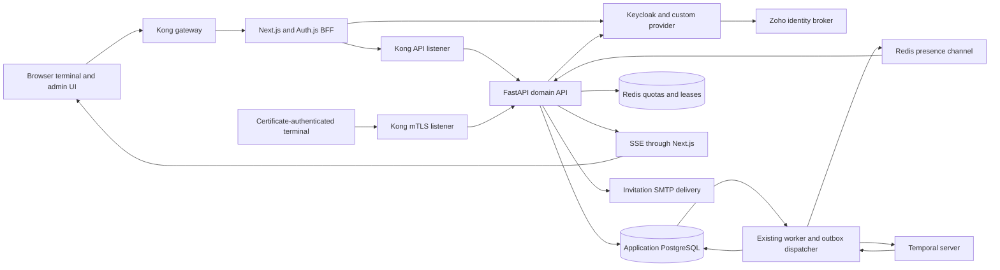
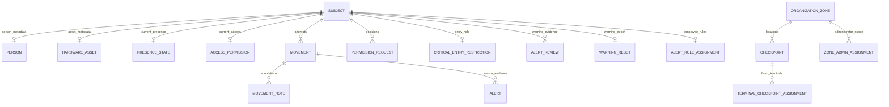
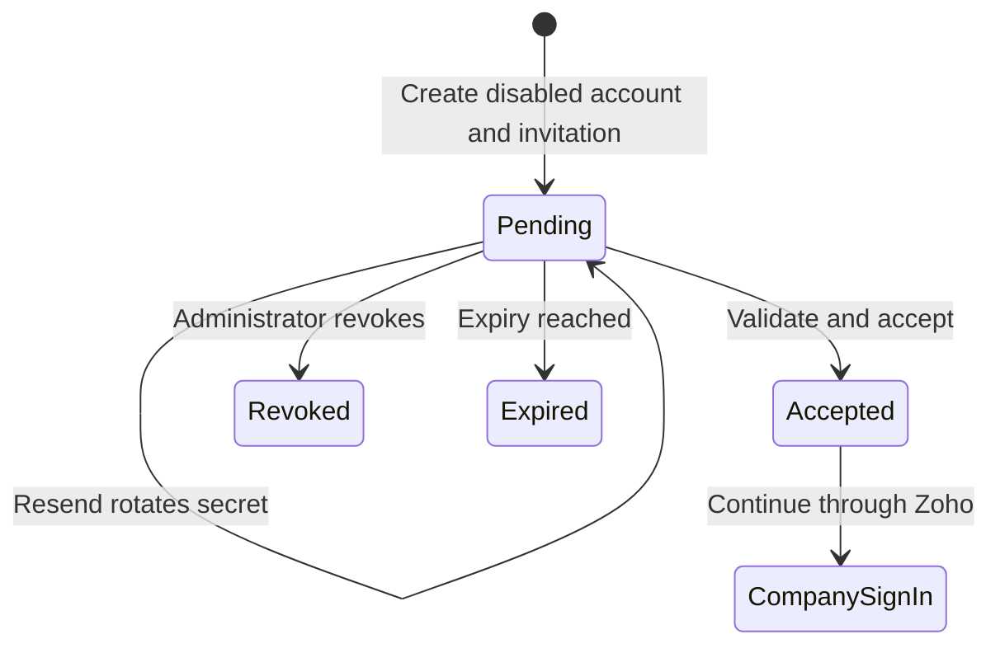
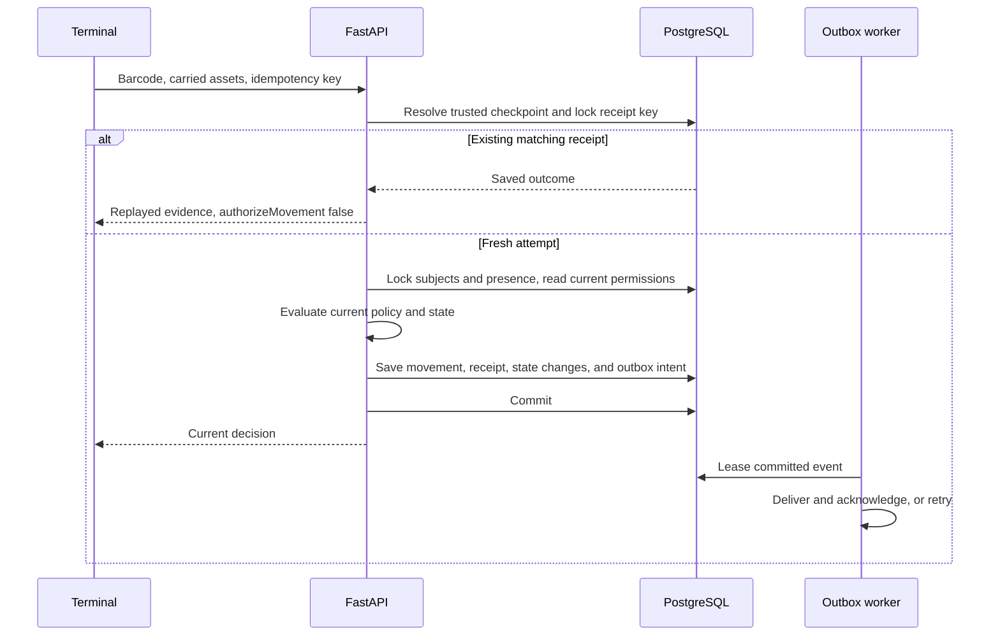

# In-Out backend and business model

Source review dated 7 November 2026. This guide describes the current working tree, including the invitation and Zoho changes that are still uncommitted. It explains the operating model implemented by the application, the backend mechanisms that support it, and the commercial decisions that would be needed to offer it as a product.

Source links are relative to this document. Function names and the route inventory at the end provide navigation when line numbers change. The historical test results discussed here belong to earlier verification runs. This documentation task used static source inspection.

## Contents

1. [The business and operating model](#1-the-business-and-operating-model)
2. [The domain concepts](#2-the-domain-concepts)
3. [Architecture and responsibility boundaries](#3-architecture-and-responsibility-boundaries)
4. [Backend code organization](#4-backend-code-organization)
5. [The database model](#5-the-database-model)
6. [Authentication and onboarding](#6-authentication-and-onboarding)
7. [Authorization and protected administration](#7-authorization-and-protected-administration)
8. [A scan from HTTP request to committed decision](#8-a-scan-from-http-request-to-committed-decision)
9. [The access decision rules](#9-the-access-decision-rules)
10. [Permissions and manual review](#10-permissions-and-manual-review)
11. [Alerts, warnings, and durable restrictions](#11-alerts-warnings-and-durable-restrictions)
12. [Time and attendance calculations](#12-time-and-attendance-calculations)
13. [Transactions and concurrency](#13-transactions-and-concurrency)
14. [The outbox, Redis, and live updates](#14-the-outbox-redis-and-live-updates)
15. [Temporal workflows](#15-temporal-workflows)
16. [Offline evidence and replay](#16-offline-evidence-and-replay)
17. [Read APIs, analytics, and exports](#17-read-apis-analytics-and-exports)
18. [Resource limits and security boundaries](#18-resource-limits-and-security-boundaries)
19. [Deployment, lifecycle, and observability](#19-deployment-lifecycle-and-observability)
20. [Testing and performance evidence](#20-testing-and-performance-evidence)
21. [Current discrepancies and implementation limits](#21-current-discrepancies-and-implementation-limits)
22. [Worked business scenarios](#22-worked-business-scenarios)
23. [Backend HTTP route inventory](#23-backend-http-route-inventory)

## 1. The business and operating model

### 1.1 What the organization uses the system for

In-Out manages controlled movement through an organization's checkpoints. Its operational questions are concrete.

- Who is this person or asset?
- Which checkpoint is making the decision?
- Is entry allowed at this place and time?
- Which employee is responsible for carried hardware?
- Is the subject currently recorded inside another building?
- Who approved an exception, and which attempt did it cover?
- Which warnings or restrictions still apply?
- What evidence can an administrator retrieve afterward?

An office, campus, or facility is a useful example deployment. These examples describe how the domain can be used, rather than evidence of actual customers or a specific industry certification.

The core business transaction is an access decision attached to an observed movement attempt. A scan can produce a denial and still be a successful system transaction. The application has identified the attempt, applied policy, saved evidence, and returned a decision. HTTP success and business approval are therefore separate outcomes.

### 1.2 Actors and responsibilities

| Actor | Business responsibility | Technical representation |
| --- | --- | --- |
| Organization owner or master administrator | Establish branches, administrator scope, and application accounts | Keycloak account with application `master-admin` role |
| Zone administrator | Manage authorized subjects, reviews, and eligible operators within assigned zones | Keycloak `zone-admin` role plus PostgreSQL zone assignments |
| Checkpoint operator | Scan barcodes, capture denied-attempt context, register visitors, and request review | Keycloak `operator` role plus a checkpoint assignment |
| Employee | Enter or leave under organizational policy and carry assigned hardware | Registry subject with `kind=employee` |
| Visitor | Receive temporary, bounded access associated with a host and purpose | Registry subject with `kind=visitor`, access window, and approval history |
| Hardware custodian | Be accountable for moving assigned equipment | Employee subject referenced by hardware custody metadata |
| Reviewer or auditor | Inspect decisions, notes, warning history, and exports | Authorized administrative views over retained records |

The application role `master-admin` and Keycloak's built-in master-realm administrator are separate authorities. An employee registry record also exists independently of a login account. A person can be tracked at a checkpoint without having a dashboard login.

### 1.3 Business lifecycle

The organization first establishes active zones and checkpoints. It assigns zone administrators to branches and operators to fixed checkpoints. Current account onboarding uses an invitation that creates a disabled Keycloak account, sends a short-lived link, and enables the account after acceptance. Company sign-in can then pass through the Zoho identity broker configured in Keycloak.

Administrators separately register employees and hardware, assign custody, and establish access. Terminal visitor registration creates a pending approval. A direct administrative visitor permission can create the visitor and approved access together. Operators then record attempts at their assigned checkpoints. Exceptions move through Permission Manager, while movement history, reviews, restrictions, and audit records support later investigation.

This produces a separation of duties. An operator can observe an attempt and explain a denial. An authorized administrator decides an exception. A database transaction binds the decision to the evidence and current policy state.

### 1.4 Value, costs, and useful business measurements

The product value comes from faster checkpoint processing, consistent access policy, equipment accountability, and recoverable approval history. A manual exception remains attributable to an administrator, and delayed network delivery can be retried without creating another admission.

Useful operating measurements include scan decision latency, queue age, time awaiting review, denied-attempt reasons, stale visitor requests, custody exceptions, time to investigate an event, and the gap between a committed decision and its appearance on an admin screen. These measurements should be interpreted together. A lower denial rate alone can mean either better preparation or weaker controls.

                                    Costs follow the actual architecture. They include application and identity hosting, PostgreSQL storage and backups, Redis capacity, Temporal history and workers, mail delivery, identity-provider administration, scanners or terminals, operational support, and integration testing. A scan carrying several assets creates more validation and locking work than a single-person scan. Audit and workflow retention also affect long-term storage costs.

### 1.5 Commercial model and product boundary

The repository implements an organizational operations platform. Its data model contains access and movement concepts rather than subscriptions, invoices, payment processing, or customer contracts. A commercial offering would need those product decisions explicitly.

Possible packaging could be an internally operated deployment, a managed deployment priced by branch or checkpoint, or an installation with support and integration services. These are productization options, not implemented revenue mechanisms. Pricing would need to account for hosting, identity integration, support obligations, retention, and the cost of recovery testing.

Zones are authorization boundaries within an organization. A hosted service serving unrelated organizations would require a defined tenant boundary throughout identity, database queries, events, exports, and operations. Adding another zone alone does not establish that business isolation.

Sources: [models](../backend/models.py), [zone scope](../backend/zone_access.py), [terminal routes](../backend/routers/terminal.py), [permission routes](../backend/routers/permissions.py), [invitations](../backend/routers/invitations.py).

## 2. The domain concepts

Several independent states meet at a scan. Keeping their meanings separate is essential when extending the backend.

| Concept | Question answered | Typical state |
| --- | --- | --- |
| Login account | Who is operating the application? | Enabled account, roles, authenticated session |
| Registry subject | Whose barcode is being scanned? | Employee, visitor, or hardware identity |
| Access permission | What may this subject do? | Zones, checkpoints, validity, access state |
| Permission request | Which administrative process is pending or completed? | Pending/approved/denied, with separate supersession and consumption markers |
| Presence | Where is the subject currently recorded? | Inside/outside, entry building, visit start |
| Movement | What attempt was recorded? | Entry/exit, approved/denied, auto/manual |
| Scan receipt | Has this exact attempted request already been processed? | Idempotency key, fingerprint, saved response |
| Alert | What condition needs attention? | Open or acknowledged display state, severity |
| Alert review | Was the condition confirmed or excused? | Final decision, reviewer, reason, timestamp |
| Entry restriction | Must new entry remain blocked? | Active hold, triggering alert, release evidence |

An approved visitor request grants access but does not mean the visitor has entered. A denied scan records evidence without changing presence. A warning reset changes the subject's warning epoch and can release a hold while preserving earlier review history. Acknowledging an alert only affects its display lifecycle.

Presence represents the system's record of approved transitions. Its accuracy depends on the organization recording actual entries and exits. Attendance calculations inherit that evidence boundary.

Sources: [models](../backend/models.py), [permission decisions](../backend/permission_decisions.py), [alert reviews](../backend/alert_reviews.py).

## 3. Architecture and responsibility boundaries

| Component | Main responsibility | Persistence or authority |
| --- | --- | --- |
| Next.js and Auth.js | Rendering, encrypted application sessions, browser-facing authentication boundaries, API adaptation | Session cookies and server-side provider-token handling |
| Kong | Routing, request-frequency limits, trusted mTLS identity forwarding, constrained public listeners | Redis-backed counters and declarative gateway configuration |
| FastAPI | Request validation, authorization, business decisions, transaction boundaries, scoped reads | Application database and domain rules |
| PostgreSQL | Subjects, grants, movements, receipts, restrictions, review history, event intent | Durable application records |
| Keycloak | Accounts, credentials, roles, authentication sessions, token issuance, invitation attributes | Identity persistence in its database |
| Redis | Pub/sub notifications, quotas, cooldowns, stream leases, application revocation markers | Runtime state with the persistence limits explained below |
| Temporal | Durable approval deadlines, workflow history, activity scheduling and recovery | Temporal persistence |
| Worker | Execute workflow activities and deliver committed outbox records | PostgreSQL leases and Temporal task processing |
| Scheduler bootstrap | Establish the durable recurring alert workflow | Stable Temporal workflow identity |
| SMTP and Zoho | Mail transport and upstream company identity | External deployment integrations |

The API's lifespan manages connection resources. Migrations, seed/bootstrap work, scheduling, and workflow execution have separate entry points. This lets the HTTP process restart without embedding all background lifecycles inside it.

The current declared frontend stack includes Next.js 15, React 19, Auth.js, and `jose`. The backend uses FastAPI, Pydantic 2, SQLAlchemy 2, `asyncpg`, Redis, and the Temporal SDK. The custom Keycloak provider and image are pinned to 26.8.2. Dependency constraints, resolved lockfiles, and deployed images describe different levels of version certainty.

Sources: [API assembly and lifespan](../backend/main.py), [frontend dependencies](../package.json), [backend dependencies](../backend/pyproject.toml), [worker](../backend/temporal_worker.py), [Keycloak image](../keycloak/Dockerfile).

## 4. Backend code organization

| Area | Files | Why it exists |
| --- | --- | --- |
| HTTP assembly | `main.py`, `routers/` | Attach routes, dependencies, middleware, and process lifecycle |
| Request contracts | `schemas.py`, route-local Pydantic models | Validate shape, lengths, allowed choices, and aliases |
| Scan transaction | `terminal_scans.py` | Serialize retries, lock state, evaluate and persist one attempt |
| Pure access decisions | `movement_logic.py` | Compute policy outcomes from supplied current state |
| Permission effects | `permission_decisions.py`, `permission_grants.py` | Apply approvals, denials, custody changes, and access revisions |
| Scope and validation | `zone_access.py`, `access_validation.py`, `registry_validation.py` | Share access boundaries and input invariants across entry points |
| Alert policy | `rule_engine.py`, `alert_reviews.py`, `critical_entry_restrictions.py` | Evaluate conditions and maintain durable warning/restriction state |
| Read projections | `registry_reads.py`, `permission_reads.py`, `movement_history.py`, `movement_analytics.py` | Produce bounded UI and reporting views |
| Reliability | `event_outbox.py`, `temporal_worker.py`, `workflows/` | Deliver committed intent and execute recoverable workflows |
| Identity integration | `auth.py`, `routers/keycloak_admin.py`, `routers/invitations.py` | Validate identities and coordinate provider administration |
| Resource protection | `request_admission.py`, `behavior_limits.py`, `data_limits.py`, `presence_leases.py` | Bound active work, abuse, disclosed bytes, and long-lived streams |
| Operations | `database.py`, `redis_client.py`, `maintenance.py`, `scheduler.py` | Own connections, retention, and bootstrap behavior |

A router normally authenticates the actor, validates scope, calls domain logic, adds durable event intent, and commits. Pure evaluators do not replace these transaction and authorization steps. Calling one directly with a dictionary is therefore different from executing the complete HTTP workflow.

### Execution model and request contracts

FastAPI dependency injection supplies authenticated claims and database sessions to route functions. Identical dependency calls can share their result within a request. A direct Python call to the same function is an ordinary function call, so this reuse depends on how the route composes its dependencies. The Keycloak administration context injects verified claims to share verification with the endpoint's actor dependency.

Asynchronous database, HTTP, and Redis calls yield while waiting for I/O. JSON serialization, policy evaluation, and interval calculations still consume CPU in their executing process. Backend RSA verification is explicitly sent to a threadpool. Shared connection pools reduce repeated connection setup, while deadlines bound waits. An `async` function alone does not make its CPU work parallel.

Pydantic validates the external contracts and handles selected aliases such as browser `checkpointId` and Python `checkpoint_id`. Domain helpers then validate semantic relationships, including checkpoint membership, custody, allowed windows, and current request revisions. SQL constraints handle another layer of invariants under concurrent writers.

Source records and response projections also differ. Current presence can be merged into a subject response even when compatibility metadata contains an older `inside` field. Movement responses retain historical snapshots. The caller must use the representation appropriate to a current decision or a historical report.

Sources: [request schemas](../backend/schemas.py), [FastAPI dependencies](../backend/auth.py), [Keycloak route context](../backend/routers/keycloak_admin.py), [database resources](../backend/database.py), [subject projection](../backend/registry_reads.py).

## 5. The database model

### 5.1 Relationships

This diagram shows the main relationships. Some movement and request subjects are nullable because an unknown barcode still needs evidence. Carried hardware references also live in the carrier movement's saved JSON. The complete relationship rules are in the migrations and domain code.

### 5.2 Table responsibilities

| Table | Important fields and invariants |
| --- | --- |
| `subjects` | Stable ID, kind, barcode, and server-owned warning-backfill gate |
| `people` / `hardware_assets` | Subject-ID primary key plus JSONB metadata |
| `organization_zones` | Unique name, active flag, creator, creation time |
| `zone_admin_assignments` | Composite administrator-subject/zone identity |
| `checkpoints` | Zone, positive zone-local number, gate type, active/required flags |
| `terminal_checkpoint_assignments` | Namespaced verified terminal identity mapped to one checkpoint |
| `presence_state` | Inside/outside, entry building/start, last scan, continuous-presence dedup marker, reviewed-visit override |
| `scan_requests` | UUID idempotency key, terminal, request fingerprint, saved response, creation time |
| `movements` | Canonical subject/checkpoint/time/result/direction/classification plus a saved descriptive snapshot |
| `access_permissions` | Current access document for one subject |
| `permission_requests` | Typed process state and snapshots needed for approval validation |
| `alerts` / `alert_rules` | Displayable conditions and rule definitions |
| `alert_reviews` | Final decision with retained alert data and subject binding |
| `warning_resets` | Latest subject reset watermark, actor, and reason |
| `critical_entry_restrictions` | Current hold and latest release metadata, with chronological history retained in audit/review records |
| `critical_alert_triggers` | Deduplication markers for processed alerts |
| `audit_events` / `movement_notes` | Administrative changes and movement annotations |
| `admin_accounts` | Local profile, preferences, and availability for a Keycloak identity |
| `user_management_window_locks` | Persisted revocation of a specific protected-management window |
| `alert_rule_assignments` | Employee overrides, exception dates, and optimistic revision |
| `event_stream_state` / `event_outbox` | Commit-ordered event revisions and retryable delivery records |

### 5.3 Relational columns and JSONB

Frequently joined identity and timing fields use relational columns. Descriptive snapshots and evolving policies use JSONB. A movement can retain the name, barcode, carrier, hardware set, and reason that applied when it was recorded, even after the current Registry changes.

JSONB still needs schema discipline. Pydantic contracts, shared metadata validation, database checks, and revision comparisons constrain documents. Access decisions must select current authoritative fields instead of accepting editable client metadata as policy.

Migrations add guarantees beyond the ORM declarations. These include case-insensitive barcode uniqueness, movement enum/object checks, foreign keys, one permission per subject, and the evolution of nullable subject references. Barcode equality in the scan path is trimmed and case-insensitive. Migration history also contains retired structures, so an old migration alone is insufficient to describe the current product.

### 5.4 Deletion and history

Person and hardware subtype rows can cascade with subject deletion. History-bearing subjects are protected by references and domain checks. Hardware can be present only inside a carrier movement's JSON, so deletion explicitly checks that history too. A conflicting delete returns 409. Restricting access or retiring an operational location preserves existing evidence.

An alert review retains its own alert snapshot without a foreign key that would erase it with alert retention. A critical hold stores the triggering alert ID independently. Those choices preserve confirmed-warning counts and entry restrictions across display-record cleanup.

Sources: [models](../backend/models.py), [initial migration](../backend/alembic/versions/b4e1548478d0_initial_schema.py), [one-permission migration](../backend/alembic/versions/e3f4a5b6c7d8_unique_permission_per_subject.py), [subject deletion](../backend/routers/registry.py), [movement history projection](../backend/movement_history.py).

## 6. Authentication and onboarding

### 6.1 App-owned credential form

The browser submits username, password, and optional OTP through the bounded Auth.js request boundary. The server generates a verifier and SHA-256 challenge, then calls the custom Keycloak `inout-auth/verify` endpoint as the confidential frontend client.

The Java provider runs Keycloak authentication, checks that password validation and any required enrolled OTP occurred, and validates required actions. It returns a random single-use code with a 30-second lifetime. The retained ticket binds the realm, client, subject, authentication session, challenge, authentication time, and credential/state fingerprint.

The server redeems that code at `inout-auth/token` with its verifier. The provider atomically consumes the ticket, checks its bindings and current eligibility, and issues ordinary Keycloak tokens. The application validates the token pair before creating its encrypted Auth.js session. Form credentials pass through the app to Keycloak. Public session JSON omits provider tokens, which the encrypted session retains for server-side use.

This is custom security code coupled to Keycloak internals. The provider checks the exact supported Keycloak version, which makes upgrade compatibility an explicit deployment responsibility.

### 6.2 Company sign-in through Zoho

The company-sign-in button uses the Keycloak provider with Authorization Code flow, PKCE, state, nonce, and `kc_idp_hint=zoho`. Keycloak brokers the upstream identity and returns the result to Auth.js. Fresh user-management step-up deliberately follows the account-bound reauthentication path.

Invitation gating depends on the deployed broker configuration. The documented Zoho first-login flow must link a verified email to an existing invited account and prevent automatic creation of an unknown account. The source and setup instructions establish the intended contract. The live realm configuration was outside this review.

Existing enabled legacy accounts can also authenticate through a correctly linked broker. The OAuth callback does not require every account to have an accepted-invitation attribute. Current onboarding gating relies on disabled pending shadow accounts and the broker's configured account-linking behavior.

### 6.3 Invitation lifecycle

`Expired` in the diagram is an effective validation outcome from the saved expiry. It need not be a separately written `invite_status` value.

Creation accepts operator or zone-admin accounts. Operator invitations require a checkpoint, while zone-admin invitations require zones. An ordinary zone administrator can invite eligible operators in their own scope. Master-admin authority itself is provisioned separately.

The API creates a disabled Keycloak shadow account and coordinates its roles with PostgreSQL checkpoint/zone assignments. A 32-byte random secret becomes the link token. Keycloak stores its SHA-256 hash, expiry, and status attributes. The default lifetime is 900 seconds.

The emailed link uses a URL fragment, `/invite/accept#u=...&t=...`. The acceptance screen reads and removes the fragment and requires an explicit action. The app forwards a bounded same-origin request to the public acceptance endpoint. Under a per-user advisory lock, the backend verifies pending state, disabled account, expiry, and constant-time hash equality. It enables the account, marks email verified, clears token state, and confirms the provider update before committing the acceptance audit.

Acceptance activates the account. The recipient then completes company sign-in to obtain an application session. Resend rotates the secret. Revoke disables the pending invitation and clears its secret. SMTP failure after the pending transaction leaves an invitation available for resend.

Keycloak and PostgreSQL have separate commit boundaries. Provider changes use confirmation and compensation where possible. A lost response after provider activation can leave the link consumed while the caller lacks a confirmed result. The current API exposes that ambiguity for administrator follow-up.

### 6.4 Sessions, refresh, password changes, and logout

Browser session responses expose selected identity/role properties. Encrypted session data retains provider tokens for server-side use. Backend API authentication independently verifies RS256 signatures, issuer, audience, required claims, and bearer-token type. A valid identity token cannot substitute for an access token.

JWKS preparation is shared and bounded. Cryptographic verification runs in a threadpool. Redis revocation checks cover both account issuance cutoffs and exact token revocations. Refresh coordination coalesces concurrent work within one process/runtime, with bounded retained results.

App-owned temporary-password setup, password changes, and required-profile completion also use the custom provider. They bind the target account, verify current credentials and enrolled OTP where required, and apply Keycloak's policy. Distributed short-lived leases protect ambiguous or concurrent password operations.

Logout attempts protected-window revocation, records administrative availability, clears the application session, and attempts provider refresh-session revocation. Browser SSO uses a Keycloak end-session flow and a signed return-state value. Sign-in availability clearing runs after the response, with an ordering marker that protects newer explicit offline choices.

Sources: [Auth.js configuration](../auth.ts), [credential protocol](../lib/keycloakCredentials.ts), [Java provider](../keycloak/providers/src/main/java/io/inout/keycloak/InteractionResource.java), [backend token verification](../backend/auth.py), [invitations](../backend/routers/invitations.py), [mail transport](../backend/invitation_mail.py), [Zoho setup](zoho-invitation-setup.md), [password update](../app/api/auth/password/update/route.ts), [logout](../app/logout/route.ts).

## 7. Authorization and protected administration

Authentication supplies an actor. Domain authorization also needs assigned zones, checkpoint identity, target account eligibility, and sometimes a fresh management window.

Ordinary subject reads use overlapping zone visibility. Historical movements use their checkpoint's zone. Some changes affect the entire subject, including custody and entry-hold changes. Those require administrator coverage of every effective access zone. A subject visible in one branch can therefore remain ineligible for a subject-global mutation by that branch's administrator.

Current zone-admin zone-access grants require explicit checkpoints. The primary checkpoint must be included, the supplied zone set must match selected checkpoint zones, and all requested zones must fall within the actor's scope. Approval replaces the canonical access set and window, so callers must provide the complete intended result.

Management step-up offers 5, 10, 15, 20, 30, or 60 minutes. A signed intent binds the account and selected duration. Completion requires fresh authentication for that account. The BFF proof additionally binds the exact bearer-token hash, authentication time, expiry, duration, and window ID. PostgreSQL window locks keep a revoked window closed across reloads and cookie removal. Extension requires another fresh authentication.

Master administrators bypass the ordinary user-management step-up window. Zone administrators may change only an existing in-scope operator's enabled state and checkpoint. Master administrators manage eligible accounts' identity fields, application roles, passwords, sessions, and deletion. Accounts carrying the application `master-admin` role are protected from ordinary managed-account edits. Pending, expired, or revoked invitation accounts must use the invitation lifecycle instead of the normal access-edit operation.

Human administrator bearer tokens still authorize ordinary Keycloak administration calls. Public invitation acceptance instead uses a dedicated confidential invitation service account. These are different authority models with different exposure. The earlier proposal to move all user-management authority into a backend-only service account remains deferred in the repository's security plan.

Sources: [zone authorization](../backend/zone_access.py), [permission route validation](../backend/routers/permissions.py), [step-up proofs](../lib/userManagementStepUp.ts), [backend proof checks](../backend/user_management_step_up.py), [window locks](../backend/user_management_locks.py), [Keycloak administration](../backend/routers/keycloak_admin.py), [deferred security decisions](security-remediation-plan.md).

## 8. A scan from HTTP request to committed decision

### 8.1 Entry points and terminal identity

Browser scans enter `POST /v1/terminal/scans`. The server authenticates an operator or administrator, resolves the account's checkpoint assignment, and rejects a mismatching checkpoint in the request. Terminal assignment keys distinguish browser identities from certificate identities.

Physical terminals can use `POST /v1/scans` through Kong's dedicated mTLS listener. Kong verifies the client certificate, strips spoofed identity headers, and supplies a verified distinguished name plus its internal secret. FastAPI checks that boundary and matches the certificate CN to the declared terminal identity. The configured checkpoint assignment still applies.

Checkpoint mode controls direction. A manual checkpoint requires an explicit direction. Nonmanual modes reject a supplied browser direction, and automatic mode derives entry or exit from current presence. An account's ability to open the terminal page alone does not establish a scanning location.

### 8.2 Processing stages

For a registered subject, the transaction locks the person and carried assets in sorted subject-ID order. It loads current access and restriction state, then initializes and locks presence in batched statements. Domain evaluation uses these refreshed values. An approved movement updates affected presence records atomically. A denial preserves existing presence while still recording the attempt and receipt.

The permission lookup in this scan path is a refreshed SELECT. Subject locks serialize the policy writers that could otherwise race with it. This differs from mutation paths that explicitly lock a permission row.

The route adds durable update intent and commits before returning the final response. A replay suppresses another publication. Input validation failures, access denial decisions, transaction conflicts, and dependency failures are different response categories.

### 8.3 Idempotency and the meaning of replay

The idempotency receipt binds a UUID key to the verified terminal and a normalized request fingerprint. Normalization handles barcode case/whitespace and sorts/deduplicates hardware IDs. Retry-only ownership and queue-time evidence are excluded from that original fingerprint.

| Situation | Expected result |
| --- | --- |
| Same key, same terminal, same request | Return saved evidence and mark it replayed |
| Same key with a changed request or another terminal | 409 conflict |
| Two concurrent copies of the same key | Serialize on the idempotency advisory lock |
| Receipt saved but HTTP response lost | A retry retrieves the committed outcome |
| Old successful entry is replayed | `authorizeMovement=false` prevents another physical admission |
| Replayed entry now belongs to a critically held subject | Recheck the current hold under subject locking |
| Old queue item outlives receipt retention | Retain it for reconciliation rather than record it as a fresh scan |

A saved approval answers what happened to the earlier attempt. The current response's authorization fields determine whether the current interaction may move someone. That distinction protects the system when a response is retried after an exit, custody change, or new restriction.

Sources: [browser scan handler](../backend/routers/terminal.py), [mTLS scan handler](../backend/main.py), [scan transaction](../backend/terminal_scans.py), [terminal assignment](../backend/terminal_assignments.py), [request schemas](../backend/schemas.py).

## 9. The access decision rules

### 9.1 Policy inputs

The evaluator receives the registered subject, checkpoint, current presence, selected hardware, and current access metadata. The transaction layer additionally handles cooldown, restrictions, cross-building conflicts, receipt replay, and manual-grant consumption.

Entry needs a recognized identity, an eligible access state, a valid time window, an allowed zone/checkpoint, compatible presence, and eligible carried hardware. Entry validity behaves as `[validFrom, validTo)`. A start can be inclusive while the end has already expired at equality.

`_zone_allowed` uses canonical zone membership. Checkpoint display names do not grant access. A nonempty checkpoint selector narrows the zone permission further. Naming two checkpoints similarly therefore does not make them equivalent identities.

### 9.2 Entry and exit have different business obligations

For a person already inside, a matching exit can bypass ordinary entry-window, employee-status, visitor-preapproval, and zone checks. This supports leaving after a permission expires or an account becomes restricted. Hardware still has its own active-state, custody, and matching-visit requirements.

An entry while already inside or an exit without an active entry is denied. A ten-second cooldown follows the last approved scan, with specific reviewed-exit and critical-hold-exit exceptions. If a subject or carried asset is recorded inside another building, the target scan is blocked and can create a high-severity cross-zone alert.

### 9.3 Carried hardware

Each selected asset is checked independently for identity, status, access, presence, and custody. An assigned asset must belong to the scanned carrier. Assigned hardware generally moves through a carrier scan, with a narrow matching-exit exception for an already reviewed hardware entry and unchanged custody.

One carrier scan remains one persisted movement. Its hardware snapshot supports later per-asset history projections. This prevents a dashboard from treating every projected hardware history row as another person entering the building.

The backend schemas permit eight selected hardware IDs. The terminal's documented interaction describes four optional carried barcodes. These are separate limits and should be aligned explicitly if the supported product limit changes.

### 9.4 Classification and physical capture

`scanType` records automatic versus administratively reviewed authorization. `captureMethod` records scanner input versus manually typed input. Typing a barcode does not provide manual approval. A fresh scan remains automatic unless the server consumes an eligible administrative grant.

Examples of denial categories include unknown barcode, inactive/restricted access, expired visitor pass, pending approval, custody mismatch, disallowed zone, cross-building conflict, duplicate entry, and missing active entry. Stable denial codes support filtering and analytics independently of display wording.

Sources: [pure evaluator](../backend/movement_logic.py), [transaction overlays and cooldown](../backend/terminal_scans.py), [schema limits](../backend/schemas.py), [hardware history](../backend/movement_history.py).

## 10. Permissions and manual review

### 10.1 Four process types

| Type | Business effect of approval | Important boundary |
| --- | --- | --- |
| `visitor` | Activate the visitor's bounded access and set visitor status to pre-approved | Current validation targets the selected visitor checkpoint |
| `zone_access` | Replace the canonical zone/checkpoint set and validity window | Caller supplies the complete resulting access |
| `hardware_custody` | Reassign equipment to the selected employee | Custody persists until another change, without automatic reversion |
| `manual_override` | Create an unused grant for a matching later scan | Evidence, current snapshots, expiry, and one-time consumption bind it |

The API records decision reason, actor, timestamps, and related audit evidence. A denial requires an administrative note. Operator manual-review submission requires an operator note. These requirements are enforced below the UI.

### 10.2 Pending request and direct grant paths

Terminal and Registry visitor registration create pending approval. Permission Manager's direct administrative grant can complete the decision immediately. For a new visitor, identity, access, completed request history, and audit evidence can commit together. Suitable pending requests can be reused by the domain helper.

Non-direct custody and zone requests capture baseline revisions. The decision helper detects a permission or custody change while a request waited and can return 409 for stale context. It also protects against an older visitor request overwriting a later permission change.

Completed decisions belong in history. Dismissing a result notification changes its visibility while preserving the decision and movement evidence. The endpoint name contains notification terminology even though it is a permission-result acknowledgement, rather than a separate team inbox.

### 10.3 Manual review binds a specific denied attempt

A manual request must identify a recent server-recorded denial with matching barcode, checkpoint, and direction. The source denial must be within ten minutes and cannot be in the future. The unanswered manual-review deadline is also ten minutes.

Approval opens a time-limited unused grant. It leaves physical presence unchanged until another matching scan consumes it. Allowed durations are 15, 30, 60, 120, and 240 minutes, with a default of 60.

The grant binds the original denial, subject identity/kind, barcode, checkpoint, direction, exact hardware set, custody, current access snapshot/revision, and the absence of a newer approved scan. A change to those assumptions invalidates consumption. Cross-building conflicts cannot be manually approved.

For an unknown barcode, manual approval calls `ensure_review_subject`. Under a case-insensitive barcode advisory lock, it creates a visitor identity and a pending one-visit access record. The unused grant can then be consumed by a subsequent matching registered-subject scan. Ordinary future access remains pending. If someone independently registered that barcode after the request, approval returns a conflict and asks for a fresh scan/review against the registered subject.

Consumption saves its time, movement ID, operator, approving administrator, and original denial context. An admitted visit can carry an `entry_override` to support its matching exit after the approval window ends. That exit still checks hardware safety and custody.

Manual denial can update the original movement's classification and review attribution while preserving its ID and original occurrence time. Legacy decisions without a usable source can have replacement `MAN-*` rows. Canonical reporting excludes superseded source rows to avoid double counting.

The current scan code blocks a critically held entry before manual-grant consumption. The README's one-visit critical-hold bypass statement conflicts with this implementation. Section 21 records that difference explicitly.

### 10.4 Time-window validation

Scheduled access uses facility time, Asia/Kolkata. A creation start has five minutes of grace for form completion. The end must follow the start and be in the future. Both ends of the requested schedule must fit within the next six calendar months. Month arithmetic preserves local time and clamps a day such as the 31st to the shorter target month's final day.

Approval can retain a previously requested past start while validating the future end. Permanent direct access is supported for zone access. Visitor schedules stay bounded. Visitor workflow expiry is thirty minutes, while the API deliberately permits a still-pending visitor to be decided later if its access window remains valid. The outcome therefore also depends on whether the timeout worker has already committed a denial.

Sources: [permission contracts](../backend/schemas.py), [HTTP process validation](../backend/routers/permissions.py), [direct grants](../backend/permission_grants.py), [decision effects and stale snapshots](../backend/permission_decisions.py), [manual deadline](../backend/manual_review_policy.py), [calendar validation](../backend/access_validation.py).

## 11. Alerts, warnings, and durable restrictions

### 11.1 Current default rules

| Rule | Subjects | Default severity | Condition |
| --- | --- | --- | --- |
| No break recorded | Employees | Medium | At least 360 minutes of approved work and zero break minutes |
| Attendance irregularity | Employees | Medium | No approved entry by 18:00 facility time |
| Scan in another zone | Employees and visitors | High | A target-zone scan while recorded inside another zone |
| Continuous presence | Employees and visitors | Medium | More than twelve hours in one ongoing visit |

Scheduled evaluation runs every five minutes, with a manual evaluation entry point. Cross-zone conflict detection also runs in the scan transaction. Continuous presence uses a persistent visit start and alerted-entry marker. Denials, retries, and redundant entries do not restart the visit. A successful exit ends it.

Attendance rules can be selected per employee. A missing assignment inherits eligible defaults. An explicit empty selection disables those assigned attendance rules. Exception dates suppress attendance irregularity. Hardware currently has no eligible scheduled rule assignments.

### 11.2 Review and warning accounting

Acknowledgement changes alert display status. Confirmation creates a retained `AlertReview` and adds to the subject's confirmed warning count. Excuse requires a reason and records a final review without adding a warning. Reviews are chronological per subject, which prevents later decisions from changing the expected ordering of warning progression.

The current count is the number of confirmed reviews after the most recent reset watermark. The third confirmed warning creates an entry hold. A bound critical alert can also create a hold directly. Finalized reviews can replay the same decision, while an opposite decision conflicts.

Severity, displayed warning number, confirmed count, and restriction state have different meanings. Display code maps medium/high/critical severity to levels, while the next review's warning ordinal derives from confirmed history. Backend hold enforcement uses the retained review ledger and restriction table.

### 11.3 Release and reset

A hold belongs to the subject and survives ordinary alert acknowledgement, another access grant, and source-alert retention. An explicit release needs an authorized actor and reason. It checks that a stale alert ID is not releasing a hold controlled by a newer trigger.

Warning reset also requires a reason. It advances the reset epoch, retains older evidence, and releases the current hold atomically. Older review records remain available for history. Legacy warning counts can be materialized into durable holds under subject locks, with a server-owned gate preventing arbitrary metadata from disabling that repair.

Sources: [rule definitions and evaluator](../backend/rule_engine.py), [alert review ledger](../backend/alert_reviews.py), [restriction lifecycle](../backend/critical_entry_restrictions.py), [rule assignment API](../backend/routers/alerts.py), [scheduler](../backend/scheduler.py).

## 12. Time and attendance calculations

The system stores canonical event timestamps and applies facility-time boundaries when building days. Employee activity fetches the last approved transition before a requested window plus transitions inside it. That predecessor is necessary for an open shift that began before the requested start.

`build_activity_days` pairs entries and exits, clips intervals to the requested window, splits overnight work at facility midnight, and produces day sessions, worked hours, and a percentage relative to an eight-hour display reference. A recorded open entry can contribute time through the requested end.

Registry overview activity can be reused for page rows by preserving exactly the final pre-window transition and all in-window transitions. Reuse must preserve same-timestamp movement ordering. Average-hours sorting still needs matching subjects' activity before it can sort and paginate that derived value.

Attendance-rule accounting and chart session accounting currently differ. The no-break rule accumulates positive exit-to-reentry gaps, then rounds aggregate worked and break minutes before testing the 360-minute and zero-break thresholds. A sufficiently short gap can round to zero break minutes. The activity chart labels break sessions only for same-day gaps of at most two hours. A calculation used for one purpose should therefore not silently replace the other.

Sources: [activity calculations](../backend/movement_analytics.py), [Registry activity reads](../backend/registry_reads.py), [attendance rule calculation](../backend/rule_engine.py).

## 13. Transactions and concurrency

### 13.1 Sessions and database resources

SQLAlchemy uses an asynchronous engine with `asyncpg`. The default pool size is five with ten overflow connections. Checkout and connect timeouts default to five seconds, statement timeout to fifteen seconds, and lock timeout to three seconds. Prepared statement caching and connection pre-ping are configured.

The read path shares the primary engine when both URLs resolve to the same database. A configured read replica gets its own pool and freshness characteristics. Adding API or worker replicas multiplies potential database connections, so the pool setting is a per-process capacity decision.

Sessions disable autoflush and expiration on commit. Domain code explicitly flushes where needed and commits the complete operation. Error and cancellation paths roll back and release failed sessions. SQL parameters are hidden from database error logging.

### 13.2 Different locks protect different invariants

| Lock or revision | Protected invariant |
| --- | --- |
| Idempotency-key advisory lock | One logical scan per receipt key |
| Sorted subject row locks | Stable person/asset access and custody during a scan |
| Presence row locks | Atomic transition from the observed current state |
| Permission/request locks and baseline revisions | One current decision against a valid policy snapshot |
| Shared active-zone locks | Scope assignments cannot race with location retirement |
| Protected management-window locks | Revocation serializes with admitted sensitive commands |
| Per-Keycloak-user advisory lock | Invite accept, resend, revoke, and account changes serialize |
| Evaluator/assignment coordination lock | Evaluation and rule configuration maintain consistent decisions |
| Global event revision row | A committed snapshot cannot skip a lower revision that commits later |

Locks are taken in consistent order where several subjects are involved. Database constraints remain important for races that pass application prechecks. An ORM session represents one transaction context and should execute its dependent SQL sequentially.

### 13.3 Snapshot consistency

`read_event_revision` requests `REPEATABLE READ` when it opens an untouched async session. A bundle that calls it before other reads pairs its data with one MVCC presence revision. Other arbitrary database sessions retain their configured transaction isolation. Code that adds a query before the revision call can therefore change the guarantee and needs review.

Sources: [database setup and cleanup](../backend/database.py), [scan locking](../backend/terminal_scans.py), [scope locks](../backend/zone_access.py), [outbox revision read](../backend/event_outbox.py), [management locks](../backend/user_management_locks.py).

## 14. The outbox, Redis, and live updates

### 14.1 Why event intent commits with business state

A direct publish before database commit could announce a change that later rolls back. Publishing only after commit without retained intent could lose the update if the process fails between those steps. The outbox stores intent inside the business transaction and moves network delivery into the worker.

The event revision uses an atomic update of a singleton state row plus insertion into the outbox. Its lock lasts through commit. A plain sequence allocates numbers independently of commit order, which would allow a snapshot cursor to advance past a transaction that commits later. The locked revision row avoids that gap. Presence records also carry their previous presence revision because workflow events consume global revision numbers too.

### 14.2 Delivery and recovery

There are two ordered lanes, presence and workflow. A lane chooses its oldest undelivered record before checking availability or lease expiry. A leased or backoff head holds that lane's order. A worker claims a thirty-second lease with an owner identifier and commits. Network delivery occurs outside that claim transaction with a fifteen-second bound.

Success is acknowledged only for the current lease owner. Failure schedules exponential retry capped at sixty seconds. A cancelled worker leaves an expiring lease. Delivery is at least once, so revisions and workflow identity must tolerate a duplicate after publish succeeded but acknowledgement was lost.

Idle dispatch polls every 250 milliseconds. The current implementation has no database-notification wake-up path. Delivered replay records older than seven days are pruned in bounded batches. Undelivered events remain available for retry.

### 14.3 Redis boundaries

The application has separate quota/security and event/pubsub connection pools. Redis ACL identities separate application counters/leases/revocations, Kong rate-limit counters, and the presence channel. The default Redis user is disabled.

The startup script disables snapshots and AOF. Consequently, Redis counters, leases, and application revocation markers are volatile across a Redis restart. Durable movement history, event intent, and workflow history live in PostgreSQL-backed stores. This distinction matters when assessing recovery and revoked-token behavior after a restart.

### 14.4 SSE resume and privacy

The versioned stream subscribes before replaying database events, closing the setup gap between a snapshot and live subscription. Internal buffering is bounded at 256 messages and one MiB. Replay reads fifty rows at a time and caps a catch-up at 500 events and four MiB. A missing predecessor, retention gap, or overflow requests a fresh snapshot.

`Last-Event-ID` takes precedence over the query cursor. Control frames advance the cursor. Streams end at token expiry, renew distributed leases, and release subscriptions on disconnect. Defaults permit three streams per principal and 128 globally, with a 45-second renewable lease.

Administrators receive refresh hints and load authorized zone-scoped data. Operators receive checkpoint/assignment-specific hints. The public stream avoids distributing the global channel's full subject and decision documents.

On the client, metadata-only hints preserve unchanged data references. Bounded refresh scheduling lets an active read finish, then performs one pending reconciliation. Ordinary terminal snapshots preserve the stream connection. Snapshot-required recovery provides a fresh cursor and a new connection.

Sources: [outbox and revisions](../backend/event_outbox.py), [Redis clients](../backend/redis_client.py), [Redis startup and ACLs](../infrastructure/redis/start-redis.sh), [SSE implementation](../backend/routers/presence.py), [stream leases](../backend/presence_leases.py), [frontend reconciliation](../frontend/context/DataContext.tsx).

## 15. Temporal workflows

The worker polls `inout-task-queue`. It shares/coalesces connection attempts and supervises Temporal startup separately from presence dispatch. Connection failure retries with bounded backoff. This separates workflow dependency latency from the presence delivery lane.

| Workflow | Trigger | Main responsibility |
| --- | --- | --- |
| `PermissionOverrideWorkflow` | Committed manual-review request | Observe decision or enforce the ten-minute deadline |
| `VisitorApprovalWorkflow` | Committed visitor request | Observe decision or enforce the thirty-minute workflow deadline |
| `AlertRuleCronWorkflow` | Durable five-minute schedule | Execute bounded rule-evaluation activities |

Deadlines originate from database request creation time. A delayed workflow start therefore cannot restart a full waiting period. The authenticated HTTP route commits the decision. A Temporal signal wakes the workflow to observe it. Activities check database state and cannot turn a forged signal into new approval authority.

Timeout activities invoke the same decision helper in expiry-only mode. Recoverable initial-activity failures have a durable recovery branch with backoff beginning at thirty seconds and capped at five minutes. Business validation and explicitly nonretryable errors remain terminal. Workflow patch markers preserve compatibility with previously recorded histories.

The scheduler bootstrap uses the stable `alert-rule-cron` identity and tolerates an already-started workflow. Alert evaluation has a two-minute activity deadline and a bounded retry policy.

API readiness still checks Temporal cluster information alongside PostgreSQL and Redis. A Temporal outage can therefore produce readiness 503 even while the process is alive and the independent presence-dispatch implementation can operate. Deployment readiness and internal task independence are separate properties.

Sources: [worker lifecycle](../backend/temporal_worker.py), [manual workflow](../backend/workflows/permission_override.py), [visitor workflow](../backend/workflows/visitor_approval.py), [recovery branch](../backend/workflows/approval_recovery.py), [activities](../backend/workflows/activities.py), [scheduler](../backend/scheduler.py), [readiness](../backend/main.py).

## 16. Offline evidence and replay

The browser stores queued attempts in the `inout-terminal-offline` IndexedDB database. A queued record preserves its original payload, idempotency key, operator subject, capture evidence, attempts, and any hold reason. Cached configuration supports the terminal's continuity, while the server decides whether movement is authorized.

A freshly authenticated server policy anchors replay time to a server sample and monotonic elapsed time, including request uncertainty. Browser wall time and a policy restored from cache are insufficient to establish replay authority.

Before transmission, replay checks the original account, current account, checkpoint assignment, verified capture time, fresh policy, future-time bounds, and receipt-retention horizon. Records that cannot be verified are held for administrator reconciliation. They keep their evidence.

The default receipt horizon is thirty days. If the original receipt has expired, resending an old event as a new attempt could duplicate history. The client and backend therefore reject automatic replay beyond the permitted horizon. The saved key and attempted payload survive a retry. Session failure, throttling, and timeout pause retry. A queue item is removed only after a successful acknowledgement.

Changing accounts or checkpoint assignments changes replay eligibility. Evidence belonging to another account is skipped. Existing offline storage remains plaintext in the browser profile, a risk recorded in the deferred storage-encryption proposal.

Sources: [offline evidence adapter](../frontend/lib/offlineTerminalQueue.ts), [terminal orchestration](../frontend/components/terminal/SecurityTerminal.tsx), [server queue-age checks](../backend/terminal_scans.py), [deferred storage decision](security-remediation-plan.md).

## 17. Read APIs, analytics, and exports

### 17.1 Bounded views

The Next.js API layer adapts browser commands to Python routes and normalizes response shapes. Server-rendered and client requests reuse their request-local authentication context. Dynamic private data uses authenticated no-store reads. Public browser session responses are sanitized separately.

| View | Backend behavior |
| --- | --- |
| Registry | Bounded pages, literal search, server sorting, current status/presence, latest-event and activity summaries |
| Subject profile | One authorized subject with focused current access |
| Permission directory | Independent paginated current access with state/search filters |
| Pending queues | Independent manual/other groups, totals, and bounded related metadata |
| Alert command center | Bounded alert rows, scoped global totals, rule controls, scheduled exceptions |
| Alert history | Rows and focused enrichment, with optional unused directory/catalog work skipped |
| Movement ledger | Filters, exact counts, page rows, optional notes, aggregate chart buckets |
| Hardware history | Projected asset rows with a stable source-event reference |
| Dashboard | SQL aggregates and bounded recent records |

The usual interactive page size is 25, with alert command/history pages commonly using 50. Server limits differ by endpoint and remain authoritative. Exact counts and OFFSET pagination still exist. Derived average-hours ordering can require all matching employee activity before selecting a page.

`bounded_rows` retrieves an extra row and rejects an incomplete full result. It avoids silently presenting a truncated directory or rule evaluation as complete. Explicit page contracts instead return their page and total.

### 17.2 Canonical and projected history

A historical manual decision may have replaced a source movement in an older schema. Canonical filters prevent both rows from contributing to ordinary totals. Hardware history expands a carrier event's saved hardware set into virtual per-asset rows, preserving historical names/barcodes, carrier information, and `sourceEventId`.

Virtual rows are read projections. Notes resolve back to the physical source movement. A projected asset row must not be sent into a write path as if it were a newly observed physical scan.

### 17.3 Export boundaries

`GET /v1/exports` provides one bounded read for Registry, movement, alert, and permission-history reports. It validates filters, checks exact result completeness, enforces a maximum of 10,000 rows subject to configuration, checks the response byte cap, and supports cancellation with a sixty-second deadline.

CSV callers opt into lean reads. Registry exports keep employee averages while skipping unused latest-event/checkpoint details. Movement exports can skip notes. Alert exports retain item review and restriction fields while avoiding unused global catalogs and directory work.

The browser formats CSV in batches of 256 rows, yields to the event loop, checks cancellation, and enforces exact UTF-8 byte limits including a BOM where applicable. Cells are quoted and formula-like prefixes are escaped. This protects both responsiveness and the integrity of a spreadsheet opened from untrusted subject names or notes.

Sources: [BFF adaptation](../app/api/data/bff.ts), [server transport](../app/api/pythonApi.ts), [Registry reads](../backend/registry_reads.py), [permission reads](../backend/permission_reads.py), [movement projections](../backend/movement_history.py), [exports](../backend/routers/exports.py), [CSV formatting](../lib/csv.ts).

## 18. Resource limits and security boundaries

### 18.1 Three kinds of capacity control

| Layer | What it limits | Source-reviewed defaults or examples |
| --- | --- | --- |
| Kong frequency limits | Requests per verified credential or IP | General API 300/minute, common mutation 10/second and 60/minute, selected sensitive/export operations 5/second and 20/minute |
| Application admission | Concurrent short-lived request work and request bodies | 64 active requests, 256 KiB write body, thirty-second body deadline |
| Application data budget | Authenticated successful GET JSON/SSE disclosure | 64 MiB per sixty seconds, sixteen MiB maximum JSON response |
| Behavior cooldown | Repeated relevant failures and unknown-barcode enumeration | Twenty failures/minute, thirty distinct fresh unknown barcodes/minute, sixty-second cooldown |
| SSE leases | Long-lived stream resources | Three per principal, 128 global, 45-second renewable leases |

These are configured route and application defaults. Effective limits depend on the selected Kong route and deployment settings. A request should not be assumed to consume every specialized route counter. Invitation acceptance has a separate ten-per-IP-per-minute budget, and invitation-management posts have a thirty-per-IP-per-minute budget in the current setup.

Kong obtains verified account identity through a private API callback before credential-based accounting. Trusted terminal identity comes from the certificate listener. Caller-supplied identity hints are removed. The backend independently verifies authorization for the actual operation.

Application admission fails quickly with 503 when active capacity is full. It does not grow an unlimited wait queue. SSE releases the short-lived admission slot after headers and uses its distributed lease for the remaining stream lifetime.

JSON reads are fully buffered before releasing data so the byte budget can be debited before disclosure. SSE is debited by chunk. Exhaustion returns 429 with retry guidance, while a failed quota/revocation store can produce 503. Behavior limits throttle and record abuse indicators. Account suspension remains an administrative operation.

The disclosure middleware applies to successful authenticated GET JSON/SSE responses. Mutation paths can apply their separate explicit response-size/precharge guard. These hooks should be checked when adding a new write response.

### 18.2 Security boundaries by request path

- Auth request handling constrains Origin, CSRF, body size/time, query fields, and redirect destinations.
- BFF routes authenticate the browser session and forward server-held bearer tokens.
- FastAPI validates access tokens and the actor's application role.
- Domain helpers enforce zone and target-specific authority, trusted checkpoint assignment, and current state.
- PostgreSQL constraints and locks enforce identity and transaction invariants under races.
- Internal gateway/password endpoints require their own purpose-bound trust checks.
- API errors and logs avoid echoing secrets, tokens, provider bodies, or database parameters.

Permission payload fields naming an actor are not a substitute for the authenticated identity. A backend write should derive its effective actor from verified claims and preserve that attribution in audit evidence.

### 18.3 Important response categories

| Response | Operational meaning |
| --- | --- |
| 200 with denied movement | Validly processed scan whose business outcome is denial |
| 400 / 422 | Malformed or invalid request, unsupported values, or bounds violation |
| 401 | Authentication missing, invalid, expired, revoked, or protected proof rejected |
| 403 | Insufficient authority, scope, or a deliberately forbidden operation |
| 404 | Missing resource or resource concealed by authorized lookup |
| 409 | Stale decision, incompatible retry, concurrent conflict, or protected history |
| 410 | Retired API contract such as direct user creation |
| 413 | Request or response exceeds a byte bound |
| 429 | Rate, behavior, or disclosed-data budget exhausted |
| 503 | Required dependency or active capacity unavailable |
| 504 | A bounded operation exceeded its deadline |
| 499 in cancellation paths | Client disconnected or cancelled the operation |

The exact route defines its contract. For example, the BFF translates a persisted management-window rejection into the UI's step-up-required response.

Sources: [gateway routes and limits](../gateway/kong.yml), [gateway identity plugin](../gateway/plugins/inout-rate-identity/handler.lua), [admission](../backend/request_admission.py), [behavior limits](../backend/behavior_limits.py), [data limits](../backend/data_limits.py), [token revocation](../backend/token_revocation.py), [authentication boundary](../lib/authRequestBoundary.ts).

## 19. Deployment, lifecycle, and observability

### 19.1 Persistence and credentials

The current PostgreSQL service hosts application tables in `inout.public` and Keycloak tables in `inout.keycloak`. Temporal uses the separate `temporal` and `temporal_visibility` databases on that same service. Provisioning separates application DML, migrations, Keycloak, and Temporal roles. The migrator owns application schema operations and grants runtime table/sequence privileges. Database/schema ownership and cross-service permissions need explicit verification during existing-volume upgrades.

Important configuration groups include database URLs and timeouts, Redis role credentials, Keycloak issuer/audience and private client secrets, gateway shared secrets, Temporal host/task processing, retention limits, and invitation delivery.

Invitation source fields include `KEYCLOAK_INVITE_CLIENT_ID`, `KEYCLOAK_INVITE_CLIENT_SECRET`, `INVITE_APP_BASE_URL`, `INVITE_TTL_SECONDS`, and the `INVITE_SMTP_*` group. Deployment documentation maps these to public-origin and mail-provider settings. The acceptance client needs tightly protected user-management authority because it activates accounts from a public endpoint.

The development setup uses separate `app.localhost` and `auth.localhost` hostnames. The documented app listener is port 1008, API gateway port 1002, identity login port 1005, and maintenance identity listener port 1009. Container-side API, database, and Redis listeners use internal ports. The optional certificate-authenticated terminal listener is separate. Public origins, callback URLs, forwarded headers, and TLS termination must agree with the actual deployment.

The frontend runtime starts Node with a 64 KiB total request-header limit. Auth.js can split a large encrypted session across cookie chunks, while temporary authentication cookies add further header bytes. The provider-session reconstruction helper applies its own 32 KiB bound. Browser session format, application limits, and proxy buffers therefore need to be considered together when diagnosing authentication errors such as HTTP 431.

The local HTTP configuration assumes a trusted development workstation. A deployed credential or invitation flow needs transport protection and controlled access to administrative listeners. Raw invitation secrets belong in the acceptance fragment and submitted body, while client secrets remain in their configured backend process.

### 19.2 Startup and shutdown

The HTTP lifespan initializes resource pools and closes HTTP, database, Redis, and Temporal clients during shutdown. Dedicated entry points perform migration/bootstrap, workflow worker execution, and recurring schedule creation.

Liveness checks whether the HTTP process can answer. Readiness checks database access, Redis, and Temporal cluster information under a bounded deadline. These probes answer different operational questions and can disagree during a dependency outage.

### 19.3 Retention

Default receipt retention is thirty days. Movement, audit, and alert retention default to zero, meaning indefinite retention under the current settings. Applied maintenance selects at most 500 candidates per transaction, rechecks eligibility at deletion, and reports actual deleted rows.

Movements referenced by alert evidence or manual-review source events are excluded. Dry runs count candidates. Applied cleanup requires its explicit option. Outbox replay retention is a separate seven-day technical policy, and Temporal workflow persistence has its own lifecycle.

Audit rows are ordinary database records protected by the application's permissions and database privileges. Independent tamper evidence and contractual retention guarantees would require an explicit design and operational policy.

### 19.4 Observability and latency interpretation

Request IDs connect gateway/BFF/API activity. Backend logs record route patterns, status, header timing, duration, and outcome. Response timing separates cumulative upstream work from overlapping wall time. Three parallel upstream calls can consume more cumulative work than the browser waited, so those values serve different diagnostic purposes.

Useful measurements are SQL rows/time, pool checkout waits, row/advisory lock waits, request/response bytes, oldest pending outbox age, retry attempts, workflow recovery age, browser long tasks, scan-decision time, and commit-to-visible-update time. Route latency alone cannot establish live-update freshness.

Sources: [database provisioning](../infrastructure/postgres/provision_database.py), [database resources](../backend/database.py), [API lifecycle and probes](../backend/main.py), [frontend runtime](../Dockerfile), [session cookie reconstruction](../lib/authCallbackSession.ts), [retention](../backend/maintenance.py), [request logging](../backend/request_observability.py), [BFF timing](../lib/serverTiming.ts), [invitation deployment](zoho-invitation-setup.md).

## 20. Testing and performance evidence

The repository includes unit/domain tests, HTTP boundary tests with synthetic providers, and opt-in database/service integration tests. Meaningful backend cases cover concurrent scan keys, stale permissions, custody changes, history protection, review chronology, critical holds, outbox leases, workflow recovery, and scoped read completeness.

Frontend tests cover normalization, replay/idempotency behavior, refresh coordination, query forwarding, session boundaries, date validation, pagination, and bounded CSV generation. A production Next.js build checks a different layer from an isolated Python domain test.

The recorded latency-remediation verification passed 257 frontend tests and 404 backend tests, with 275 backend integration skips. Those are historical run results recorded before the current invitation and Zoho working-tree changes. They cannot certify the newer onboarding code. This documentation pass did not execute an application, test suite, mail delivery, or live realm configuration.

The historical October 16 benchmark used 1,000 subjects, 5,000 movements, and 500 alerts.

| Handler workload | p50 | p95 |
| --- | ---: | ---: |
| First 25 Registry records plus global summary | 259.849 ms | 495.771 ms |
| First 50 command-center alerts | 40.348 ms | 54.010 ms |
| Scan with durable event intent | 66.357 ms | 239.509 ms |
| Aggregated dashboard | 24.272 ms | 30.011 ms |

These measurements cover synthetic PostgreSQL handlers. HTTP, TLS, Kong, Keycloak, and browser rendering were outside that experiment. The outbox drain experiment used an injected successful sink. Fresh deployment latency and real Redis/Temporal delivery require their own measurements.

The benchmark requires a dedicated test database whose name ends in `_test`. PostgreSQL integration tests skip when their explicit test URL is unavailable. Reading a green test summary therefore requires checking both executed and skipped cases.

Sources: [recorded implementation verification](latency-remediation-plan.md), [historical benchmark JSON](performance-results-2026-10-16.json), [benchmark harness](../backend/benchmark_performance.py), [database fixture](../backend/tests/test_database.py), [frontend scripts](../package.json).

## 21. Current discrepancies and implementation limits

The following distinctions matter when presenting or extending the current project.

| Topic | Current source behavior | Consequence for documentation and use |
| --- | --- | --- |
| Critical hold plus manual approval | Held entries skip manual-grant lookup | The README's reviewed one-visit bypass statement is not implemented by the current scan path. Release is required before grant consumption |
| Unknown barcode | Its first scan records a denial. Manual approval creates a visitor identity and unused one-visit grant | A subsequent matching scan consumes the grant and changes presence. Approval alone leaves presence outside |
| Paper/manual historical movement entry | Current movement router has reads, sync/conflict flags, and notes, with no creation endpoint | Retained paper-reference fields do not establish a working paper-transcription workflow |
| Hardware count | API schemas allow eight selected hardware IDs, while terminal documentation describes four | UI capacity and API validation need to be described separately |
| Rule definitions | `PATCH /v1/alert-rules/{rule_id}` deliberately returns 403 | Per-subject assignments are editable, while global definitions are read-only through this API |
| Account creation | `POST /v1/keycloak/users` returns 410 | Invitation endpoints are the current account-onboarding path |
| Former Zoho approval page/API | `/api/zoho-approvals` returns 410 | Invitation gating replaced that approval process |
| Invitation broker boundary | Linking/unknown-user rejection depends on realm configuration | The setup procedure is part of the security contract and needs deployment verification |
| Redis restart | Runtime persistence is disabled | Quotas, leases, and application revocation markers need recovery analysis across restart |
| Temporal outage | Dispatcher lanes are independent, but readiness checks Temporal | Internal presence progress does not establish healthy API readiness |
| Access scope changes | Zone approval replaces the complete stored scope | Clients must not assume an automatic additive merge |
| Attendance versus chart breaks | Different interval definitions and minute rounding apply | Reusing one calculation for both changes business outcomes |
| Commercial isolation | Zones represent branches inside the application model | A multi-customer hosted service needs an explicit tenant design |

The two earlier security proposals remain relevant design decisions. The user-management proposal would replace human provider-administration authority with a backend-only identity. The storage proposal would encrypt retained browser evidence. The current repository records both as deferred.

Sources: [scan path](../backend/terminal_scans.py), [movement routes](../backend/routers/movements.py), [schema](../backend/schemas.py), [read-only rules](../backend/routers/alerts.py), [retired user creation](../backend/routers/keycloak_admin.py), [retired Zoho API](../app/api/zoho-approvals/route.ts), [deferred security plan](security-remediation-plan.md).

## 22. Worked business scenarios

### 22.1 Employee carrying an assigned laptop

An operator at a Zone A checkpoint scans the employee and selects the laptop. The backend resolves that operator's fixed checkpoint, locks the employee and laptop in stable order, and checks both policies and presence. The laptop's custody must match the employee. Approval updates both presence records in one transaction and saves one carrier event with a hardware snapshot. The asset history later projects its own row referencing that source event.

If the laptop belongs to another employee, a custody denial is retained. A later custody change is an explicit administrative operation with its own scope and audit evidence. Replaying the old denied or approved scan does not create a new physical admission.

### 22.2 Visitor registered at the gate

The operator records the visitor, barcode, host, purpose, checkpoint, and valid window. Registration saves pending access and starts approval processing through committed event intent. An authorized administrator can approve or deny the request. The visitor still needs an actual scan for presence to become inside.

If the response is lost after a scan commits, retry returns the original receipt. If approval is delayed, both the valid access end and the current request state matter. A worker timeout may already have denied it. A direct administrative visitor permission is a separate supported path that can complete identity and access creation together.

### 22.3 Attempting another building before exiting

An employee may have permission for Zones A and B, but currently be recorded inside A. An attempted scan at B is a location conflict. It records a denial and can create a high-severity alert. The supported lifecycle requires resolving the existing visit rather than using manual approval to bypass the conflict.

### 22.4 Third confirmed warning

An employee already has two confirmed reviews after the current reset. An administrator confirms the next review in chronological order. The third warning and entry restriction commit together. An acknowledgement or another ordinary permission leaves the hold in force. An authorized reset or explicit release records its reason and changes the durable hold state.

Under the current scan code, an unused manual approval cannot be consumed for a held entry. This scenario is where the README discrepancy has a direct operational effect.

### 22.5 Network outage after a committed scan

The terminal retains the original key and attempted payload. On reconnection, it obtains fresh replay policy and verifies account, checkpoint, and capture evidence. A matching saved receipt prevents another mutation and returns evidence-only replay. If the queue item exceeds the receipt horizon, it stays held for reconciliation.

### 22.6 Lost invitation email

An administrator creates the disabled invited account and assignments. Mail delivery fails after pending state commits. The invitation remains pending, so resend can rotate its token and attempt delivery again. The old link becomes invalid. After explicit acceptance and provider confirmation, the recipient continues through Zoho. Account activation, application sign-in, and Registry registration remain separate business events.

### 22.7 Historical movement maintenance

An administrator can attach a note to an existing event or use a bounded sync/conflict operation on explicit movement IDs. The operation validates scope before changing eligible flags and commits the batch atomically. It does not recalculate presence, record a newly observed scan, or provide the absent paper-entry creation workflow.

### 22.8 Reviewing an unregistered barcode

An unknown barcode produces a saved denial with no subject foreign key. The operator attaches the required note and requests review of that exact event. Approval can create a pending visitor identity and one-visit grant under a barcode lock. The visitor remains outside until a subsequent matching scan consumes the grant. After that visit and its matching exit, future entry still requires access approval. Denying the request retains the original unknown-attempt evidence without registering a visitor.

## 23. Backend HTTP route inventory

The table below is generated from route decorators in the current application source. Authentication dependencies and business behavior remain defined by the referenced functions. A decorated path can deliberately return a rejection, including the retired user-creation path and the read-only rule-update path. The browser's `/api/*` routes are adapters and authentication boundaries in front of these backend contracts.

| Method | Backend path | Handler | Source |
| --- | --- | --- | --- |
| GET | `/` | `api_root` | [backend/main.py](../backend/main.py#L119) |
| GET | `/health/live` | `health_live` | [backend/main.py](../backend/main.py#L186) |
| GET | `/health/ready` | `health_ready` | [backend/main.py](../backend/main.py#L192) |
| POST | `/internal/gateway/identity` | `gateway_rate_identity` | [backend/main.py](../backend/main.py#L113) |
| POST | `/internal/password-updates/lease` | `password_update_lease` | [backend/routers/password_updates.py](../backend/routers/password_updates.py#L96) |
| GET | `/v1/admin/profile` | `get_admin_profile` | [backend/routers/admin_profile.py](../backend/routers/admin_profile.py#L97) |
| PATCH | `/v1/admin/profile` | `update_admin_profile` | [backend/routers/admin_profile.py](../backend/routers/admin_profile.py#L106) |
| PATCH | `/v1/admin/profile/availability` | `update_admin_availability` | [backend/routers/admin_profile.py](../backend/routers/admin_profile.py#L120) |
| GET | `/v1/alert-rule-assignments` | `alert_rule_assignment_directory` | [backend/routers/alerts.py](../backend/routers/alerts.py#L60) |
| PUT | `/v1/alert-rule-assignments/{subject_id}` | `update_alert_rule_assignment` | [backend/routers/alerts.py](../backend/routers/alerts.py#L74) |
| PATCH | `/v1/alert-rules/{rule_id}` | `update_alert_rule` | [backend/routers/alerts.py](../backend/routers/alerts.py#L400) |
| POST | `/v1/alert-warnings/{subject_id}/reset` | `reset_alert_warnings` | [backend/routers/alerts.py](../backend/routers/alerts.py#L342) |
| GET | `/v1/alerts` | `list_alerts` | [backend/routers/alerts.py](../backend/routers/alerts.py#L111) |
| POST | `/v1/alerts/evaluate` | `evaluate_alerts` | [backend/routers/alerts.py](../backend/routers/alerts.py#L383) |
| PATCH | `/v1/alerts/{alert_id}` | `update_alert` | [backend/routers/alerts.py](../backend/routers/alerts.py#L310) |
| POST | `/v1/alerts/{alert_id}/release-entry-restriction` | `release_entry_restriction` | [backend/routers/alerts.py](../backend/routers/alerts.py#L357) |
| POST | `/v1/alerts/{alert_id}/review` | `submit_alert_review` | [backend/routers/alerts.py](../backend/routers/alerts.py#L327) |
| GET | `/v1/audit-events` | `list_audit_events` | [backend/routers/audit.py](../backend/routers/audit.py#L28) |
| GET | `/v1/checkpoints` | `list_checkpoints` | [backend/routers/checkpoints.py](../backend/routers/checkpoints.py#L107) |
| POST | `/v1/checkpoints` | `create_checkpoint` | [backend/routers/checkpoints.py](../backend/routers/checkpoints.py#L123) |
| DELETE | `/v1/checkpoints/{checkpoint_id}` | `delete_checkpoint` | [backend/routers/checkpoints.py](../backend/routers/checkpoints.py#L246) |
| PATCH | `/v1/checkpoints/{checkpoint_id}` | `rename_checkpoint` | [backend/routers/checkpoints.py](../backend/routers/checkpoints.py#L204) |
| GET | `/v1/dashboard` | `get_dashboard` | [backend/routers/dashboard.py](../backend/routers/dashboard.py#L30) |
| GET | `/v1/exports` | `export_records` | [backend/routers/exports.py](../backend/routers/exports.py#L101) |
| GET | `/v1/invitations` | `list_invitations` | [backend/routers/invitations.py](../backend/routers/invitations.py#L198) |
| POST | `/v1/invitations` | `create_invitation` | [backend/routers/invitations.py](../backend/routers/invitations.py#L245) |
| POST | `/v1/invitations/accept` | `accept_invitation` | [backend/routers/invitations.py](../backend/routers/invitations.py#L457) |
| DELETE | `/v1/invitations/{user_id}` | `revoke_invitation` | [backend/routers/invitations.py](../backend/routers/invitations.py#L391) |
| POST | `/v1/invitations/{user_id}/resend` | `resend_invitation` | [backend/routers/invitations.py](../backend/routers/invitations.py#L362) |
| GET | `/v1/keycloak/users` | `list_users` | [backend/routers/keycloak_admin.py](../backend/routers/keycloak_admin.py#L253) |
| POST | `/v1/keycloak/users` | `create_user` | [backend/routers/keycloak_admin.py](../backend/routers/keycloak_admin.py#L340) |
| DELETE | `/v1/keycloak/users/{user_id}` | `delete_user` | [backend/routers/keycloak_admin.py](../backend/routers/keycloak_admin.py#L557) |
| GET | `/v1/keycloak/users/{user_id}` | `get_user` | [backend/routers/keycloak_admin.py](../backend/routers/keycloak_admin.py#L317) |
| PATCH | `/v1/keycloak/users/{user_id}` | `update_user` | [backend/routers/keycloak_admin.py](../backend/routers/keycloak_admin.py#L344) |
| POST | `/v1/keycloak/users/{user_id}/logout` | `end_user_sessions` | [backend/routers/keycloak_admin.py](../backend/routers/keycloak_admin.py#L539) |
| PUT | `/v1/keycloak/users/{user_id}/password` | `reset_password` | [backend/routers/keycloak_admin.py](../backend/routers/keycloak_admin.py#L488) |
| PUT | `/v1/keycloak/users/{user_id}/roles` | `replace_user_roles` | [backend/routers/keycloak_admin.py](../backend/routers/keycloak_admin.py#L466) |
| GET | `/v1/movements` | `list_movements` | [backend/routers/movements.py](../backend/routers/movements.py#L141) |
| GET | `/v1/movements/analytics` | `movement_analytics` | [backend/routers/movements.py](../backend/routers/movements.py#L258) |
| POST | `/v1/movements/conflicts/resolve` | `resolve_conflicts` | [backend/routers/movements.py](../backend/routers/movements.py#L393) |
| GET | `/v1/movements/dashboard-analytics` | `dashboard_analytics` | [backend/movement_analytics.py](../backend/movement_analytics.py#L82) |
| GET | `/v1/movements/employee-activity` | `employee_activity` | [backend/movement_analytics.py](../backend/movement_analytics.py#L193) |
| GET | `/v1/movements/employee-activity-summary` | `employee_activity_summary` | [backend/movement_analytics.py](../backend/movement_analytics.py#L230) |
| POST | `/v1/movements/sync` | `sync_movements` | [backend/routers/movements.py](../backend/routers/movements.py#L375) |
| GET | `/v1/movements/{movement_id}/notes` | `get_movement_notes` | [backend/routers/movements.py](../backend/routers/movements.py#L425) |
| POST | `/v1/movements/{movement_id}/notes` | `add_movement_note` | [backend/routers/movements.py](../backend/routers/movements.py#L448) |
| POST | `/v1/permission-requests` | `create_permission_request` | [backend/routers/permissions.py](../backend/routers/permissions.py#L118) |
| POST | `/v1/permission-requests/{req_id}/decide` | `decide_permission_request` | [backend/routers/permissions.py](../backend/routers/permissions.py#L319) |
| POST | `/v1/permission-requests/{req_id}/dismiss` | `dismiss_permission_notification` | [backend/routers/permissions.py](../backend/routers/permissions.py#L367) |
| GET | `/v1/permissions` | `list_permissions` | [backend/routers/permissions.py](../backend/routers/permissions.py#L414) |
| POST | `/v1/permissions/grant` | `grant_permission` | [backend/routers/permissions.py](../backend/routers/permissions.py#L53) |
| GET | `/v1/presence` | `get_presence_snapshot` | [backend/routers/presence.py](../backend/routers/presence.py#L38) |
| GET | `/v1/presence/stream` | `stream_presence` | [backend/routers/presence.py](../backend/routers/presence.py#L257) |
| GET | `/v1/registry/bundle` | `registry_bundle` | [backend/routers/registry.py](../backend/routers/registry.py#L691) |
| GET | `/v1/registry/subjects` | `list_subjects` | [backend/routers/registry.py](../backend/routers/registry.py#L215) |
| POST | `/v1/registry/subjects` | `create_subject` | [backend/routers/registry.py](../backend/routers/registry.py#L293) |
| DELETE | `/v1/registry/subjects/{subject_id}` | `delete_subject` | [backend/routers/registry.py](../backend/routers/registry.py#L642) |
| GET | `/v1/registry/subjects/{subject_id}` | `get_subject` | [backend/routers/registry.py](../backend/routers/registry.py#L265) |
| PUT | `/v1/registry/subjects/{subject_id}` | `update_subject` | [backend/routers/registry.py](../backend/routers/registry.py#L486) |
| POST | `/v1/scans` | `process_scan` | [backend/main.py](../backend/main.py#L125) |
| GET | `/v1/terminal/bundle` | `get_terminal_bundle` | [backend/routers/terminal.py](../backend/routers/terminal.py#L140) |
| POST | `/v1/terminal/manual-reviews` | `create_manual_review` | [backend/routers/terminal.py](../backend/routers/terminal.py#L72) |
| POST | `/v1/terminal/scans` | `scan` | [backend/routers/terminal.py](../backend/routers/terminal.py#L38) |
| GET | `/v1/terminal/visitors` | `get_terminal_visitors` | [backend/routers/terminal.py](../backend/routers/terminal.py#L385) |
| POST | `/v1/user-management/lock` | `revoke_window` | [backend/routers/user_management_auth.py](../backend/routers/user_management_auth.py#L32) |
| GET | `/v1/user-management/window` | `window_state` | [backend/routers/user_management_auth.py](../backend/routers/user_management_auth.py#L20) |
| GET | `/v1/zones` | `list_zones` | [backend/routers/zones.py](../backend/routers/zones.py#L88) |
| POST | `/v1/zones` | `create_zone` | [backend/routers/zones.py](../backend/routers/zones.py#L113) |
| DELETE | `/v1/zones/{zone_id}` | `delete_zone` | [backend/routers/zones.py](../backend/routers/zones.py#L200) |
| PATCH | `/v1/zones/{zone_id}` | `rename_zone` | [backend/routers/zones.py](../backend/routers/zones.py#L164) |

This inventory contains 70 decorated handlers. FastAPI-generated documentation routes and the Next.js adapter routes are outside this table.

### Reading order for a backend walkthrough

Follow `main.py` into `routers/terminal.py`, `terminal_assignments.py`, `terminal_scans.py`, and `movement_logic.py`. Then trace a pending process through `routers/permissions.py`, `permission_decisions.py`, `event_outbox.py`, and `workflows/`. Finally inspect `auth.py`, `zone_access.py`, the invitation integration, the models/migrations, and the resource-limit middleware. This follows one business event through its request, decision, durable state, and downstream delivery.
