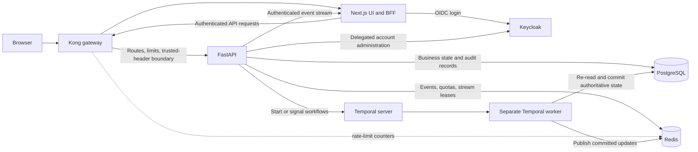

# Inbound/Outbound Management System — Phase 2 Technical Report

**Author:** Rahul Datta  
**Iteration:** Phase 2  
**Report version:** 1.0  
**Date:** 15 October 2026  
**Scope:** Technical changes introduced in Phase 2, measured against the Phase 1 branch baseline.

## Executive summary

Phase 2 extends the initial inbound/outbound workflows with stronger identity-to-checkpoint binding, governed permission and alert decisions, durable approval timers, subject-level entry restrictions, richer movement analytics, and delegated user administration with step-up authentication. It also separates Temporal workers from the API process and adds stricter controls around live updates, gateway traffic, and service resource use.

The changes preserve a server-authoritative model: the browser submits requests, while FastAPI validates identity and policy and persists decisions. PostgreSQL stores durable business state; Redis supports rate counters, leases, and live-update coordination; Temporal manages long-running and scheduled work.

## 1. Scope and Phase 1 baseline

Phase 1 already contained the core application stack and initial login, registry, permission, scan, movement, dashboard, alert, presence, and workflow paths. Their existence is not counted here as a Phase 2 deliverable. This report covers the material Phase 2 extensions and controls applied to those flows.

## 2. Phase 2 service architecture

Kong is the application entry point and enforces configured traffic limits. The Next.js BFF handles browser sessions and proxies API calls. FastAPI independently verifies access tokens and applies business policy. Temporal workflow activities run in a separate worker and use PostgreSQL as the source of truth; Redis is used for coordination and transient state rather than durable business decisions.

## 3. Phase 2 implementation

### 3.1 Account-bound checkpoint assignments

Checkpoint assignment is stored against the authenticated Keycloak subject rather than accepted as a trusted terminal form value. The terminal bootstrap response includes the operator identity and assignment; the UI checks that they match. FastAPI resolves the assignment again for scans, manual-review requests, retries, and related terminal actions, rejecting stale or client-substituted checkpoint IDs. Reassignment publishes an invalidation event so active terminals can reload their scope. Optional certificate-DN assignment supports physical terminals.

Relevant implementation files: `backend/terminal_assignments.py`, `backend/routers/terminal.py`, and `frontend/components/admin/UserManagement.tsx`.

### 3.2 Permission grants and manual review

Phase 2 consolidates access data and strengthens server-side validation for visitor access, zone access, and hardware custody. Grant operations validate subject and asset types, registered carriers, facility zones, and bounded validity windows. New-visitor direct grants persist the visitor, grant, decision, and audit evidence transactionally; operator-submitted visitor registrations remain requests awaiting review.

Manual review is bound to the denied scan context, including subject/barcode, checkpoint, direction, carried hardware, and the relevant access snapshot. Approval does not directly authorize entry: it permits a bounded, matching rescan, which FastAPI evaluates again and consumes according to one-use semantics. Visitor approval and manual override requests expire if no decision arrives before their workflow deadlines. Completed terminal notices can be dismissed without deleting the underlying decision history.

Relevant implementation files: `backend/routers/permissions.py`, `backend/permission_grants.py`, `backend/permission_decisions.py`, and `backend/manual_review_policy.py`.

### 3.3 Durable workflows and scheduled processing

Phase 2 moves workflow execution out of the FastAPI HTTP process into a dedicated Temporal worker. Visitor registration approval waits up to 30 minutes; manual permission overrides wait up to 10 minutes. At timeout, a still-pending request is expired or denied. Administrator signals wake workflows but do not themselves grant access: activities reload committed PostgreSQL state before applying effects. Activities use bounded retry policies and publish updates after durable changes.

Alert evaluation is scheduled every five minutes through an idempotently bootstrapped Temporal schedule. API/init restarts do not require each API process to run duplicate worker loops or create duplicate schedules.

Relevant implementation files: `backend/workflows/visitor_approval.py`, `backend/workflows/permission_override.py`, `backend/workflows/activities.py`, `backend/temporal_worker.py`, and `backend/scheduler.py`.

### 3.4 Alert rules, reviews, and entry restrictions

The alert evaluator supports no-break, attendance-irregularity, cross-zone scan, and visitor-overstay conditions. Evaluation is bounded, tracks presence/zone context, and deduplicates repeated triggers. Administrators can configure eligible attendance rules per subject and schedule irregularity skip dates; cross-zone checks remain independent of those attendance selections.

Alert reviews are immutable records tied to the subject, alert, reviewer, timestamp, and reason. A subject’s alerts must be reviewed in order. Confirming a warning increments the current warning epoch; excusing an alert requires a reason and does not increment the count. Three confirmed warnings activate a durable entry hold and block further reviews until a reasoned reset starts a new epoch. Critical-severity alerts can activate the same hold independently. An active hold can be cleared by the reasoned warning-reset operation or the dedicated reasoned release operation; the latter does not reset the warning count. Reprocessing an old critical alert does not reinstate a released hold, while a new distinct critical trigger can.

Relevant implementation files: `backend/rule_engine.py`, `backend/routers/alerts.py`, `backend/alert_reviews.py`, `backend/alert_rule_assignments.py`, and `backend/critical_entry_restrictions.py`.

### 3.5 Movement history, analytics, and reporting

Movement queries support pagination and filtering by time, direction, result, checkpoint, scan type, subject, and search text. Analytics provide dashboard-period comparisons, checkpoint/time aggregates, and employee activity windows. Movement notes attach to individual events; sync/conflict operations update synchronization status without replaying a scan or recomputing presence.

CSV reporting and BFF collection reads use explicit row and query limits. Oversized requests fail visibly rather than silently returning incomplete results. Indexes support frequent subject, checkpoint, and date queries; analytics avoid counting a reviewed scan twice when it produces a separate authoritative movement.

Relevant implementation files: `backend/routers/movements.py`, `backend/movement_analytics.py`, and `frontend/components/admin/reports/ReportBuilder.tsx`.

### 3.6 Delegated user administration and step-up authentication

Administrators can search and manage supported Keycloak accounts in the application: create users, update profiles and enabled state, assign supported application roles and terminal checkpoints, reset passwords, and terminate sessions. The application does not store a Keycloak master-administrator password; FastAPI forwards the current administrator’s verified bearer token to the internal Keycloak Admin REST API.

Sensitive operations require a fresh, bounded step-up window. The Next.js BFF signs a short-lived proof bound to the exact bearer-token hash and selected window. FastAPI verifies the proof signature, token binding, authentication time, expiry, and server-side lock/revocation state. Step-up state and profile preferences are keyed by Keycloak subject to prevent cross-account sharing.

Relevant implementation files: `backend/routers/keycloak_admin.py`, `backend/user_management_step_up.py`, `backend/user_management_locks.py`, `app/api/auth/step-up/route.ts`, and `frontend/components/admin/UserManagement.tsx`.

### 3.7 Live updates, gateway controls, and service hardening

Redis-backed server-sent events deliver scoped refresh hints after database commits. Admin streams and operator streams have different visibility; operators receive only permitted checkpoint and assignment updates. Per-principal and global stream leases limit concurrent presence connections, and separate Redis pools keep long-lived pub/sub connections from consuming quota/lease connections.

Kong applies Redis-backed request-frequency limits, strips untrusted identity headers, bounds request payloads and read time, propagates correlation IDs, and passes SSE without response buffering. FastAPI independently verifies token signature, issuer, audience, expiry, and roles, and applies request, concurrency, query, response, and alert-evaluation bounds. PostgreSQL provisioning separates runtime, migration, identity, and workflow privileges; Redis ACLs separate gateway counters, application quota/lease keys, and event channels.

Relevant implementation files: `gateway/kong.yml`, `backend/main.py`, `backend/data_limits.py`, `backend/redis_client.py`, `backend/presence_leases.py`, and `backend/routers/presence.py`.

## 4. Service-level Phase 2 changes

| Service | Phase 2 implementation |
| --- | --- |
| Next.js / Auth.js | BFF step-up flow, checkpoint-aware terminal state, scoped SSE proxy, expanded review, access, analytics, and user-management screens. |
| Keycloak | Delegated account and session administration using the authenticated administrator; remains the identity provider. |
| Kong | Redis-backed rate limiting, trusted-header boundary, request bounds, correlation IDs, and SSE pass-through. |
| FastAPI | Server-side checkpoint, permission, alert, restriction, analytics, user-management, and resource-admission policies. |
| PostgreSQL | Durable assignments, grants, reviews, warning resets, restrictions, profiles/locks, audit records, and supporting indexes. |
| Redis | Gateway counters, application quotas and stream leases, and scoped event publication using separated ACLs/pools. |
| Temporal | Separate worker, database-authoritative approval activities, bounded deadlines/retries, and scheduled alert evaluation. |
| Compose / initialization | Explicit role provisioning, migration and seed steps, schedule initialization, and distinct API/worker processes. |

## 5. Verification and limitations

Phase 2 adds targeted backend and frontend tests for checkpoint assignment, authentication and step-up, permission validation and workflows, alert rules/reviews/restrictions, and frontend contracts. Test instructions are in `README.md`; backend tests are under `backend/tests/`.

Automated tests cover selected policy and integration paths; they do not establish complete end-to-end coverage of every browser flow, real Keycloak deployment, multi-service outage, or export/synchronization scenario. Deployment behavior should therefore be verified against the target Compose configuration and identity-provider settings.

## Conclusion

Phase 2 is primarily a control and operational-hardening release on top of the Phase 1 platform. Its central technical changes are server-bound checkpoint identity, validated and auditable access decisions, durable workflow execution, ordered alert governance with explicit entry-hold lifecycle, bounded analytics, token-bound step-up administration, and scoped live updates behind hardened service boundaries.
