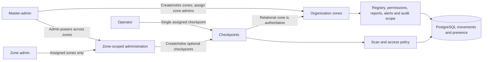

# Inbound/Outbound Management System — Phase 3 Technical Report

**Author:** Rahul Datta 
**Iteration:** Phase 3 
**Report version:** 1.0 
**Date:** 22 October 2026 
**Scope:** Replace the former public/secure location model with organization branches (zones) and zone-scoped checkpoints and administration.

## Executive summary

Phase 3 models a multi-branch organization. A zone represents an organization branch; a checkpoint represents an entry/exit point at that branch. The change replaces the previous public/secure location concept and separates zone lifecycle from checkpoint lifecycle.

Zone scope is enforced in the API and database-backed authorization, not just filtered in the interface. Master-admins retain administrator capabilities across all zones and can create or retire zones and assign zone administrators. Administrators operate only within their assigned zones and can manage checkpoints and operators there. Operator scan authority continues to come from the assigned checkpoint, whose relational zone determines the applicable branch scope.

## 1. Functional scope

- Zones A and B are the initial organization branches. A newly created zone also receives checkpoint 1 (required Front Gate) and checkpoint 2 (optional Back Gate).
- Checkpoints are independent records related to a zone. The Back Gate is an optional preset; additional custom checkpoints receive sequential numbers. The API bounds active checkpoints per zone.
- Master-admins can create and retire zones, assign zone administrators, and administer all active zones. The role is provisioned outside ordinary in-app role editing.
- Administrators can manage only their assigned zones, including checkpoints and operator assignments. Master-admins can perform those administrator operations in any active zone.
- Each operator remains assigned to one active checkpoint. The server resolves that checkpoint and its zone; a browser-provided location cannot grant authority.
- Registry, permissions, movements, alerts, audit reads, dashboard data, and terminal bootstrap use the zone/checkpoint relationship to apply the caller's scope.

## 2. Data model and request flow

PostgreSQL stores zones, administrator-to-zone assignments, and checkpoints as relational records. Checkpoints have a zone foreign key, positive zone-local number, gate type, required/active state, and a unique zone/number constraint. A partial constraint permits at most one required checkpoint per zone. Existing movement and audit evidence is not erased when zones or optional checkpoints are retired; retirement marks the records inactive.

Zone and checkpoint mutations require an authenticated administrator, an active step-up window, and an unlocked user-management window. Master-admin-only zone operations and assigned-zone checks are enforced server-side. Mutations write audit evidence and enqueue the existing durable change notification in the same database transaction.

## 3. Lifecycle and safety rules

- The required Front Gate cannot be retired.
- A checkpoint cannot be retired while an operator is assigned to it or a permission request is pending against it. Retired checkpoint numbers remain reserved so historical references are not reused.
- A zone cannot be retired while an operator is assigned within it, a subject is inside from that zone, or a permission request remains pending there. Retirement also deactivates its checkpoints and removes zone-admin assignments while preserving historical records.
- Zone row locks prevent checkpoint operations from racing with zone retirement. Advisory registry locks and database uniqueness/check constraints protect concurrent zone and checkpoint creation.
- Zone names and checkpoint inputs are validated and bounded. The API rejects requests outside the caller's assigned-zone scope.

## 4. Migration and deployment boundary

The prior public/secure categories do not provide a safe, unambiguous mapping to organization branches. The new migration creates zones A and B and their four default checkpoints, but deliberately refuses to continue if legacy InOut application tables contain records. It does not infer new ownership for old movements, permissions, assignments, or audit records, and it is intentionally not reversible.

The database reset was not performed as part of this work; the owner said they will handle the disposable development database. Before applying this migration, reset only the intended disposable InOut application database through the approved Compose workflow. Do not remove Temporal databases, shared data, or volumes as a shortcut. After reset, apply the migration and validate the seeded A/B zones and default checkpoints before using the environment.

## 5. Verification status and remaining gate

Frontend tests, TypeScript typechecking, Python bytecode compilation, and `git diff --check` passed during implementation. The isolated backend integration/database migration rehearsal was not run because the local Python test environment was unavailable. Accordingly, the migration has not been verified against a live disposable database, and the owner-controlled reset and post-migration smoke test remain deployment gates.

Focused regression coverage is present for zone scope, zone retirement, checkpoint creation/retirement, admin-zone assignments, and user-management authorization. Those test files are not claimed as executed in the verification above.

## Phase boundary

This report classifies the branch-zone and numbered-checkpoint redesign as Phase 3. The Phase 2 report remains a historical record of the earlier checkpoint hardening and application capabilities; this Phase 3 model supersedes its former location semantics. The product specification and service architecture remain current descriptions of the application as a whole.
